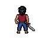
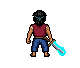

# Bento — correções de direção e oclusão

O ataque para a esquerda e as quatro animações solicitadas de costas foram substituídos e integrados. A aparência de Bento e da espada foi preservada. As mãos e antebraços não cruzam mais a superfície visível das costas; na vista norte, ficam à frente do torso, ocultos pelo corpo. A lâmina fica bastante encoberta durante o golpe norte por essa perspectiva — o movimento dos ombros permanece visível. Não foi mantida a pose incorreta com as mãos sobre as costas.

## Resultado

- Ataque esquerda: oito frames, mantendo a vista lateral até a recuperação.
- Guarda norte: quatro frames, costas visíveis e antebraços ocultos.
- Ataque norte: oito frames, mesma orientação e retorno à guarda.
- Corte de Maré norte: 12 frames, efeito marítimo turquesa e braços sem cruzar as costas; o efeito varre o lado do personagem.
- Hurt norte: quatro frames, reação discreta e recuperação da guarda.

As cinco direções/ações foram reativadas: não há mais combinação substituída pela guarda estática em razão dessas falhas. O fallback de carregamento continua disponível. A queda permanece byte a byte idêntica à versão anterior. Não foram gerados outros personagens, classes ou facções.

## Montagem e verificação

36 frames novos mantidos na ordem original. Tamanhos efetivamente retornados: oeste 68×68; guarda norte 68×68; ataque/hurt norte 76×68; Corte norte 80×68. Nenhum foi redimensionado para entrega, repintado, espelhado, invertido, duplicado ou cortado. Só foi acrescentado padding para as células 84×84 já usadas pelo jogo. Os grids ampliados são auxiliares de inspeção separados.

Cada recorte da folha ativa foi comparado ao PNG original, incluindo alpha. As outras linhas das folhas permaneceram byte a byte idênticas durante cada substituição. Os GIFs foram coalescidos e comparados nas áreas visíveis, com paleta exata, transparência, disposal 2 e repetição apenas de inspeção.

O pivô [42,65] e a altura de referência de 46 px foram preservados. O impacto do novo Corte norte ocorre no frame 3, acompanhando o novo efeito; as outras direções conservam o frame 5. A máquina de estados aceita esse evento por direção. Testes unitários verificam os dois tempos e o impacto único.

3 cenários de navegador aprovados: combate real, morte com pose final/renascimento e isolamento de facção/classe. Evidências em `docs/evidence-bento-directions/`. O teste de morte foi estabilizado pausando a auto-caçada pelo controle real quando um inimigo se aproxima, evitando vitórias e cura por nível que impediam uma derrota na execução aleatória anterior.

## Custos e referências

As cinco respostas de criação informaram **5 gerações**: 1 pela esquerda e 1 por cada correção norte. O lote norte ficou abaixo das 5–8 estimadas. Pelas respostas das chamadas desta etapa, são 4 do piloto + 23 da produção + 5 das correções = **32 gerações informadas**. Não foi usada a variação do saldo global para atribuir custo a este fluxo, pois o getter também expôs outras versões remotas de norte durante a conferência. As versões adicionais foram apenas baixadas e inspecionadas; nenhuma delas foi gerada ou selecionada por este fluxo.

Foram usadas cinco chamadas MCP `animate_character`, `mode: v3`, `keep_first_frame: false`, no personagem armado `1c0b995e-67da-4baf-b6e7-f210bd709ef4`. Cada chamada gerou somente a direção corrigida. A guarda norte usou apenas `custom_start_frame_base64`; as outras quatro usaram início e fim iguais à guarda da direção, em PNG 64×64. Nenhum seed foi enviado.

Checkpoint: `C:/Users/Marcos/Desktop/MARE/backups/mare-partida-v12-before-bento-direction-fixes-20261018`. Os originais e as versões anteriores continuam preservados; nada foi apagado ou sobrescrito remotamente. Não há job pendente nem retry adicional executado.

## Entradas textuais exatas

`Perform one sword strike toward the left. Keep facing west for the entire clip, including recovery. Finish in exactly the supplied west-facing guard, holding the sword in the same hand.`

Tradução: Golpear para a esquerda mantendo essa direção durante todo o clipe, recuperar exatamente a guarda fornecida e manter a espada na mesma mão.

`Keep the back of the head and vest facing the viewer. Breathe subtly in a north-facing sword guard, with forearms in front of the chest and occluded by the torso. Keep feet planted and return to the starting guard.`

Tradução: Respirar em guarda de costas, manter antebraços à frente do peito e ocultos pelo torso, pés apoiados e recuperar a guarda.

`Strike forward toward north, away from the viewer, then recover the supplied north-facing guard. Keep the back of the head and vest visible throughout. Forearms move in front of the chest, occluded by the torso; the blade swings beyond the far shoulder.`

Tradução: Golpear para o norte, afastando-se do observador, com costas visíveis, antebraços à frente do peito ocultos pelo torso e lâmina além do ombro distante; recuperar a guarda.

`Wind up and slash forward toward north, away from the viewer, with a turquoise sea-energy arc beyond the far shoulder, then recover the supplied guard. Keep the back of the head and vest visible; forearms stay in front of the chest, occluded by the torso.`

Tradução: Preparar Corte de Maré para o norte, com arco turquesa além do ombro distante, mantendo costas visíveis, antebraços ocultos pelo torso e recuperando a guarda.

`Recoil briefly from a hit while facing north, then recover the supplied guard. Keep the back of the head and vest visible; hands and forearms remain in front of the torso and occluded from the viewer.`

Tradução: Reagir ao dano de costas e recuperar a guarda, mantendo mãos e antebraços à frente do torso e ocultos do observador.

[Galeria ao vivo](http://127.0.0.1:8123/pixellab-pip-generations/bento-combat-production-20261018/preview.html) · [Manifesto](../pixellab-pip-generations/bento-direction-fixes-20261018/manifest.json) · [Blueprint](../pixellab-pip-generations/bento-direction-fixes-20261018/bento-direction-fixes.blueprint.json)
