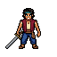

# Bento Espadachim — teste frontal para avaliação

A aparência de Bento com a espada foi aprovada pelo usuário após a apresentação das duas prévias. Isso aprova a direção visual; os ajustes de guarda/recuperação e o lote adicional de produção ainda aguardam autorização de custo. O plano concreto prevê 21–41 gerações adicionais: uma rotação armada e cinco animações em quatro direções, incluindo novas versões frontais de idle e ataque para corrigir o piloto. A diferença em relação aos 19–37 preliminares são esses dois clipes frontais. Não inclui retries nem outras classes/facções. Parâmetros exatos: `pixellab-pip-generations/bento-combat-pilot-20261018/appearance-approval-and-next-plan.json`.

Foram produzidas duas prévias PixelLab, sem ativar as novas artes no combate. Os sprites-base e o save continuam preservados. Checkpoint: `C:/Users/Marcos/Desktop/MARE/backups/mare-partida-v12-before-bento-combat-20261018`.

## Resultado visual

A primeira edição virou Bento para a direita e foi rejeitada. A correção extra autorizada manteve a frente e acrescentou a espada. O idle tem cinco frames e o ataque sete: a API devolve um frame inicial além dos quatro/seis gerados. Todos foram mantidos em ordem.

O idle abaixa a espada durante a respiração, em vez de manter uma guarda firme. O ataque mostra preparação, corte e impacto, mas termina com a espada no lado oposto da pose inicial, causando um salto ao repetir. A recuperação precisa de refinamento antes de considerar o piloto pronto para produção. O rosto, a faixa, o colete carmim e a calça azul permanecem reconhecíveis.

O frame inicial retornado também não é uma cópia exata da referência: o PixelLab mudou 87 pixels visíveis no idle e 67 no ataque. Esses resultados foram preservados, sem substituir, cortar ou repintar frames. As folhas mantêm 64×64; o original 48×48 recebeu apenas 8 px de margem transparente em cada lado antes da edição.

## Verificação e custos

12 PNGs decodificados e 12 frames de GIF comparados pixel a pixel nas áreas visíveis. Transparência, ordem, paleta sem quantização, disposal 2 e loop 0 verificados. As grades são auxiliares de inspeção separados; os PNGs originais não foram alterados. Nenhum frame toca a borda do canvas. Não houve mudança no código de combate, por isso não foram repetidas regressões do jogo para este piloto de arte.

Consumo confirmado: **4 gerações**, uma por chamada. Saldo 1667 → 1663. Créditos USD: **0**. Não há geração pendente. Manifesto, blueprint portátil, resultados, PNGs, GIFs e folhas ficam em `pixellab-pip-generations/bento-combat-pilot-20261018/`.

Para as demais direções e animações, estimativa preliminar de **19–37 gerações**: uma rotação da referência armada e 18 clipes direcionais (3 idle, 3 ataque, 4 Corte de Maré, 4 hurt, 4 death), estimados em 1–2 por clipe conforme o canvas. Essa estimativa exclui correções do piloto, retries, caminhada armada e escalada Pro. Não é autorização para gastar: requer novo plano concreto e aprovação depois da avaliação visual.

## Rota e entradas exatas

MCP `edit_image_pixen` (Pixen) seguido de `animate_image` (v3). Todas as chamadas usaram `no_background: true`; nenhum seed ou last_frame foi enviado. As edições usaram a mesma frente original com padding, `width: 64`, `height: 64`. As duas animações partiram do PNG da edição corrigida, usando `first_frame_url`.

1. `Preserve this character's face, hair, outfit, proportions, palette and pixel shading. Add one original steel sword with an aged bronze guard and cloth grip, held in a relaxed combat guard. Keep facing south, full body visible.`

   Tradução: Preservar rosto, cabelo, roupa, proporções, paleta e sombras; acrescentar espada de aço com guarda de bronze envelhecido e cabo de tecido, em guarda relaxada, mantendo a frente e o corpo inteiro.

2. `Keep the original front-facing pose exactly: face and torso directly toward the viewer, both eyes visible, shoulders symmetrical. Preserve identity, outfit, proportions and pixel style. Add one steel sword with an aged bronze guard and cloth grip. Keep the entire character centered.`

   Tradução: Manter exatamente a pose frontal, rosto e torso para o observador, ambos os olhos visíveis e ombros simétricos; preservar identidade e estilo, acrescentar espada e centralizar.

3. `Breathe gently in combat guard, holding the sword steadily. Face south throughout, feet planted, body in place.`

   Tradução: Respirar discretamente em guarda, segurar a espada firme, manter frente, pés apoiados e corpo no lugar.

4. `Prepare one sword strike, swing through a clear impact, then recover into the starting guard. Face south throughout and stay in place.`

   Tradução: Preparar um golpe de espada, executar o corte com impacto legível e recuperar a guarda inicial; manter frente e posição.

[Plano visual](PLANO-BENTO-ESPADACHIM.md) · [Manifesto](../pixellab-pip-generations/bento-combat-pilot-20261018/manifest.json) · [Blueprint](../pixellab-pip-generations/bento-combat-pilot-20261018/bento-combat-pilot.blueprint.json)
