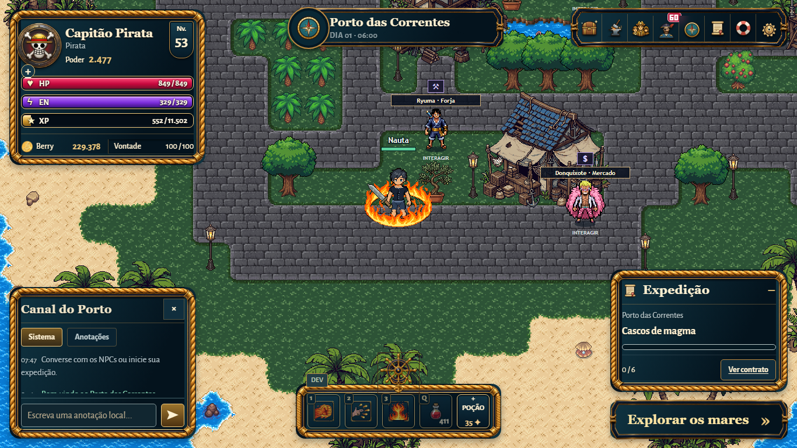
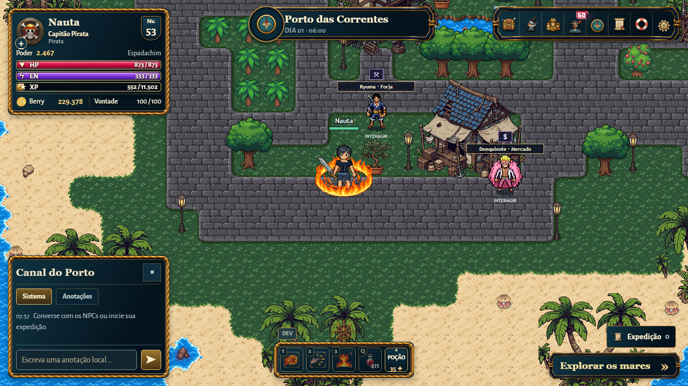
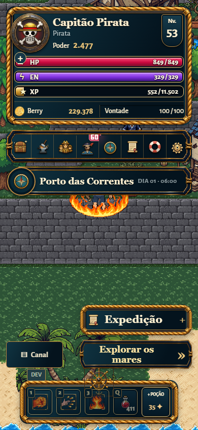
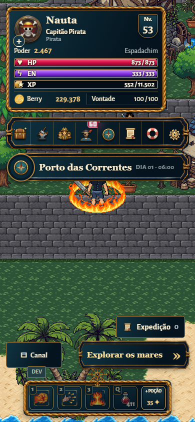

# Refinamento da HUD V2

## Auditoria e plano anterior à implementação

Base: f4cfbbe1. `index.html` e `ui-preview.html` definem o perfil; `character-hud.js` atualiza identidade e medidores. `game.js` cria e atualiza objetivos, expedição, atalhos e controles; `ui-system.js` monta as superfícies. `hud-nautical.css`, carregado por último, controla os elementos fixos. Os estilos anteriores continuam responsáveis pelas demais janelas.

O painel permanente de objetivos e a janela `floatingExpedition` duplicam o contexto de expedição. O atalho O já abre essa janela; J pertence ao Haki. Reutilizar a janela e mover para ela os mesmos nós de objetivos e rota, preservando IDs, listeners e atualizações. Manter pausa da caçada fora da janela. Não alterar combate, contratos, saves ou APIs.

Moldura: PNG RGBA 1254×1254, recorte de 150 px por canto, hoje renderizado em 25 px. Reduzir a largura renderizada via nove fatias, sem reamostrar o arquivo inteiro. Rails 2172×724 e timão 1254×1254 continuam sendo imagens existentes. Ícones de menu, habilidades e poções permanecem os existentes.

Composição: perfil superior esquerdo; localização central; menu superior direito; chat inferior esquerdo; hotbar central inferior; exploração e acesso discreto à expedição à direita. Breakpoints existentes 1399/1150/760 px e paisagem com altura até 500 px. Validar desktop primeiro e depois as duas orientações móveis solicitadas.

Tokens: azul #04131d/#071e2b/#123545, latão #edc77c/#bc8840, marfim #fff1d2. Georgia para identidade e títulos; Alegreya Sans para dados e controles. Espaçamentos 4/8/12, moldura compartilhada, números tabulares. Nome em primeiro plano, patente e facção secundárias; poder e classe em linha própria; medidores e recursos alinhados horizontalmente. Essa hierarquia preserva a direção náutica aprovada, sem introduzir outra estética.

Baseline real em `tmp/hud-compact/before`: cinco resoluções, PNGs e JSON de dimensões. Em 1920×1080: perfil 360×267, hotbar 352×94, poção 56×58, chat 360×260, objetivos fixos 340×209,89. O novo teste falhou antes das alterações porque os objetivos permaneciam visíveis com a janela fechada.

Metas: perfil 320 px de largura e cerca de 200 px de altura; slots 46×48 desktop e 48×48 móveis; hotbar cerca de 72 px; corda visual aproximadamente 5–7 px. Barras podem ter 18 px para preservar texto de 14 px. A janela contextual terá foco de abertura e retorno ao acionador, fechamento por botão/O/Escape e nenhuma captura durante digitação.

## Resultado medido

Dimensões em CSS px; áreas calculadas de `getBoundingClientRect()`. Personagem de teste nível 53 com fruta, sem Haki ativado. Nomes, classe, talento e slots extras podem aumentar a altura para preservar o conteúdo.

| Tela | Status antes → depois | Redução de área | Hotbar antes → depois |
|---|---|---|---|
| 1920×1080 | 360×267 → 320×213 | 29.1% | 352×94 → 278×72 |
| 1366×768 | 336×267 → 320×213 | 24.0% | 352×94 → 278×72 |
| 1280×720 | 336×267 → 320×213 | 24.0% | 352×94 → 278×72 |
| 844×390 | 300×229 → 300×213 | 7.0% | 264×122 → 264×126 |
| 390×844 | 366×234 → 320×213 | 20.4% | 312×86 → 296×72 |

Comparação em 1920×1080:

| Componente | Antes | Depois | Redução de área |
|---|---|---|---|
| Status | 360.0×267.0 | 320.0×213.0 | 29.1% |
| Hotbar | 352.0×94.0 | 278.0×72.0 | 39.5% |
| Poção | 56.0×58.0 | 46.0×48.0 | 32.0% |
| Comprar poção | 56.0×58.0 | 46.0×48.0 | 32.0% |
| Chat | 360.0×260.0 | 360.0×244.0 | 6.2% |
| Objetivos fixos → acesso | 340.0×209.9 | 145.7×44.0 | 91.0% |
| Explorar | 340.0×64.0 | 260.0×48.0 | 42.6% |

A altura do status caiu 20,2%; a da hotbar desktop caiu 23,4%. Em 844×390, a hotbar com cinco ações passou de 122 para 126 px de altura: mantivemos alvos de toque de 48×48, em duas linhas, para não sobrepor navegação e combate. A compactação desktop não foi imposta aos alvos móveis.

As barras têm 18 px para comportar números de 14 px. Moldura: nine-slice de 150 px preservado, renderização de 25 → 14 px, com aproximadamente 5–7 px de corda visível. Não houve geração de novos assets nem custo de API.

## Comparação visual

| Desktop antes | Desktop depois |
|---|---|
|  |  |

| Celular antes | Celular depois |
|---|---|
|  |  |

Somente quatro capturas selecionadas acompanham o PR. Matriz completa, JSONs, logs e demais evidências permanecem em `tmp/`, fora do Git.

## Escopo e revisão

HTML: identidade e classe. `character-hud.js`: atualização textual segura. `hud-nautical.css`: tokens, proporções e janela contextual. `ui-system.js`: movimentação dos nós existentes, aviso de recompensa e montagem. `game.js`: abertura, fechamento e foco da expedição, com classe incluída no payload visual. Testes e workflow acompanham a nova interação. Nenhuma regra de combate, progressão, save, servidor ou API mudou.

Revisão pelas Web Interface Guidelines: controles nativos, foco visível, retorno ao acionador, nome acessível da janela, toque mínimo de 44 px, rolagem contida, números tabulares e movimento reduzido preservados.

## Validação

- `npm test`: 223 testes foundation e 157/157 arquivos Node legados aprovados.
- `python -X utf8 tools/build_pages.py`: pacote estático gerado.
- `hud_compact_browser.py`: cinco resoluções, janela inicialmente fechada, menu/O/Escape, foco, guarda de digitação, recompensa atualizada com janela fechada, resgate, poção, compra e habilidade com cooldown reais.
- `hud_nautical_browser.py`: 21 estados de layout, incluindo combate e todos os slots, sem colisões das superfícies verificadas.
- `gameplay_harmony_controls_browser.cjs`: menus exclusivos, notas, mensagens de sistema, chat, pausa e métricas.
- `character_hud_browser.cjs`: 32 patentes, oito resoluções, barras/recursos, aparência, cartaz, teclado, rotas e persistência.

Limites: testes Chromium em desktop com viewports móveis; não substituem teste físico em iOS/Safari. O chat validado é o canal local de sistema/anotações existente; não foi criada nem alterada uma rede de mensagens. Demais janelas mantêm sua arquitetura e acabamento.

- Validação ampliada: 16 janelas em sete resoluções, atalhos de inventário e dados preservados (hud_responsive_browser.py). Corrigida a regra antiga que abria submenus para fora da tela no modo retrato; agora a altura disponível deriva do limite inferior real do menu.

## Integração e limite de teste histórico

Dawn (cinco resoluções, sete rotas, chefe, resgate e rollback), Conchas (cinco resoluções e rotas) e navegação online foram validados após fechar a expedição ao abrir rotas/contratos. Os testes agora abrem explicitamente a janela contextual antes de acessar a rota.

O ensaio histórico `orange_browser.py` falha na expectativa de bloqueio de um personagem nível 20. A mesma expectativa existe na main anterior à HUD; `archipelago.js` já define acesso no nível 11 e `hunt-system.js` faixa 11–15, sem chefe. Nenhum desses arquivos mudou neste PR. Não se alterou gameplay para satisfazer uma fixture antiga. A navegação atual de Orange Town foi verificada separadamente no nível 15, em 1366×768, 390×844 e 844×390: viagem, abertura contextual das rotas e retorno ao porto passaram, sem erros de página. Atualizar as expectativas históricas de progressão/chefe fica fora desta refatoração.

### Faixa de localização

A placa, a bússola e o nó em `assets/ui/location-banner/` são sprites da folha RGBA fornecida pelo proprietário em 04/11/2026. Os recortes preservam os pixels originais. O calendário vetorial acompanha a cor do relógio. O nome da área e a hora são os campos atualizados pelo jogo. A faixa abre o mapa pelo mesmo comando do menu, por clique, toque ou teclado.

### Canal do Porto

As dez peças transparentes fornecidas pelo proprietário em 04/11/2026 compõem a moldura, a faixa de título, o timão, os botões, as placas e a barra de rolagem. Os sprites de execução ficam em `assets/ui/port-chat/`. A lista usa rolagem nativa. Geral reúne todos os registros, Sistema exibe eventos e Anotações exibe as notas locais do jogador.

### Menu principal

A moldura azul e dourada e os oito ícones vêm da folha transparente de menu fornecida pelo proprietário em 04/11/2026. Cada imagem em `assets/ui/nav-menu/` contém três células de 56 px para repouso, destaque e seleção. As áreas de toque têm pelo menos 44 px. Os avisos de personagem e os convites de grupo exibem os contadores do jogo.
