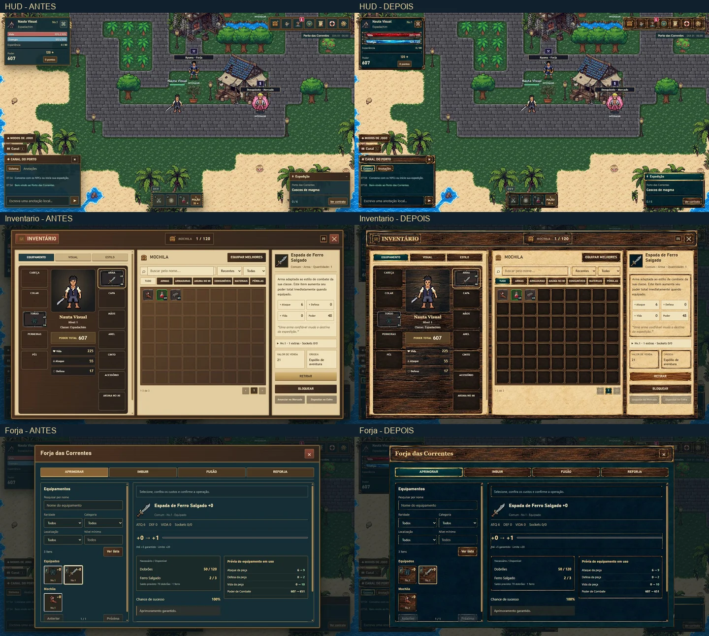

# HUD náutica v2 — auditoria, implementação e validação

> Histórico da primeira aplicação. Seus materiais foram substituídos após a avaliação do proprietário. Para a arte, custos, animação e verificações atuais, consulte [HUD — revisão em pixel art](HUD-PIXEL-REFINEMENT.md).

Base: origin/main ce262cf. A pasta original e a branch Paper Doll permanecem intactas. Capturas desta sessão: docs/evidence-nautical-v2/before (ignoradas pelo Git).

| Grupo | Componentes e entradas | Primitivas visuais a substituir |
|---|---|---|
| HUD | Retrato, nome/classe/nível, vida, energia, XP, Vontade, recurso de talento, poder, carteira/pontos | topbar, profile-heading, profile-resource, mini-meter, profile-xp |
| Navegação | Inventário, Forja, menu Personagem, menu Modos, Contratos, Ajuda, Central, localização/relógio | bottom-nav, character-quick-menu, world-topline, captain-menu |
| Combate | Atalhos, habilidades, poções, Haki, recargas, alvo/chefe | action-panel, skill-button, hakiQuickCast, target-hud, boss-banner |
| Canal | Sistema/anotações locais, campo, enviar, recolher | floating-chat, floating-title, chat-tabs |
| Expedição | Auto-caçada, rota, retorno, recompensas, XP/h | journey-hud, journey-heading, hunt-route, hunt-xp-tracker |
| Inventário | Equipamento/Visual/Estilo, retrato, 12 posições incluindo fruta, mochila, busca, ordenação, raridade, categorias, páginas, detalhes, ações | op-inventory-shell, op-topbar, op-panel, op-equipment-board, op-item, op-equip-slot, op-detail-box |
| Personagem | Perfil/atributos, quantidades, rascunho, derivados, aparência | character-sheet, attribute-dashboard, character-card, attribute-card, derived-card, pd-look |
| Progressão | Talentos/constelação, inspeção/zoom, conquistas, Haki, compêndio/ranks/frutas, transformação, hierarquia/ranking | talent-*, achievement-*, haki-*, akuma-*, hierarchy-* |
| Forja | Aprimorar, imbuir/sockets/pérolas, fusão de equipamento/pérolas, reforjar, seleção, custos, prévia, resultado/confirmação | forge2-selection, forge2-operation, forge2-tile, forge2-fusion-slot, forge2-costs, forge2-preview |
| Mundo | Mapa/ilhas/regiões, viagem, monstros, prisão/andares, NPC/mercador e contratos | voyage-*, island-*, monster-*, prison-*, shop-*, contract-card, npc-tooltip |
| Central | Jornal/categorias, perfil/equipamentos/mural/personalizar, configurações geral/áudio/gráficos/interface/acessibilidade, áudio compacto | captain-*, audio-* |
| Compartilhados | Criação/facção/classe, diálogo, confirmação, alerta, tooltip, toast, card, campos, abas, slots, progresso | creation-dialog, faction-choice, class-choice, dialog, ui-window, confirmation-card, ui-card, ui-button, game-tooltip |
| Ferramentas | DEV isolado e controles de inspeção | shell compartilhado; ferramentas não devem virar opções normais |

## Constatações antes da implementação

1. HUD: vida/energia são retângulos planos; molduras simples não acompanham as referências. Prioridade alta.
2. Inventário: pergaminho e bandeja procedurais; slots ocupados já têm seis PNGs de raridade que devem ser preservados. Slots vazios e molduras externas precisam harmonização.
3. Personagem/forja/frutas: fundos lisos e bordas de 1px; há dependência forte das primitivas comuns. Substituição central evita duplicar lógica.
4. Criação: fundo em gradiente; cartas muito planas. Preservar prévia Paper Doll atual da main.
5. Haki em nível 1 abre confirmação de bloqueio, corretamente; painel desbloqueado exige cenário isolado de teste. Ranking global, mural/cofre/mercado online têm limitações existentes; preservar avisos.
6. Talentos já possuem oceano e ícones próprios aprovados; preservar a constelação e aplicar materiais só à moldura/controles/inspeção.

## Plano visual e contrato

Madeira #49301F, petróleo #102C38, marinho #10202D, bronze #A77A3D, ouro #D8B575, papel #E6D4AB. Títulos náuticos com serif local; texto e números com as fontes legíveis existentes. Ornamentos nos cantos/cabeçalhos, centro de leitura discreto. Imagens raster em 9-slice, texturas reutilizadas; barras com trilho e preenchimento independentes. Sem novo framework, fórmula, catálogo, save, navegação ou evento. Arquivos previstos: folha de materiais, index, build, assets, documentação. Risco: precedência de CSS legado e área útil das molduras; validação visual e geométrica nas cinco resoluções solicitadas e 1280×720. Uma geração integrada de atlas, sem créditos PixelLab; nenhum deploy/merge.

## Assets e integração

Biblioteca final em `assets/ui/nautical/`, manifest com dimensões, bytes, origem e hash do atlas:

| Arquivos WebP | Uso |
|---|---|
| `frames/window`, `frames/compact`, `frames/parchment` | Molduras grandes, compactas e de pergaminho; 9-slice de 44 pixels, espessura visual adaptada ao controle |
| `panels/wood`, `panels/sea`, `panels/navy`, `panels/parchment` | Materiais repetidos em vez de esticar um painel de apresentação |
| `headers/rope` | Cabeçalhos de madeira, cordame e bronze |
| `buttons/normal`, `hover`, `pressed`, `selected`, `disabled`, `focus` | Seis materiais independentes para estados reais dos botões |
| `slots/empty` | Slots neutros; seis molduras PNG de raridade existentes preservadas integralmente |
| `bars/track`, `health`, `energy`, `experience` | Trilho e preenchimentos independentes; vermelho, ciano e âmbar |

19 WebPs, **284.488 bytes no total**, até 256×256; três texturas centrais de 144×144. Uma chamada à ferramenta ImageGen embutida; a ferramenta não informou custo monetário. Nenhuma chamada ou crédito PixelLab. A referência foi usada como direção de materiais; nenhuma prancha, legenda ou número foi recortado dela para distribuição. Os recortes vêm do atlas original gerado, com limites medidos, reproduzíveis por `python tools/prepare_nautical_assets.py caminho/do/atlas.png`.

Reutilizados também os PNGs de coração/âncora/estrela em `assets/ui/talents/`, os ícones do menu e as artes próprias de Haki, frutas, hierarquia e talentos. O desenho e a navegação da constelação, seus ícones e o oceano aprovado foram preservados. Sprites, mapas, retratos e ícones de itens continuam nos renderizadores anteriores.

`ui-nautical-assets.css` é a camada final de materiais, carregada em `index.html` e `ui-preview.html`. CSS usa imagens para superfícies, molduras, botões e barras; conserva layout, cores semânticas, foco acessível, recorte dos preenchimentos e responsividade. Nenhum gradiente decorativo, nova sombra ou `!important` nessa camada. O build inclui a folha e aplica o hash de conteúdo existente, com caminhos relativos para todos os WebPs.

Arquivos da atualização: `ui-nautical-assets.css`, `index.html`, `ui-preview.html`, `tools/build_pages.py`, `tools/prepare_nautical_assets.py`, `assets/ui/nautical/*`, este relatório, `docs/CHANGELOG_DEV.md` e `docs/nautical-hud-v2-comparison.webp`. Nenhum JavaScript de jogo, handler, fórmula, chave de save ou índice de item foi alterado.

## Validação executada em 29/10/2026

Navegador integrado Chromium, dados criados nesta sessão em origem local separada; mutações de nível/recursos/itens restritas ao laboratório `?dev=1` e sua chave própria. A pasta original do proprietário e seu trabalho Paper Doll não foram editados.

| Resolução | Superfícies principais | Janela dentro da viewport | Overflow horizontal / imagens quebradas |
|---|---:|---|---|
| 1920×1080 | 14 | Passou | 0 / 0 |
| 1366×768 | 14 | Passou, repetido no material final | 0 / 0 |
| 1280×720 | 14 | Passou | 0 / 0 |
| 1024×768 | 14 | Passou | 0 / 0 |
| 768×1024 | 14 | Passou | 0 / 0 |
| 390×844 | 14 | Passou, repetido no material final | 0 / 0 |

As 14 superfícies são inventário, forja, status, talentos, conquistas, frutas, hierarquia, contratos, mapa, prisão, jornal, meu perfil, configurações e ajuda. A HUD também foi capturada em cada resolução; o teste de retângulos não encontrou colisões entre seus módulos. As capturas foram abertas em folhas de contato para inspeção; inventário, criação, forja, Haki, aparência e mercador também receberam inspeção individual. Total de 120 registros geométricos aceitos, incluindo verificações iniciais e a repetição final. Repetições com viewport diferente do solicitado foram rejeitadas e recapturadas, sem usá-las como prova de responsividade.

| Passo do fluxo | Resultado observado |
|---|---|
| 1. Criar personagem/facção/classe | Passou em 390×844; sete classes e prévia de aparência continuam acessíveis; aventura criada |
| 2. HUD/menus/canal/expedição | Passou nas seis resoluções; materiais carregados e áreas centrais preservadas |
| 3. Inventário/equipamentos | Passou; slots vazios e ocupados, filtros, seleção, equipamento, trava e reload conferidos |
| 4. Atributos/aparência | Janelas e controles conferidos; fontes, prévia e materiais preservam os dados existentes |
| 5. Talentos/conquistas | Janelas conferidas; constelação, zoom/inspeção e artes próprias preservados |
| 6. Haki/frutas/hierarquia | Estado bloqueado de Haki e painel desbloqueado no DEV conferidos; compêndio/ranks e hierarquia abertos |
| 7. Forja | Aprimoramento +0→+1 com consumo de 50 dobrões e 2 ferros; confirmação e resultado reais |
| 8. Fusão/imbuir/reforja | Cinco pérolas Nv.1 produziram uma Nv.2 e consumiram 40 dobrões; instalação em socket confirmada; seleção automática de equipamento, prévias e aba de reforja conferidas |
| 9. Mapa/monstros/prisão | Janelas, detalhes de Dawn com arte de César e controles de navegação conferidos; disponibilidade de conteúdo preservada |
| 10. Mercador/NPC | Caminhada e interação no mundo abriram o mercador real, com saldo e botão de compra corretos |
| 11. Caçada/recompensas | 59 abates e 2 chefes na leitura da rota; XP 0→679, energia 317/331 e recargas reais; retorno ao porto e reload executados |
| 12. Barras | Vida parcial 170/847 (20,2%) e cheia 847/847 (100%); moldura manteve 230×22 nas duas medições; energia e XP continuam proporcionais |
| 13. Configurações/perfil/jornal | Janelas e expansões de geral, áudio, gráficos, interface e acessibilidade conferidas |
| 14. Foco/tooltip/confirmação/mobile | Tab permaneceu no modal; Escape fechou; tooltip de Poção apareceu por foco; moldura de foco própria confirmada; rolagem móvel entre equipamento/mochila/detalhes manteve cabeçalho/fechar acessíveis |
| 15. Distribuição estática | `dist/index.html` aberto no navegador; CSS com hash e materiais relativos carregados |

Comandos e resultados:

- `node --test` nos arquivos `tests/*.test.cjs`, exceto `supa-browser.test.cjs`: **145 testes passaram, zero falhas**.
- Repetição focada de `ui-system`, `ui-mobile-preview`, `inventory-rarity-slots`, `forge-system`, `hud-zoom-xph`, `player-hub`: **6/6 passaram**.
- Sintaxe de todos os JS de raiz com `node --check`: passou.
- `python tools/build_pages.py`: passou; igualdade dos bytes das 19 artes no pacote, decodificação WebP, dimensões e todos os URLs relativos conferidos.
- `git diff --check`: passou.
- Console da aba de aceite sem erros JavaScript na leitura final.

A primeira execução ampla teve duas falhas: a integração Supa sem módulo Node `playwright`, e uma asserção de ordem do allowlist do build. A ordem original foi preservada e o teste mobile passou na execução final; a integração Supa permanece com limitação de ambiente, descrita abaixo. Não foi tratada como teste aprovado.

## Evidência e limites

O comparativo acima é o único arquivo de capturas versionado. Capturas completas antes/depois, grades desktop/móvel, resultados e verificações locais estão em `docs/evidence-nautical-v2/` (ignorado pelo Git). Todas são desta sessão, 29/10/2026; não são mockups. As imagens completas de referência não entram no pacote público.

Pendências e limites explícitos:

- **Arraste HTML5:** a entrada nativa automatizada não preencheu o slot de fusão nem na base sem a nova folha, nem na nova HUD. Os handlers JS e os alvos não foram alterados. Seleção por clique/automática, fusão real e instalação passaram; o gesto de arraste exige confirmação manual, sem alegar aprovação ponta a ponta.
- **`tests/supa-browser.test.cjs`:** não executou por `Cannot find module 'playwright'` no ambiente Node. É uma integração de navegador, separada dos 145 testes Node aprovados. A validação visual desta tarefa usou o navegador integrado, sem instalar dependências ou modificar esse teste.
- Android/iOS físicos, Safari, Firefox, leitores de tela e medição formal de FPS/memória não foram testados. A matriz acima é responsividade em Chromium, não certificação de aparelhos. Não foram adicionadas animações ou dependências pesadas; os materiais são estáticos e reutilizados.
- Rankings globais, mercado online, cofre e demais opções marcadas indisponíveis continuam respeitando o estado implementado. Não foram criados placeholders funcionais nem desbloqueios em produção.
- Fundos/ícones próprios de constelação, mapa, hierarquia, frutas, sprites e cenas foram preservados por serem conteúdo artístico, enquanto molduras e controles receberam o novo sistema. Barras sobre personagens no Canvas pertencem ao mundo, não aos controles DOM reformulados.
- Aprovação artística do proprietário e merge permanecem pendentes. PRs #92/#96 de direção visual anterior podem tocar a mesma entrada HTML; não foram mesclados ou fechados por esta tarefa.

Rollback: reverter os commits desta branch remove a nova camada e as referências, sem migração ou limpeza de saves. Push/PR não são deploy; nenhuma publicação de produção ou merge foi autorizado/executado. O próximo passo mínimo é revisão artística e confirmação manual do arraste/aparelhos-alvo antes do merge.
