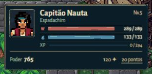
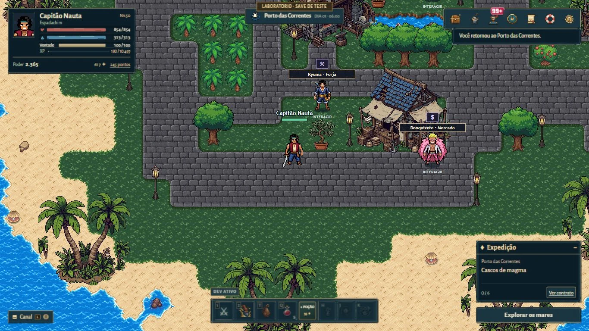

# HUD — proposta de navegador

Direção solicitada em 29/10/2026 após rejeição das duas reformulações anteriores. Nenhuma imagem enviada pelo proprietário é usada como referência ou entrada de geração. O ponto de partida é o cenário implementado: mar azul, telhados escuros, areia clara, velas e instrumentos dos navegantes.

## Plano de design antes da implementação

**Problema observado:** o perfil no nível 50 ocupa cerca de 230 px de altura; poder, carteira, recursos e menus disputam atenção. Sete botões enquadrados se somam à moldura do menu, à do perfil e à do canal. A troca de texturas não alterou essa hierarquia.

**Paleta-base:** tinta `#0b1e28`, oceano `#1a3540`, ardósia `#30525a`, bronze fosco `#b8a578`, vela `#eee3c8`, verde marítimo `#709394`. Vida e energia usam acentos semânticos, sem brilho neon. Marrom não será a superfície padrão.

**Tipo:** Alegreya Sans local, pesos 400/500/700. Corpo legível, títulos com desenho humanista; números tabulares. Licença OFL incluída. Nenhum serviço de fontes em runtime.

**Composição escolhida após avaliação do proprietário:** um único cartão compacto reúne busto, nome, classe, recursos e rodapé. O retrato circular com faixas soltas foi rejeitado; a versão atual elimina essa fragmentação. Vida e energia usam pequenos ícones e preenchimentos vivos sem moldura por linha. Navegação em uma única faixa; habilidades no centro inferior; contrato e exploração à direita. No celular, a navegação se desloca para a base, liberando o topo.

```text
cartão do capitão              local         navegação

                       mundo

canal                  habilidades       contrato / explorar
```

O cartão mede 296 px de largura e cresce com os recursos condicionais (137 px no nível 5, 153 px com Vontade). O retrato abre os atributos, sem botão duplicado. A apresentação humana mostra o busto; a forma Zoan mantém o corpo inteiro usando o estado acessível já fornecido pelo jogo. O canvas original continua 64 × 64, preservando os consumidores do retrato.

**Princípios:** um ponto memorável no retrato e no símbolo de vela/corrente; nada de moldura em cada texto; bronze indica interação ou foco; superfícies escuras para controles, papel apenas em leitura contextual; imagens decorativas originais, sem substituir controles por screenshot.

## Escopo e aprovação

Direção aprovada pelo proprietário em 29/10/2026, com a resposta explícita “Aprovar a direção”. Composição promovida de `ui-preview.html` para `index.html`, incluindo os estilos de base usados na prévia. `ui-navigator.css` e `assets/ui/navigator/` são compartilhados pelas duas entradas. Mesmos scripts, IDs, controles, eventos e estados do jogo; sequência artística do `AGENTS.md` cumprida. Em seguida, o proprietário autorizou explicitamente o lançamento no Pages.

Invariantes: saves, itens, combate, colisões, sprites e flags Paper Doll. Riscos principais: CSS legado, foco/rolagem dos modais, espaço dos recursos condicionais e colisão entre HUDs no celular. Verificação: navegação real, recursos cheios/parciais, inventário, janelas e seis viewports, além dos testes focados e build estático.





## Arte e rastreabilidade

15 WebPs nativos preparados por `tools/prepare_navigator_ui.py`, com comparação RGBA após codificação, tamanho e SHA-256 em `assets/ui/navigator/manifest.json`. Os materiais vêm de um estudo PixelLab de 256 × 256; peças inferiores com defeitos foram descartadas. O emblema original mede 28 × 28. Coração, gota e líquidos foram desenhados no Workbench; não são recortes de capturas nem imagens fornecidas pelo proprietário. CSS organiza e anima esses rasters, mantendo controles e texto reais.

Cobrança confirmada: **11 gerações** (10 do estudo, 1 do emblema), teto 12, nenhuma repetição paga. Workbench é descrito pelo provedor como gratuito; não se atribui a ele uma cobrança medida. Fontes Alegreya Sans 400/500/700 são locais, com licença OFL incluída. Receita de quatro etapas e ledger em `pixellab-pip-generations/hud-navigator-20261029/`. A máscara alfa do aro circular permanece documentada na biblioteca, embora o perfil atual use a moldura retangular.

## Verificação observada

- Build Pages e preparação dos 15 assets concluídos; `git diff --check` sem erros.
- Suítes focadas de UI, prévia móvel, inventário, zoom/XP e Player Hub: 5/5 aprovadas após o novo retrato clicável.
- Execução completa Node: 145 aprovadas e uma falha de inicialização em `supa-browser.test.cjs`, por dependência `playwright` ausente. A suíte completa não está verde.
- HUD/inventário/forja em 1920×1080, 1366×768, 1024×768, 768×1024, 390×844 e 360×800: 18 estados sem overflow horizontal; janelas dentro da tela. HUD repetida nos seis tamanhos após o cartão final, também sem colisões entre os widgets inferiores medidos.
- Mais 13 janelas em desktop e celular: 26 capturas inspecionadas (atributos, talentos, conquistas, Haki, fruta, hierarquia, diário, perfil, configurações, mapa, prisão, contratos e ajuda).
- Busca, seleção e detalhe de item no celular; foco visível de 2 px, Tab no diálogo e Escape para fechar. Retrato abre Personagem. Preferência de movimento reduzido desliga a animação do líquido.
- Vida cheia e parcial conferidas contra texto e largura real; contadores ficam fora do preenchimento. Transformação Uma-Uma acionada pelo inventário: canvas intacto e apresentação de 46 × 46, sem corte do corpo. Cenários de porto, Ilha Dawn e Baratie inspecionados.
- Navegação cobria o botão DEV no celular; posição corrigida e abertura do laboratório novamente confirmada. Testes finais usaram origem local separada `localhost:8768`, preservando a sessão ativa do proprietário em `localhost:8766`.
- Após a aprovação, `index.html` foi validado diretamente: skin carregada, canvas 64 × 64 preservado, um acesso visível aos atributos pelo retrato e diálogo Personagem aberto. HUD e inventário em 1366×768, 390×844 e 360×800 ficaram dentro da tela, sem overflow horizontal nem colisões entre os widgets inferiores medidos. As cinco suítes focadas passaram novamente; build Pages e sintaxe Python também aprovados. Sem novas gerações PixelLab.
- Pré-publicação: o CI identificou um botão Personagem redundante, oculto, copiado da prévia na promoção. Removidos o botão e seu agrupador das duas entradas, além da regra CSS obsoleta. A regressão existente `node tests/character-quick-menu.test.cjs` falhou antes e passou depois, sem alterar suas asserções. O navegador confirmou um único gatilho do menu, seis atalhos e abertura de Personagem. `node --test` com os 145 arquivos Node autônomos passou integralmente; `supa-browser.test.cjs` foi excluído por ser E2E que exige servidor e Playwright, como já determina o workflow de testes.

Limites: validação em navegador de desktop com viewports simulados, sem certificação em aparelhos físicos ou outros motores. A energia foi observada cheia; não há evidência final registrada de um estado parcial de energia. Capturas e medições extensas ficam no diretório ignorado `docs/evidence-hud-navigator/`, sem publicação em massa. O estado efetivo da publicação deve ser conferido no workflow Pages e no site; build local não confirma deploy.
