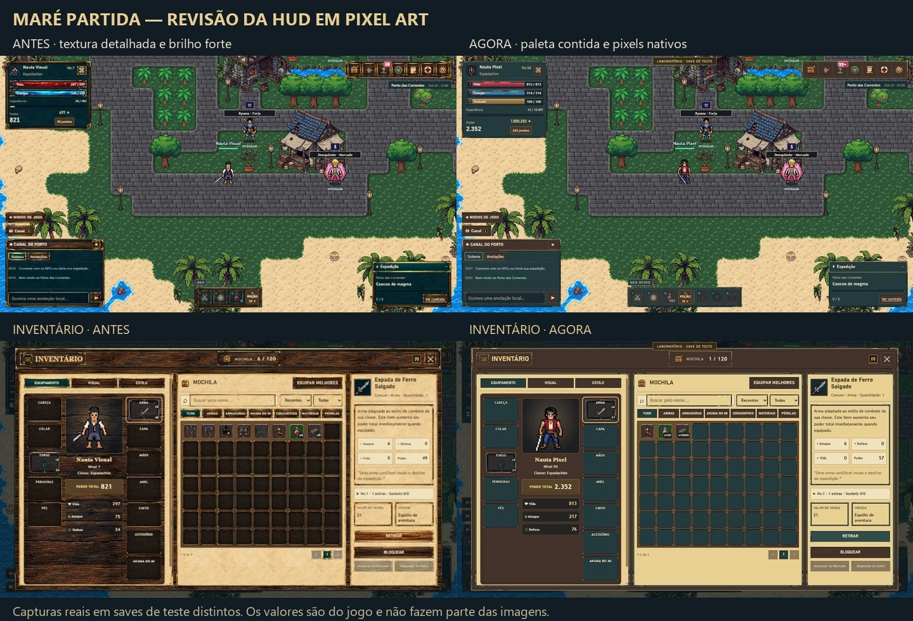
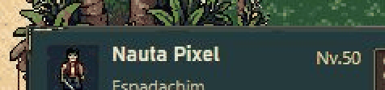

# HUD náutica — revisão em pixel art

29/10/2026 · `feature/nautical-hud-assets-v2` · [PR #147](https://github.com/Eximaq/mare-partida/pull/147).

O proprietário rejeitou a primeira aplicação por excesso de madeira, brilho e aparência de textura sobreposta. Esta revisão substitui esses materiais por pixel art nativa mais simples. A direção continua náutica, com azul petróleo, latão contido e madeira restrita a superfícies uniformes dos cabeçalhos.

## Referências e decisões

- A folha de referência enviada foi analisada como direção: contornos pequenos, poucos tons, interiores calmos e barras legíveis. Nenhum pixel nem marca-d'água dessa folha entra no jogo.
- O [kit náutico do próprio autor Falvey](https://falvey.itch.io/jolly-roger-ui-pirate-pixel-ui-kit-65-pieces-3-themes-9-slice) serviu para estudar escala pequena, paleta compartilhada e composição em 9-slice. Não foram comprados, baixados ou reutilizados seus assets.
- O [guia de simplificação de Rivals Library](https://www.rivalslib.com/workshop_guide/art/simplification.html) embasou a redução de pixels isolados e de detalhes que competem com a leitura.

Aplicação: centros planos, poucos agrupamentos de pixels nos contornos, ausência de veio fotográfico repetido e brilhos discretos. Cabeçalhos mantêm marrom; cartões e HUD usam azul escuro; o pergaminho fica nas áreas de leitura do inventário/contratos. Sprites, mapas, ícones de itens, raridades e constelação permanecem com suas artes existentes.

## Arte e reprodução

O proprietário autorizou explicitamente PixelLab nesta revisão. Uma chamada `create_ui_asset` produziu o atlas **256×256** com paleta limitada. A bússola **48×48** já existente no jogo foi enviada como referência de estilo. Os limites reais dos elementos foram inspecionados, sem pressupor que a geração obedeceu exatamente às coordenadas solicitadas.

PixelLab Workbench produziu os materiais de líquido e a trilha vazia em **64×40**. Vida e energia usam recortes **64×8**, cada um com quatro tons, superfície de um pixel e reflexos curtos. As operações exatas e solicitações estão na [receita reproduzível](../pixellab-pip-generations/hud-native-pixel-20261029/hud-native-pixel.blueprint.json), junto dos dois PNGs fonte. O [ledger](../pixellab-pip-generations/hud-native-pixel-20261029/manifest.json) registra a chamada paga.

**Custo confirmado: 10 gerações.** O retorno da geração e a variação do saldo concordam. Workbench é descrito pelo provedor como gratuito para assinantes e não devolveu cobrança por chamada. Não houve compra de créditos. A segunda geração paga prevista no limite de 20 não foi necessária.

`python tools/prepare_pixel_hud.py` apenas recorta e codifica WebP sem perdas. Não pinta, recolore nem redimensiona os pixels. Confere igualdade RGBA após decodificar cada arquivo. O [manifesto de runtime](../assets/ui/nautical/manifest.json) contém limites, dimensões e hashes.

Os **19 WebPs somam 3.830 bytes**, antes 284.488 bytes. A folha `ui-nautical-assets.css` aplica os recortes em 9-slice e mantém os alvos dos controles. As referências HTML e a lógica de build permanecem como antes; o pacote continua usando hashes de conteúdo.

## Barras reais

- A largura inline do jogo continua controlando a quantidade. Não há números gravados na arte nem mudanças de fórmulas, saves, itens ou combate.
- A área do medidor termina antes do contador numérico. O contador antigo era absoluto; agora participa da grade da barra, preservando a proporção do trecho visível. A moldura desktop permanece **230×22**.
- O deslocamento de fundo move apenas os pequenos detalhes do líquido, em passos de dois pixels, com período de dez segundos. Não há timer JavaScript novo. XP e Vontade permanecem estáticos.
- A opção **Animações de interface → Reduzidas** desliga a animação; **Normais** a restaura. A folha também respeita `prefers-reduced-motion` do sistema.
- As transições de largura de 200 ms e a regeneração já existentes continuam presentes; uma captura durante a transição pode preceder o alvo numérico por alguns pixels.

## Verificação desta revisão

As capturas e medições locais estão em `docs/evidence-nautical-pixel-v3/`, ignorado pelo Git. A inspeção usa o jogo real em Chromium e um save DEV isolado.

| Conferência | Resultado observado |
|---|---|
| HUD, inventário e forja | Seis viewports: 1920×1080, 1366×768, 1024×768, 768×1024, 390×844 e 360×800; sem transbordamento horizontal ou janela fora do viewport |
| Demais janelas | Personagem, talentos, conquistas, Haki, frutas, hierarquia, jornal, perfil, configurações, mapa, prisão, contratos e ajuda abertos em 1366 e 390; 26 capturas, sem imagens quebradas |
| Vida/energia/XP | Vida cheia 813/813 e parcial 164/813; energia consumida em combate 283/314; XP obtido 44 e depois 55; percentuais e preenchimentos reais |
| Movimento | Fase do fundo avança em Normais; `animation:none` em Reduzidas; preferência testada pelo controle real do jogo |
| Inventário móvel | Âncoras Mochila/Detalhes, busca por Poção, seleção e detalhes corretos; fechar continua visível |
| Teclado | Tab mantém foco no modal e mostra contorno de 2 px; Escape fecha |
| Testes Node | 145 testes passaram, zero falhas; integração `supa-browser` excluída pela dependência Playwright ausente já documentada |
| Testes focados | UI, mobile preview, raridades, forja, zoom/XP e player hub: 6/6 passaram |
| Arte | 19 recortes nativos, igualdade RGBA após WebP, arquivos e caminhos relativos conferidos no build |

Também executados: compilação sintática do preparador Python, `git diff --check` e `python tools/build_pages.py`. O pacote `dist` foi aberto em 1366 e 390, incluindo inventário. Os 19 arquivos são idênticos aos da fonte; os 22 URLs de imagem da folha existem, e o hash de conteúdo do CSS foi conferido. Console da aba de teste sem erros JavaScript na leitura final. O GIF acima contém 57 capturas do recorte real da HUD, durante aproximadamente dez segundos; não contém quadros de líquido fabricados para apresentação.

## Limites e publicação

Esta revisão não certifica aparelhos físicos, Safari/Firefox, leitores de tela ou desempenho por medição formal. O gesto HTML5 de arraste continua com a limitação de automação registrada na auditoria anterior; seus handlers não foram alterados. A preferência do sistema operacional tem regra CSS, mas a emulação manual do sistema não foi executada; a preferência interna foi testada ponta a ponta.

O relatório [HUD-NAUTICAL-ASSETS-V2.md](HUD-NAUTICAL-ASSETS-V2.md) passa a ser histórico da primeira aplicação, cujos materiais foram substituídos. A aprovação artística final é do proprietário. Commit/push/PR não são publicação: não houve merge ou deploy de produção nesta tarefa. Paper Doll e a pasta original foram preservados.
