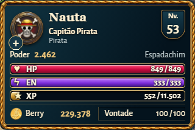
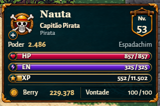

# Status inspirado nos elementos fornecidos

Escopo: somente o status superior esquerdo. Base 59573aa4, incluindo o equipamento nativo de 56 px incorporado por outro colaborador. Chat, hotbar, expedição, demais janelas e regras de jogo permanecem fora desta adaptação.

Plano visual: conservar a largura de 320 px, hierarquia tipográfica e números vivos. Trocar a moldura de corda por madeira estreita e cantoneiras douradas; usar fundo petróleo com rosa dos ventos discreta, medalhão ilustrado, escudo suspenso de nível, botão de atributos e ícones de HP/EN/XP/Berry derivados da imagem do usuário. Tipografia existente: Georgia para nome, Alegreya Sans para dados. Paleta: #04131d, #072632, #704022, #bc8840, #edc77c, #fff1d2. Manter áreas de toque de 44 px e ícones proporcionais, com prioridade para desktop/tablet/smartphones atuais.

## Assets e procedência

Fonte: JPG de elementos visuais fornecido pelo proprietário nesta conversa. Seu quadriculado é parte do JPG, não um canal alpha. Adaptação feita com a ferramenta integrada ImageGen, sem API paga separada, em dois arquivos transparentes: `assets/ui/hud-status-reference/frame.png` e `ornaments.png`.

Prompts finais completos: [prompts.txt](../assets/ui/hud-status-reference/prompts.txt). Resumo:

- Frame: extrair/adaptar a moldura superior esquerda, preservando madeira escura, cantos dourados e interior petróleo com bússola sutil; retirar retrato, botão, escudo e crista; bordas retas estreitas e cantos preparados para nove fatias; sem texto e com alpha verdadeiro fora do painel.
- Atlas: extrair os oito ornamentos em grade regular 4×2; primeira linha com aro vazio, escudo suspenso, botão + e crista pirata; segunda com coração, raio, estrela e moeda; preservar estilo, centralizar cada item, remover quadriculado e usar alpha real.

O frame usa nove fatias para manter os cantos. O atlas é amostrado em CSS, sem cópias regravadas dos sprites. Barras conservam preenchimento dinâmico por porcentagem; rótulos e valores continuam sendo texto HTML acessível. Ícones decorativos não substituem a identificação dos recursos. Emblemas das demais facções continuam vinculados à facção real.

## Validação

- 16 testes Node: `character-hud-hierarchy`, `hud-standardization` e `ui-system`.
- `hud_compact_browser.py`: cinco resoluções principais, interações, poções e recargas; também executado na build estática final.
- `hud_nautical_browser.py`: 21 estados de layout, sem sobreposição de controles.
- `character_hud_browser.cjs --offline`: oito viewports, 32 patentes, barras em 0/25/100%, teclado, toque e reload; nenhum erro ou asset ausente.
- `python -X utf8 tools/build_pages.py`: build concluída com caminhos relativos.

Dimensões preservadas: 320 × 213 px em desktop e smartphone vertical; 300 × 213 px no smartphone horizontal. Não foram acrescentados breakpoints para telas menores.

Capturas do navegador, antes e depois (o antes usa o CSS do commit base):

