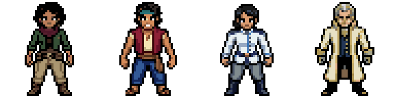

# Sprites-base das facções — etapa 1

Quatro personagens-base gerados e integrados à seleção, ao perfil e ao lobby. Idle e caminhada funcionam nas quatro direções. Iara usa um ciclo frontal curto de quatro frames, aprovado expressamente pelo usuário após dois resultados completos mudarem de direção. Não foram criados sprites de classes ou novas animações de combate.

## Referência e criação

Os quatro NPCs atuais usam PNGs transparentes 48×48; suas figuras ocupam 46 px de altura e entre 27 e 44 px de largura. São exibidos com altura de 72–76 px no mapa. A arte tem contornos escuros, sombras agrupadas, cabeça estilizada e contraste entre roupa, pele e acessórios. Os arquivos de NPC são estáticos: não havia idle/walk deles para copiar. Os movimentos novos usam templates de animação, preservando as características das bases.

`assets/npcs/ryuma.png` foi usado apenas como referência de contorno, detalhe e sombreamento. Não foram copiados rosto, cabelo, roupa ou símbolos. As quatro bases usam descrições originais, sem símbolos oficiais ou identidades conhecidas.

| Personagem | Facção | Base selecionada |
|---|---|---:|
| Iara do Levante | Exército Revolucionário | 1 |
| Bento Maré-Livre | Pirata | 1 |
| Cecília da Vigília | Marinheiro | 2 |
| Dário do Conselho | Governo Mundial | 1 |

As bases foram escolhidas entre os candidatos retornados, com delegação expressa do usuário. Os demais candidatos foram preservados para auditoria, sem novas chamadas pagas. As bases são 48×48 nativas; as dimensões das animações serão registradas conforme o retorno do PixelLab, sem presumir que o canvas de trabalho é igual ao da base.

## Preservação

Checkpoint anterior às edições: `C:/Users/Marcos/Desktop/MARE/backups/mare-partida-v12-before-faction-bases-20261018`. Os 52 assets existentes permanecem intactos. Facções e classes continuam independentes; os sete estilos de combate não recebem novas artes próprias nesta etapa.

O carregador antigo é mantido somente como fallback de carregamento. Com as novas folhas prontas, o jogador e as prévias usam o mesmo personagem novo, inclusive durante o combate. A pose idle permanece durante golpes, pois novas animações de ataque, habilidade, dano e morte pertencem à próxima etapa.

## Estrutura entregue

`assets/factions/revolucionario`, `pirata`, `marinheiro` e `governo_mundial`, cada uma com `idle.png`, `walk.png`, `preview.png` e `metadata.json`. Originais PixelLab, candidatos, rotações, frames de animação, inspeções, manifest e blueprint ficam separados em `pixellab-pip-generations/faccoes-base-20261018/`.

As folhas têm uma linha por direção (frente, costas, esquerda, direita). Os sprites e templates foram gerados em canvas 48×48; as células de entrega têm **56×56**, com padding transparente para ancoragem, sem aumentar a resolução nativa da arte. A tentativa corretiva de Iara retornou nove frames em 68×68, mas não foi usada no jogo.

Idle: quatro frames por direção, 4 FPS. Caminhada: oito frames por direção, 8 FPS, exceto frente de Iara, com os quatro primeiros frames válidos do template original a 6 FPS. O jogador autorizou esse ciclo menor. Os frames restantes e a correção inteira estão preservados para auditoria. Nenhum frame foi repintado, espelhado, interpolado ou sintetizado localmente.

O padding alinha o último pixel visível dos pés ao mesmo pivô. Os metadados incluem offsets de montagem, contagem e FPS por direção e altura visível mediana de cada ciclo. No jogo, a escala mantém cerca de 70 px de altura visível, preservando proporção e suavização desligada; a respiração e a passada podem variar essa altura em poucos pixels. Essa calibração evita que Iara encolha ao parar. Os PNGs originais permanecem inalterados.

## Inspeção no jogo

Em **Personagem → Inspecionar sprites das facções no lobby**, o mostruário permite ver os quatro juntos e alternar idle, caminhada e direção. São modelos de inspeção visual, sem aliados ou comportamento de combate. Para testar o movimento real do herói, escolha a facção normalmente e caminhe no lobby. A classe e os bônus continuam sendo selecionados separadamente.

Em telas estreitas, o mostruário oculta temporariamente a HUD para liberar a visão dos quatro personagens e restaura os controles ao fechar. A abertura e a restauração foram verificadas em 587×683, com [captura de inspeção](evidence-factions/showcase-narrow.png).

## Arquivos de integração

- `faction-sprites.js`: leitura dos metadados e reprodução das direções/ciclos, sem espelhamento.
- `faction-assets.js`: registro dos quatro conjuntos gerados, utilizável também com `file://`.
- `game.js`: herói, retratos e mostruário usam as novas folhas; pose idle durante golpes nesta etapa.
- `index.html`: novos scripts, imagens de seleção e controles do mostruário.
- `styles.css`: painel temporário de inspeção.
- `tools/package_faction_sprites.py`: montagem reproduzível, preservação de pixels, padding e prévias.
- `tools/faction_generation_io.py`: download dos candidatos e arquivos oficiais MCP, sem chamadas de geração.
- `tools/dev_server.py`: monitora os dois novos arquivos para recarga do preview.
- `tests/factions_browser.py` e `tests/faction_artwork.py`: aceitação visual/técnica. As entradas de regressão existentes aceitam diretório de evidências separado; o teste de contrato agora espera a conclusão real em vez de depender da distribuição aleatória de inimigos em exatamente 20 derrotas.
- `README.md`, este relatório e os arquivos de geração/auditoria.

## Testes executados

- **6 cenários de facções em navegador:** quatro seleções, idle e caminhada nas quatro direções por teclado, comparação junto aos NPCs, mostruário com quatro modelos, troca de direção, fechamento e preservação de classe/equipamento/atributos após recarga. Sem erros JavaScript. [Resultados](evidence-factions/results.json).
- **188 frames de entrega verificados:** igualdade dos pixels visíveis com os originais PixelLab, padding transparente sem cortes na montagem, mesma linha dos pés, animações com mais de um frame distinto, altura de exibição de 66–75 px e GIFs de inspeção com loop e limpeza de transparência corretos. [Auditoria](../pixellab-pip-generations/faccoes-base-20261018/artwork-verification.json).
- **12 cenários de regressão das classes:** criação, combate e nível das sete classes, distribuição e migração, inventário/forja, cura e persistência. [Resultados](evidence-factions/character-regression/results.json).
- **12 cenários de regressão do mundo/HUD:** cinco resoluções, caminhada, NPC, inventário, pelo menos 20 derrotas, contrato real e save. [Resultados](evidence-factions/island-regression/results.json).
- **10 cenários** de fórmulas/migração, **39 verificações** de mundo/câmera e **oito rotas** da ilha aprovados.
- SHA256: **52 assets anteriores** e os arquivos de mapa, câmera e balanceamento (`world-system.js`, `island-world.js`, `island-assets.js`, `character-system.js`) idênticos ao checkpoint.

Uma primeira execução de regressão encontrou uma recusa momentânea de conexão ao iniciar três navegadores em paralelo; o servidor respondeu HTTP 200 e a repetição passou. Outra execução expôs a espera insuficiente do teste de contrato aleatório, corrigida no teste sem alterar a regra do jogo. As verificações aprovadas acima correspondem às execuções finais.

## PixelLab e custos

**77 gerações observadas e contabilizadas:** 40 pelas quatro bases Pro, 4 pelas rotações, 32 pelos oito conjuntos de animações e 1 pela tentativa corretiva adicional de Iara. A aprovação inicial foi 80–108 estimadas, sem retries; a correção de 1–2 gerações foi autorizada separadamente e custou 1. Sete chamadas recusadas por falta de vagas não criaram trabalhos nem geraram cobrança; foram reenviadas quando houve espaço. Não há geração ao iniciar ou jogar.

Rota: MCP `create_image_pro` → `create_character(mode=v3)` → `animate_character(mode=template)`; correção autorizada com `mode=v3`. `style_image_base64` recebeu uma cópia exata do PNG de Ryuma, copiando outline/detail/shading; `reference_image_base64` recebeu a base frontal selecionada de cada personagem. Nenhum seed foi escolhido. Prompts elaborados a partir do pedido, parâmetros e IDs estão no [manifesto](../pixellab-pip-generations/faccoes-base-20261018/manifest.json) e no [blueprint](../pixellab-pip-generations/faccoes-base-20261018/faccoes-base.blueprint.json).

## Refinamentos antes da próxima etapa

O ciclo frontal de quatro frames de Iara é mais curto e menos suave que os ciclos de oito frames. Uma futura substituição exige nova geração aprovada e inspeção; as tentativas completas atuais não devem ser reaproveitadas como aprovadas. A continuidade de proporções entre poses foi calibrada na renderização, mas ainda merece avaliação artística pelo usuário antes de expandir para sete classes.

Ataques, skills, hurt e death continuam fora desta etapa. Durante combate, as habilidades e danos funcionam, mas o personagem mantém a identidade nova com pose idle enquanto golpeia. Esta entrega é a base para aprovação visual das facções, não aprovação automática da próxima etapa.
