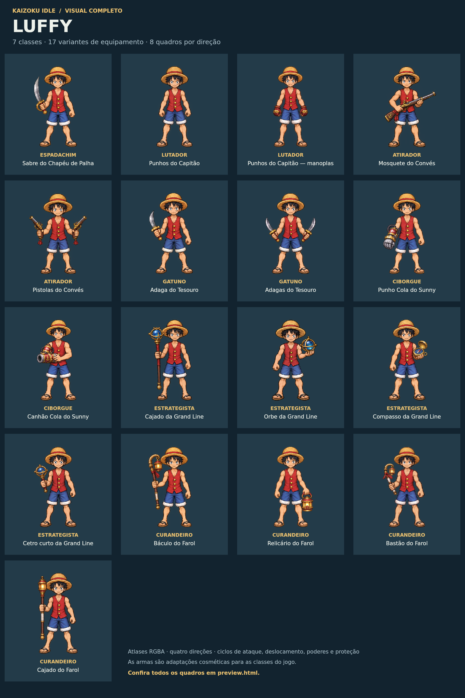

# Luffy — Visual Completo HD

Integração para revisão no [PR #398](https://github.com/Eximaq/mare-partida/pull/398), sobre `c55d68d3a6cda29d314f42e3e8381113aa7981d7`.

## Item e compatibilidade

`visual_completo_luffy` foi acrescentado **ao final do catálogo, índice 246**, no slot `visual_completo`. Os índices 0 a 245 permanecem idênticos. O Zoro continua no índice 187, exclusivo de Espadachim. O Luffy aceita `sword`, `brawler`, `gunner`, `rogue`, `cyborg`, `strategist` e `healer`.

O item usa `assets/skins/visual-completo/luffy/icon.png`, cópia exata da arte fornecida pelo usuário. SHA-256: `dacdb2dda30e5b395579f6a1d293b0173df2411f7f82b313f8f2d602e174f4df`.

O visual depende de uma instância pertencente ao personagem, preserva o vínculo do item e usa os fluxos existentes de equipar, substituir, salvar e retirar. Não concede atributos, armas funcionais ou habilidades, não entra em loot automaticamente e não acrescenta itens aos saves. Também não substitui os quatro cosméticos separados da coleção East Blue deste PR.

## Arte e cobertura

O traje usa chapéu de palha com faixa vermelha, colete vermelho sem mangas, bermuda azul com barras claras e sandálias. A roupa foi desenhada junto ao corpo em cada movimento; as armas são adaptações cosméticas para as classes.

São **85 ciclos físicos, 340 atlases direcionais e 2.720 quadros**. Cada ciclo tem oito quadros para Sul, Norte, Leste e Oeste, inclusive repouso, caminhada e reação a dano. As 255 folhas geradas contêm 2.040 poses fonte. Os 680 quadros Oeste são espelhos individuais dos quadros Leste, na mesma ordem temporal, conforme a convenção do protagonista HD. O espelhamento também inverte assimetrias e a lateralidade das armas.

| Classe | Variantes de equipamento |
| --- | --- |
| Espadachim | Sabre do Chapéu de Palha |
| Lutador | Mãos livres; Punhos do Capitão com manoplas |
| Atirador | Mosquete do Convés; pistolas duplas |
| Gatuno | Adaga do Tesouro; adagas duplas |
| Ciborgue | Punho hidráulico; Canhão Cola do Sunny |
| Estrategista | Cajado, cetro, orbe e compasso da Grand Line |
| Curandeiro | Báculo, bastão, cajado reto e relicário do Farol |

Há 68 ciclos básicos (17 variantes × repouso/caminhada/ataque/dano), 16 ciclos especiais e um ciclo compartilhado de poder com mão livre. O mapeamento de equipamentos considera os 42 IDs das armas de classe existentes. Adaga simples também está disponível na arte, embora os seis itens atuais do Gatuno selecionem empunhadura dupla.

As células são de 512 × 512 px para repouso/caminhada e 640 × 640 px para os demais movimentos. A altura corporal mediana por ciclo varia de 328,5 a 411,5 pixels nas fontes; o empacotamento preserva os pixels RGBA, sem ampliar ou interpolar poses. A escala de mundo corresponde a uma altura corporal de 96 unidades, com âncoras nos pés. O retrato ajusta o ciclo inteiro à área disponível, evitando cortes e mudanças de escala entre quadros.

## Habilidades

| Classe | Habilidade 0 | Habilidade 1 |
| --- | --- | --- |
| Espadachim | Corte de Maré: ciclo próprio | Arco do Horizonte: ciclo próprio |
| Lutador | Impacto de Âncora: corpo do golpe pesado | Fôlego de Ferro: proteção, sem golpe |
| Atirador | Disparo Preciso: corpo do disparo | Rajada de Estilhaços: ciclo próprio por arma |
| Gatuno | Ataque ao Ponto Fraco: corpo da investida | Dança das Adagas: ciclo próprio por empunhadura |
| Ciborgue | Protocolo de Provocação: gesto próprio | Blindagem Ativa: proteção por equipamento |
| Estrategista | Chama Concentrada: canalização do foco | Tempestade das Correntes: canalização do foco |
| Curandeiro | Maré Restauradora: canalização de cura | Bênção do Farol: gesto próprio por foco |

Os compartilhamentos corporais são declarados como `bodyShared` no atlas e não aumentam a contagem de arte inédita. Os VFX continuam separados, com os nomes e o comportamento já usados pelo jogo. Oito quadros de desenho não significam oito impactos.

O ciclo `cast_palm_shared` esconde a arma durante um poder com a mão livre e retorna ao equipamento selecionado ao terminar. Sem arma funcional, a apresentação usa mãos livres; habilidades de classe usam um gesto de palma, ou proteção no caso da Blindagem Ativa. Zoan conserva prioridade e morte usa o caminho nativo existente.

## Ligação com o jogo

- `luffy-animation.js`: seleção pura de família, clipe, direção e quadro.
- `visual-completo-luffy.js`: leitura do atlas, validação, carregamento por demanda e desenho.
- `visual-completo-renderer.js`: despacho entre Luffy e Zoro.
- `game.js`: transmite classe, índice da habilidade e direção pelo relógio que executa a ação.
- `paper-doll-96-lobby.js`: consome a apresentação no mundo, silhueta, retratos e pares; mantém desenho nativo enquanto um atlas falta ou carrega.

`progress` e `hitFrameRatio` dos relógios existentes determinam o quadro de ação, normalmente índice 4. A apresentação não muda dano, velocidade, recarga, custo ou callbacks de impacto. Habilidades próprias sem um relógio usam um gesto com prazo de expiração, sem criar bloqueio de combate. Uma habilidade encerrada não prevalece sobre dano, caminhada ou repouso.

O carregador busca apenas o atlas solicitado e mantém até 12 imagens decodificadas em cache, em vez de abrir os 340 arquivos na entrada. O fallback usa uma projeção de apresentação sem o slot de visual completo, preservando o personagem, a arma e o save originais. A passagem entre um clipe Luffy pronto e outro pendente mantém a locomoção nativa preparada.

## Verificação e limites

Os testes adicionados verificam as sete classes, preservação do catálogo e dos saves, origem exata do ícone, quatro direções com oito quadros, limites, dimensões RGBA e hashes de todos os PNGs, habilidades offline e online, ordem dos scripts, fallback e ajuste do retrato.

Na produção de arte, 21.768 verificações de pixels/metadados e 3.588 verificações do adaptador de prévia passaram. O vídeo separado reproduz os 85 ciclos em Canvas, com as quatro direções simultâneas; ele não é uma captura de gameplay.

Na integração, passaram 72/72 testes focados, 263/263 testes foundation, `npm run typecheck`, `npm run build`, sintaxe e `git diff --check`. A execução completa de `npm test` terminou com 122/357 arquivos legados passando: 230 falhas dependem de arquivos/assets ausentes neste checkout, e cinco são falhas de comportamento/fixture reproduzidas na base do PR. Todos os testes novos e os de Zoro passaram também nessa execução completa.

Na revisão inicial, a instalação do Chromium foi bloqueada por HTTP 403 e o checkout seletivo não incluía `tools/rework-modular-outfits-hd/index.json.gz`. A revisão de merge usou um checkout integral para gerar `dist` e testar o jogo no Chromium.

`approved:false` e `productionEnabled:false` no manifest registram o estado de revisão da arte. A ativação do renderizador depende do Visual Completo equipado.

### Atualização para revisão — 28/11/2026

Armas funcionais compartilham a variante do Luffy pela classe e pela empunhadura. O Cajado das Marés (127) usa o mesmo ciclo do Cajado do Farol (31). O Orbe de Skypiea (122) compartilha o ciclo do Orbe das Correntes (17). Braços mecânicos e canhões conservam variantes próprias do Ciborgue. Quando um ID equipado não está registrado, o seletor usa a variante base da classe. As trocas preservam o item funcional e as regras das habilidades.

O teste do seletor cobre as 42 armas atuais nas quatro direções em repouso, caminhada, ataque e reação a dano. No Chromium, a troca para o cajado 127, o orbe 122 e o canhão 118 preservou os ciclos previstos em repouso, caminhada e ataque no mapa. Pontos de emissão de projéteis permanecem ligados ao sistema existente e seu alinhamento visual ainda não foi medido.

A revisão de merge regenerou o manifesto native96, atualizou o teste Docker para o catálogo com 247 definições e preservou as verificações do hash e das permissões. Os testes antigos de mapa, viagem e carregamento agora conferem a cena pintada de Conchas, o balanceamento atual, as informações de viagem e a continuidade entre poses.

## Proveniência

`assets/skins/visual-completo/luffy/provenance.json` registra o método, a referência do traje, o ícone e as verificações. Os hashes de cada atlas estão no manifest. Fontes de geração, prompts, vídeo e visualizador de revisão são fornecidos no pacote de arte separado e não entram no payload do jogo.

Referência do traje: [Referência visual oficial de Luffy](https://tamashiiweb.com/item/14796/?wovn=en). Personagem e universo: One Piece; as armas desta skin são adaptações para as classes do projeto.
