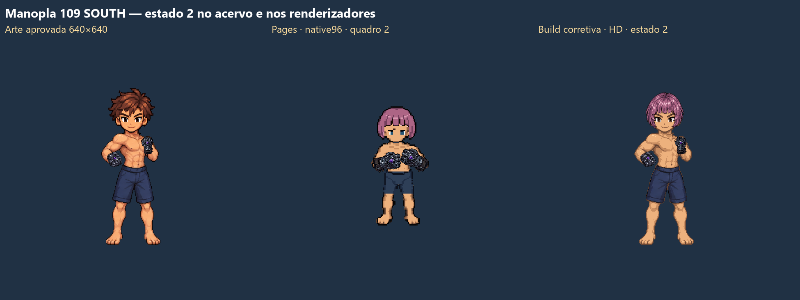

# Restauração de poses históricas no mapa

Base do patch e deploy observado `58b7df142e7fac3ee0a1c3450a34a4946aaa1804`. A [execução do Pages](https://github.com/Eximaq/mare-partida/actions/runs/43503273289) registrou implantação bem-sucedida. A build corretiva foi servida apenas em loopback. O navegador usou perfis descartáveis e a mesma fixture de save no site e na build local em cada comparação principal. A fixture define classe, arma, roupa, corpo e aparência. O teste dispara o ataque por clique no alvo no mapa Ilha Dawn. O cenário de combate usa um alvo descartável para observar a sequência, sem alterar o seletor ou o compositor.

## Diagnóstico e resultado

| ID / identidade | Ação e vista | Aprovação e fonte | Site | Build corretiva |
| --- | --- | --- | --- | --- |
| 109 / M, sem outros slots visuais, Chanel rosa, pele clara, olhos azuis | Básico SOUTH | a227079d → 4542de58. V3 de encaixe inicial, sete estados apresentados. | `native96`, oito quadros | `gauntlet109-south-native-layers-appearance-bob`, estados 0–6 |
| 17 / M, sem outros slots visuais, Chanel rosa, pele clara, olhos azuis | Básico SOUTH | a227079d → 4542de58. Textura v2, ressalva no quadro 5. | `native96`, oito quadros | `orb17-south-native-layers-appearance-bob`, estados 0–7 |
| 0 / M, arma isolada, aparência original sem paleta explícita | Básico SOUTH | e06ebec3 → e433c1d8, com ressalva histórica. Nove composições originais. | O jogo normaliza o save carregado para uma paleta explícita. | A rota original seleciona `sword0-south-historical-attack` no teste de compositor. Os 16 ticks recompõem exatamente os nove PNGs no canvas nativo. |
| 0 / M, arma isolada, cabelo Original, preto, pele clara, íris azul | Básico SOUTH | A identidade normalizada possui cores que a composição histórica fechada não representa. | `sword0-south-modular-nine-adapted-original` | `sword0-south-historical-layers-appearance-original`, nove estados do pacote no mapa. |
| 0 / M, peitoral 6, Chanel rosa, porcelana | Básico SOUTH | A adaptação modular é candidata para esse traje e aparência. | `sword0-south-modular-nine-coat6-adapted-bob`, nove estados | Continua adaptação. A comparação da adaptação sem peitoral, com paleta original, encontrou de 57 a 1.370 pixels divergentes por fase, em canvas 640×640. |
| 0 / F, peitoral 6, Chanel rosa, porcelana | Básico SOUTH | Nenhuma aprovação de ciclo completo identificada para essa composição exata. | `female0-attack-sword-south-candidate-coat6-native-sword`, oito estados | Mesma família. Controle de criação, caminhada e ataque exercitado no mapa. |
| 115 / M, peitoral 151, capacete 157 visível, cabelo Espetado, preto, pele clara, íris azul | Básico SOUTH | b16d162f, provisória. V5 com identidade exata. | Não exercitado nesta bateria. | `rifle115-v5-south-native-layers`, cinco estados. Repouso e caminhada mantêm a família de porte. |
| 128 / M e F, trajes 151/158/165/179 | NORTH | b923836a → 89646436. Pacote BASE127 reconstruído e seus 444 hashes conferidos. | Não exercitado nesta bateria. | O seletor mantém o registro anterior `staff128-north-native-base17-attachment-candidate` para identidades compatíveis. A fonte correta BASE127 permanece sem vínculo comprovado. |

O seletor recusava o cabelo e/ou a pele das fixtures de 109 e 17. Os índices estavam disponíveis e o mapa preparou o fallback de propósito. A correção reutiliza a base e as fases aprovadas em SOUTH. O cabelo separado segue o contrato de pivô e âncoras da cabeça. Na 17, a substituição de pixels da mão aplica cor somente quando a amostra RGBA coincide com a anatomia no mesmo pixel. O teste não certifica o restante dos pixels de interface como pele. A 109 conserva o quadro de encaixe inicial V3, sem introduzir a pose 7 do DRAWN8. O relógio de apresentação existente foi preservado. O jogo ainda usa sua cadência lógica para executar o golpe.

A 109 manteve porte HD em SOUTH. A 17 ainda teve `native96/masculino/idle/south` e `native96/masculino/walk/south` com essa aparência. A correção não afirma restauração das demais vistas, roupas, capacetes ou armas.

### Comparação da Manopla 109 em SOUTH

[Abrir o PNG em resolução original](evidence/approved-poses/Kaizoku-109-fase-2.png)

## Fontes recuperadas

| Caso | Caminho na branch `feature/approved-weapon-art` em `2801902fa2dad8e83069815faeaa3f53f90bc1b6` | SHA-256 |
| --- | --- | --- |
| 0 SOUTH | `art-approved/weapons/sword0-south/male_sword0_south_approved-cycle_presentation-v2.zip` | `9e95e9dcea550cadf43c3aa36bd12a6604d92c287a1058bf0d8c210baf8c5991` |
| 109 SOUTH | `art-approved/weapons/manopla109-south-initial-fit-v3-approved/109_SOUTH_INITIAL_FIT_V3/Manopla109_EncaixeInicial_v3_Editavel.zip` | `be620e66e06ea2b9c943b92600abae46e0ef7f473e9917b6491cbf545cd06f8c` |
| 17 SOUTH | `art-approved/weapons/orbe17-south-frame5-caveat-approved/17_SOUTH_PRESENTED_FRAME5_CAVEAT/Orbe17_SOUTH_Textura_3_4_v2_Aprovada_Somente17.zip` | `99c55ef65e110a3340d0f889b77b5036cc03391711586bcb481ddb1d6765f0c5` |
| 115 SOUTH V5 | Registro `rifle115-v5-south-native-layers` e contrato de hashes no seletor. Pacote histórico externo não localizado nesta bateria. | `d87a8ccc05a8aff100db2c7454dd40355c7dfef65e7fbc45d164005f3535d585` |
| 128 NORTH | `art-approved/weapons/staff128-north-base127-approved/128_N_BASE127/Cajado128_BASE127_Editavel_Backup_QA.zip.part001–003`. 72 quadros M640×640/F768×768, com camadas 127, máscara de remoção e arma 128. | `218ef49345deb0b68186a5d1f171f71697a541f5bbfa1b4edac4bdc2be3bc6f6` |

Os hashes dos PNGs de aprovação de 0, 109 e 17 correspondem aos respectivos estados em `tools/rework-weapon-layers-hd/index.json`. O pacote 128 contém cabeça e roupa incorporadas, incluindo botas e chapéu na variante feminina. O vínculo depende de confirmar os slots e o pivô de cada conjunto. O relógio do vídeo de revisão não foi adotado como relógio de combate.

## Build, cache e integridade

- O Pages serviu `game.js?v=abbf42936ae91c41`, `item-catalog.js?v=8be36692f0470c60`, o índice HD e seu índice de arquivos com HTTP 200, `max-age=600` e respostas fora de service worker nos cenários instrumentados. O SHA-256 do índice de armas servido coincide com o checkout (`1093c7fec5666bb74a40599b074276c3b6e98af95a3655acdaf0ead954067604`). Índice de armas com ETag `W/"6af77553-b8e981"`. A build de revisão foi servida com `Cache-Control: no-store` e zero registros de service worker nos perfis de teste.
- `python tools/build_pages.py` passou. `node --test tests/rework-starter-coat.test.cjs player-rework-weapon-native-hd.test.cjs player-rework-outfit-overlay-hd.test.cjs` passou com 24 testes. O teste de integração cobre os estados, ordem, tempos registrados, poses e rejeição de outros trajes.
- `node tools/audit_rework_map_coverage.cjs <diretório>` exercitou 189 arranjos e 4.536 consultas por paleta. Essa matriz mede a seleção e mantém as lacunas como não restauradas.
- Os quatro exports locais de posicionamento foram conferidos antes e depois. Os mesmos SHA-256 valem para as duas leituras.

| Export em `tools/rework-accessories` | SHA-256 antes e depois |
| --- | --- |
| `hair_user_adjustments_source-only_v1/adjustments.json` | `f17aeda3998dbdc17bf5e3cc65956999554e50a6fc0173e0b693ee9426c0162c` |
| `headgear_user_adjustments_source-only_v1/adjustments.json` | `f30fd5f27c9c72efa8d034ffc4ce8669a317783854047021893870298b3d48ee` |
| `male_hair_user_adjustments_source-only_v1/adjustments.json` | `a342ff01b29442e022ca743be165dc46551ab1c8e0b262712583abe782360678` |
| `male_headgear_user_adjustments_source-only_v1/adjustments.json` | `a4275461acdc3c6824b6d71329a21bacf278152291ea8595e30e1d145af0f685` |

## Pendências da primeira bateria

- A prova da fonte histórica é limitada às combinações exercitadas. Os casos 4/5/0/111/119 SOUTH, 15 NORTH, 69 NORTH e adagas NORTH constam da matriz.
- Retestar na revisão atual 151 nas laterais, calças 140/147/154/161/175/182 nos dois corpos, Grevas 21, capacetes 18/19/157 e troca de ações ou equipamento durante a preparação. A regressão automatizada da seleção é mais estreita que essa bateria no mapa.
- Fechar o encaixe de pele na interface da 17, o porte com a aparência usada no teste e a comparação alinhada de todas as variantes com vídeos e PNGs aprovados.

## Cruzamento integral de art-approved

`python tools/audit_art_approved.py . origin/feature/approved-weapon-art <diretório>` reconstrói os ZIPs multipartes, confere tamanho e SHA-256 do catálogo e cruza os membros com os índices HD e os catálogos portáteis de roupa e arma. O CSV aponta a entrada original e os IDs de registro que a referenciam. O JSON conserva a origem, as partes e os metadados existentes. A presença de uma referência de hash não certifica que a variante inteira é selecionada no mapa.

- Foram lidos 287 pacotes de `art-approved/CATALOG.json` e quatro ZIPs originais de cabelo e capacete em `art-sources/user-adjustments`. Nenhuma parte de ZIP ficou sem associação. As 27.703 entradas PNG incluem quadros, camadas e materiais auxiliares. Dos 291 pacotes, 278 têm referência por hash nos catálogos ou índices. Desses, 149 cruzam também com os índices HD. Os índices e catálogos referenciam 13.560 entradas PNG. As tabelas de assets HD publicados contêm 4.635 entradas por identidade de bytes. Os resultados incluem correspondências parciais.
- Os dez ZIPs de `clothing/female-historical-cycles` correspondem ao SHA-256 do índice histórico. Os quatro source packs femininos do peitoral 6 têm correspondência de todos os 560 PNGs nos índices locais. As seis composições finais `133 r15`, `161 r27` e `21 r3` em EAST/WEST constam exatamente no catálogo portátil de revisão, com 12 PNGs e relógio de 40 ticks a 40 fps por vista. As versões congeladas do renderizador normal têm outros hashes. O mapa ainda precisa de prova de equivalência ou vínculo com essas composições.
- O pacote `128 NORTH BASE127` aparece no catálogo portátil com as oito variantes e 144 entradas PNG por hash, incluindo referências compartilhadas. Nenhum dos 435 PNGs está identificado nas tabelas HD usadas pelo renderizador normal. Para `69 NORTH V6`, 24 de 34 têm correspondência. Para `15 NORTH Aros`, 20 de 42. Para `4 SOUTH V3 M151/157`, 15 de 26. Os três últimos são cruzamentos parciais, com a prova por fase no mapa pendente.

## Validação da integração em mapa

A [matriz do acervo](approved-pose-runtime-matrix.csv) cruza os 287 pacotes e quatro exports com os registros existentes. As linhas de execução incluem ID, corpo, combinação, ação, direção, ciclo e captura. As linhas sem execução registram a situação da fonte. Correspondências por hash podem apontar uma revisão anterior ou uma composição diferente.

| Caso | Exercício no mapa | Evidência |
| --- | --- | --- |
| 4 SOUTH V3 | Criação do Atirador pela interface. Equipagem dos itens 151, 157 e 4 pelo inventário, recarga do save descartável, ataque pelo clique no alvo e verificação dos cinco estados 0, 1, 2, 4 e R. Retirar o 157 desativa essa combinação. | [Aprovado e raster do mapa, estados 4 e R](evidence/approved-poses/Kaizoku-4-south-comparativo.png) |
| 15 NORTH | Ciborgue no mapa com arma 15, Chanel rosa e pele escura. Oito estados 0–7 durante ataque com a fonte dos aros fechados. A personalização usa a anatomia e o cabelo separados. | [Aprovado e raster do mapa, estado 2](evidence/approved-poses/Kaizoku-15-north-comparativo.png) |

As seis adagas 12, 13, 71, 72, 73 e 74 em NORTH preservam a ordem original de oclusão da arma atrás do corpo. A base modular referenciada no JSON de origem recompôs os oito quadros de cada arma sem diferenças de pixel na configuração da fonte. A prova no mapa observou as oito fases de cada arma em combate com cabelo Chanel rosa, pele escura e olhos verdes. [Comparativo dos seis IDs no estado 2](evidence/approved-poses/Kaizoku-adagas-north-comparativo.png).

O Mosquete 4 usa os três PNGs nativos de cada estado, com os backings e mãos de mesmo SHA-256 da 115 V5. O teste de compositor compara os cinco estados com os PNGs aprovados. Na captura do navegador, os cinco têm alfa e pixels opacos iguais. Nos pixels translúcidos, a diferença RGB pré-multiplicada ficou abaixo de 1 unidade de canal. O relógio visual de 43 ticks a 24 fps e o pivô de [80, 128] foram preservados. O teste de combate confirmou o dano pelo fluxo habitual.

O Canhão 15 mantém o PNG da peça e as oito fases aprovadas. A camada de interface pode conter pele da mão. A aplicação da paleta exige coincidência dessa amostra com a anatomia de origem na mesma coordenada. Esse vínculo cobre o registro masculino de arma isolada, com as âncoras de cabeça disponíveis.

A build passou com `python tools/build_pages.py`. Os 22 testes do conjunto focado passaram. A execução no navegador usou Edge e a build publicável em loopback, com um perfil descartável por variante. Nenhum deploy foi executado.

O Nodachi 69 NORTH V6 usa a própria arma e o rig NORTH espelhado do pacote de origem. As fases 1–6 da base são iguais pixel a pixel. Em 0 e 7, o teste isolou a alteração da mão em retângulos de 28×30 e 28×31 pixels. O compositor recompõe os oito PNGs aprovados na paleta da fonte. No mapa, as oito fases exibiram a identidade com cabelo Chanel rosa, pele escura e olhos verdes. [Comparativo da fase 2](evidence/approved-poses/Kaizoku-69-north-v6-comparativo.png).

### Ciclos SOUTH confirmados no mapa

| ID | Fonte efetivamente desenhada | Estados | Comparativo |
| --- | --- | --- | --- |
| 0 | `sword0-south-historical-layers-appearance-original` | 0–8 | [Aprovado e save normalizado no mapa](evidence/approved-poses/Kaizoku-0-south-comparativo.png) |
| 5 | `mosquete5-south-initial-v2-appearance-bob` | 0–9 | [Arte aprovada e mapa](evidence/approved-poses/Kaizoku-5-south-comparativo.png) |
| 111 | `gauntlet111-south-initial-v2-appearance-bob` | 0–11 | [Arte aprovada e mapa](evidence/approved-poses/Kaizoku-111-south-comparativo.png) |
| 119 | `cyborg119-south-authored-layers-appearance-bob` | 0–11 | [Arte aprovada e mapa](evidence/approved-poses/Kaizoku-119-south-comparativo.png) |

A espada 0 foi executada em save descartável carregado pela rotina normal, que gravou cabelo Original preto, pele clara e olhos azuis. A camada frontal do estado 3 preserva a oclusão da lâmina. O 5 usa a ordem de `normal.txt`, com a pose 0 ampliada na própria fonte e a 9 preservada. A 111 e a 119 mantêm 20 ticks a 24 fps, com 12 PNGs de referência. A 119 tem a camada frontal do braço onde ele encobre a cabeça. As máscaras de pele atuam nos pixels compatíveis com a anatomia de origem. A igualdade de raster foi testada sem recoloração.

## Peitorais femininos e ajustes de cabeça

O mapa apresentou o peitoral 130 feminino com pele escura, cabelo Chanel rosa e olhos verdes em repouso, caminhada e ataque nas quatro direções. Os oito estados de ataque de cada direção foram observados. Na caminhada, o teste conferiu a seleção e amostras desenhadas. A evidência é da integração no mapa. A equivalência integral dos quatro pacotes editáveis da roupa com esses ciclos ainda precisa de comparação por fase. [Captura do ataque SOUTH](evidence/approved-poses/Kaizoku-peitoral130-feminino-mapa.png).

O teste de composição conferiu as mesmas camadas de roupa em 120 combinações de peitoral, direção e ação. A paleta usa somente camadas de anatomia que coincidem por identidade e hash com a base. Para os 837 ajustes dos quatro exports, a consulta do seletor normal escolheu a identidade exata em 2.511 de 2.511 cenários de repouso, caminhada e ataque sem outras peças. Isso verifica a seleção, e a validação visual de cada ciclo permanece pendente. A consulta é reproduzível com `node tests/rework_approved_head_selection_audit.cjs <saida.json>`.

## Lacunas das referências laterais e do Cajado 128

Nos seis ZIPs de 133 r15, 161 r27 e 21 r3, os 72 quadros têm fundo opaco uniforme. A base transparente v42 coincide com a cabeça das prévias, mas diverge nas pernas e no alfa das fases 3 e 9. O registro v47 também diverge em todas as amostras comparadas. A integração requer recuperar o alfa e as camadas dessas revisões.

O pacote BASE127 foi cruzado com os dois arquivos multipartes de origem do Cajado 127. A variante feminina usa um corpo 768×768 com botas e chapéu incorporados e o registro portátil ancora no fundo do canvas, abaixo dos pés. No masculino, o cabelo incorporado não coincide com a fonte modular NORTH nas nove fases. Falta localizar a geometria e o contrato de aparência desses conjuntos para substituir a seleção divergente do 128.

A interface de porte SOUTH da Orbe 17 inclui a mão e o aro dourado no mesmo PNG. A correspondência de sete pixels na anatomia foi descartada como máscara. O vínculo atual usa uma máscara de propriedade desenhada na grade de pixels da fonte, vinculada pelo SHA-256 do PNG e independente dos ajustes de posição. A validação do compositor exercitou repouso e 16 quadros da caminhada SOUTH sem modificar alfa ou núcleo azul. NORTH e EAST também receberam máscaras de propriedade específicas. WEST usa a máscara do EAST junto ao mesmo raster e ao espelhamento previsto.

A matriz registra os ciclos portáteis de roupa e arma por corpo, ação, direção e versão, incluindo as oito variantes do BASE127. Os status de inventário, seleção automática e execução no mapa são independentes.

O check de save padrão em `6a970284` ainda esperava que o fallback feminino descartasse a paleta. A regressão agora compara todos os quadros com o peitoral 6 na aparência salva e exige que somente a arma sintética sem fonte seja omitida. [Execução que identificou a divergência](https://github.com/Eximaq/mare-partida/actions/runs/43517640716).

O peitoral 130 masculino preservou a pele escura, o cabelo Chanel rosa e os olhos verdes nas quatro direções. A prova de seleção e identidade de camadas cobre 108 combinações de nove peitorais masculinos isolados. O Sobretudo 151 masculino possui contratos próprios com roupa e arma e permanece em verificação por composição. [Captura do peitoral 130 no mapa](evidence/approved-poses/Kaizoku-peitoral130-masculino-mapa.png).

### Rifles 113 e 116 SOUTH com o capacete 157

Foram exercitadas as dez combinações masculinas com peitoral 151, 158, 165, 172 ou 179, capacete 157 e cabelo Espetado preto. O registro exige os slots exatos, a paleta dos PNGs e a direção SOUTH. O ciclo de 43 ticks a 24 fps preserva os cinco estados 0, 1, 2, 4 e R. No Rifle 113, a ordem das camadas editáveis de alguns quadros resulta em diferenças de silhueta em relação ao PNG aprovado. Por isso, ambos os rifles usam os PNGs finais dentro do escopo fechado de cada traje. As variantes de caminhada, outras direções e outras aparências seguem com verificação própria.

| Arma | Evidência fonte aprovada e raster do mapa |
| --- | --- |
| 113 | [Comparativo dos cinco trajes, estado 4](evidence/approved-poses/Kaizoku-113-south-comparativo.png) |
| 116 | [Comparativo dos cinco trajes, estado 4](evidence/approved-poses/Kaizoku-116-south-comparativo.png) |

O navegador criou o Atirador e usou o inventário para equipar as peças. O teste recarregou o save, iniciou combate ao clicar no alvo, observou os cinco estados e verificou dano. Retirar o capacete desativou a composição fechada. A comparação no compositor conferiu todos os 50 quadros e o teste negativo rejeitou a assinatura incorreta. A build e o verificador de arquivos nativos passaram. Os frames da comparação mantêm a resolução nativa, com recorte da área transparente ao redor.

O teste no mapa observou a pose estática, dez quadros da caminhada SOUTH e as oito fases de ataque com a pele escura e cabelo Chanel rosa. A máscara preserva a tonalidade do centro azul e separa o metal na composição. [Porte SOUTH, fonte e raster do mapa](evidence/approved-poses/Kaizoku-17-south-porte-comparativo.png).

O porte masculino da Orbe 17 foi exercitado também em repouso e caminhada NORTH, EAST e WEST com a mesma aparência. Os 64 quadros das quatro direções foram comparados automaticamente. A diferença de arredondamento chega a um valor de canal no núcleo azul NORTH e dois nas laterais. O alfa permanece igual. [Comparativo do porte nas quatro direções](evidence/approved-poses/Kaizoku-17-porte-quatro-direcoes.png).

### Vestes em repouso e caminhada ainda divergentes

Das 57 entradas de repouso comparadas, 53 selecionam um raster diferente do primeiro PNG do acervo e quatro vistas masculinas do 151 não tinham rota HD direta na build auditada na configuração isolada usada na comparação. As bases femininas com cabelo Curto rente coincidem com os limites da cabeça e das pernas do repouso 151 em todas as direções. No masculino, o cabelo Original apresenta o melhor encaixe de cabeça e as pernas da base neutra registrada correspondem aos pixels da vista de repouso. Para as cinco sequências de repouso femininas, a primeira comparação cobre somente a primeira pose.

No peitoral 130 feminino, os 160 ticks de caminhada dos pacotes S36, N39 e EW44 foram compostos com os seus JSONs e comparados com as 160 seleções atuais. Todos divergem. A saída do mapa que já consta no relatório demonstra que a peça está presente e que mantém as cores salvas. A restauração desses ciclos históricos continua pendente. A primeira camada dos pacotes reúne roupa, cabeça e anatomia. As sobreposições restantes incluem costuras e mãos. Fazer a substituição exige separar a propriedade desses pixels por fase para preservar a personalização.

Os hashes Git dos quatro arquivos originais de posicionamento conferem com a base do PR. A suíte nativa integral executada localmente após a correção do teste de propriedade da Manopla 111 passou em 190 casos. A nova cobertura de cores da Orbe passou em oito testes focados sobre a build correspondente.

### Ajustes femininos de cabeça

O compositor feminino substituía a escala do capacete e do cabelo por 100% mesmo quando o estilo, o item e a direção coincidiam com um ajuste aprovado. O vínculo agora usa o ajuste completo do export para esses alvos exatos. Os quatro JSONs permanecem com os hashes originais. O teste comparou o ajuste NORTH do 157 para cabelo Curto rente, de 109%, com o controle de 100%. No mapa, foram verificados repouso, cinco quadros de caminhada e oito de ataque. O comparativo anterior revelou que faltava a parte inferior do diadema. Os pixels da peça foram isolados de candidate-north-4.png, com SHA-256 6e11fefee090c4676502a3a09e2f50e377902299cb55db0a7a07a7ac4a01acdd, e registrados por translação inteira [0, −12], alinhada pela faixa dourada. O compositor aplica os mesmos 109%, Y −0,25 e hideHair do ajuste. O reteste viu repouso, cinco quadros de caminhada e os oito quadros de ataque NORTH. [Vista histórica e três quadros do mapa corrigido](evidence/approved-poses/Kaizoku-157-feminino-north-nuca.png).

### Espadas 1, 67, 68 e 69 SOUTH

O ataque masculino com arma isolada reutiliza os nove PNGs de cada fonte. O adaptador separa a cabeça onde os pixels coincidem e mantém em primeiro plano a oclusão que já aparece na composição aprovada. Os arquivos 1, 68 e 69 correspondem aos hashes do acervo. Para 67, a referência final disponível está nos ZIPs nativos históricos de 564ab8de. Cada ciclo preserva os 16 ticks a 24 fps. O 69 mantém o canvas de 896, o pivô de [112, 160] e a margem original de 128 pixels. O compositor comparou os 36 quadros com seus PNGs de referência. Os quatro ataques foram executados no mapa por clique num alvo, com pele escura, cabelo Chanel rosa e olhos verdes. Cada um exibiu os nove estados. A build, oito regressões focadas e a verificação de dimensões, CRC e SHA passaram. [Comparação lado a lado na fase 4](evidence/approved-poses/Kaizoku-espadas-south-1-67-68-69.png).

### Sobretudo 151 masculino em repouso

Os quatro PNGs nativos de v1 estão ligados ao traje isolado na aparência da referência. A seleção exige cabelo Original castanho, olhos castanhos e pele clara. O mundo desenhou os quatro ciclos estáticos após o carregamento do save. O canal alfa e os pixels opacos coincidem com a fonte em todas as direções. [Arte aprovada e mapa](evidence/approved-poses/Kaizoku-151-masculino-repouso.png).

### Ataques laterais masculinos 109, 117 e 122

Os pacotes editáveis dos quatro trajes 151, 158, 165 e 179 são selecionados por arma, peitoral, lado e aparência exata. O ciclo de cada lado usa oito poses nativas em 640×640, a 12 fps, com a última pose sustentada pelos 12 ticks adicionais da fonte. As composições estão restritas a cabelo Original castanho, olhos castanhos, pele clara e aos slots presentes na referência. Os PNGs WEST já vêm orientados para esse lado.

Na build testada, os ataques foram iniciados por clique em alvo no mapa depois de carregar os saves de teste. Os 24 ciclos emitiram as oito poses e o ID previsto. Nos 192 quadros, foram comparados o canal alfa e todos os pixels opacos sob o mesmo recorte. Um reteste equipou 151 e 109 pelo inventário, recarregou o save e confirmou os oito quadros em EAST e WEST. Os comparativos exibem a fase 4. [Manopla 109](evidence/approved-poses/Kaizoku-lateral-109-masculino.png) · [Braço 117](evidence/approved-poses/Kaizoku-lateral-117-masculino.png) · [Orbe 122](evidence/approved-poses/Kaizoku-lateral-122-masculino.png).

Nas versões femininas, a composição fechada contém pernas, botas e cabelo. Na reprodução inicial com o peitoral 151 e cabelo Curto rente, 109 e 117 selecionaram candidatos diferentes das referências aprovadas. A Orbe 122 selecionou native96. Faltam confirmar os slots que correspondem aos pixels incorporados antes de ligar os ciclos completos. A comparação masculina não cobre esse grupo.

### Calças femininas com fonte bloqueada

Os seis ZIPs de 133 r15, 161 r27 e 21 r3 EAST/WEST somam 72 quadros de apresentação com fundo opaco. A busca no acervo aprovado, nos registros de roupa e nos dois ZIPs pertinentes da pasta Correções recuperou as apresentações e as revisões posteriores v42/v47. Ainda faltam as camadas transparentes das três revisões exatas, ou uma fonte verificável que comprove a equivalência fase a fase. As linhas correspondentes permanecem abertas na matriz.
