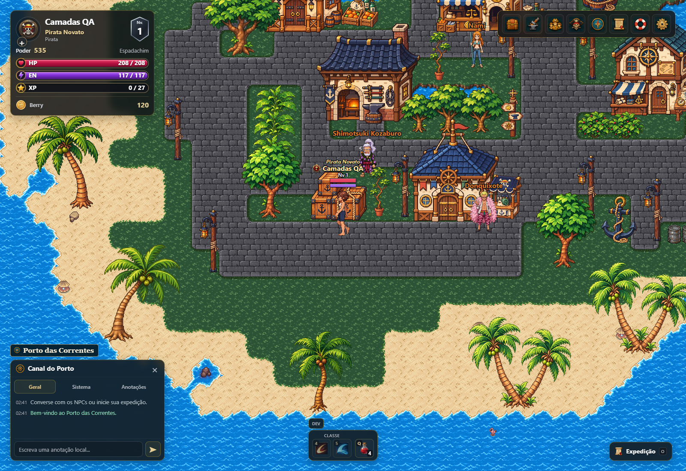
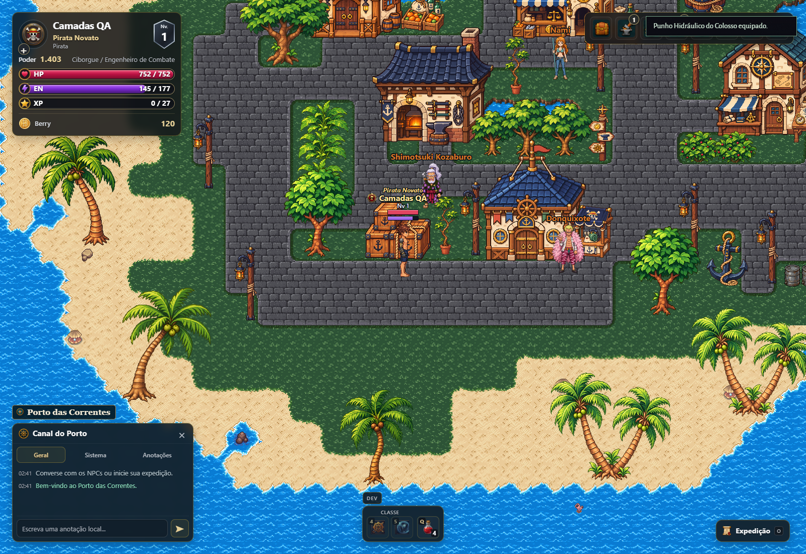

# Integração canônica do rework — revisão após o revert

> Atualização no mesmo PR: [vínculo V5, variantes e testes atuais](V5_BINDING_FOLLOWUP.md). O texto abaixo registra a entrega inicial em a7346636; suas pendências e contagens são históricas. O CSV foi atualizado pela continuação.

**Estado: rascunho; não pronto para merge.** Há correções verificadas de seleção/carregamento, mas a cobertura das variantes e combinações não é completa. Não houve merge nem comando de deploy.

## Base e comparação histórica

- Branch de trabalho: `fix/rework-canonical-integration`.
- Base: `main` em `2aea0e2c5650a1febb7ef63b38c1a38dfa7caa58` (#319), consultada no GitHub antes de criar a worktree.
- #307: merge `73eaa3083a4c0cc12fc75a51e77d6594dbcfef20`, head `a6df2da861a60b9dcbfb0eb37e9ae28869b1ac0c`.
- #313: merge `3bc539fd`; revert #314 em `65ed47cc` / merge `2667dbb4`.
- #316 (`07513b67`) já está na base e contém a recuperação posterior, incluindo `ed438cc5`, `5cd10a71`, `754f41ff`, `b533de82`, `d4e693fd`, `9728ec83`, `033d5aa9` e `8509eb2a`.
- Esta alteração é um delta sobre essa base. Não reaplica #313 ou outro commit em bloco. Preserva os ajustes de inventário #318/#319 e não modifica o checkout original com trabalho local.

Os quatro índices solicitados e seus arquivos existem na base atual. `player-rework-outfit-head-hd.js` não existe nessa árvore: a função correspondente está em `player-rework-native-hd.js`, `native-head-compat.js`, `player-rework-head-family.js`, `player-rework-female-named-hair-hd.js` e `player-rework-original-hair-helmets-hd.js`. Esses contratos foram reutilizados.

## Causas e fluxo real

1. `item-catalog.js:create().items` mantém os índices persistidos. `newItem` salva `def=itemDefs.indexOf(def)`; `equipItem` move a instância para `game.equipment[def.slot]`; `saveGame` persiste; o desenho recebe esse mesmo estado. Equipar funcionava, mas a seleção visual recusava a combinação.
2. O seletor exigia igualdade de todos os slots para uma composição aprovada. Colar, anel, cinto, amuleto e fruta, que não possuem camada de roupa, invalidavam calças e bases válidas. Agora são excluídos apenas da consulta visual.
3. `drawStable` / `prepareVisual` condicionavam uma pose disponível à preparação de toda a família de idle, caminhada e ataque. Uma incompatibilidade em outro ataque bloqueava idle/walk. Agora a preparação é por pose; a auditoria de família continua disponível.
4. O fallback anterior esvaziava todos os slots. Agora procura o maior subconjunto com **contrato exato já existente**, registra os slots omitidos e não mistura ciclos compostos arbitrariamente. O objeto salvo não é alterado.
5. A retenção do último quadro dependia da identidade do objeto, mas o fallback criava cópias. A retenção agora usa a identidade visual e tem limite de oito entradas. Falha definitiva de arquivo/prova não é tratada como carregamento eterno.
6. Roupas masculinas isoladas podem reutilizar o contrato de cabeça existente apenas quando a prova de pixels do `headBase` é compatível. As imagens do arquivo modular também são identificadas pelo SHA para essa prova. Nenhum ajuste de pivô ou escala foi inventado.

O carregamento segue índices → registros exatos → archive-index → PNGs → compositor nativo → canvas do mapa. O manifesto de versão foi atualizado pelo gerador oficial, pois inclui o hash de `paper-doll-96-lobby.js`.

## Catálogo e cobertura

[Relatório completo por registro, slot, corpo, ação, direção e variante](CANONICAL_INTEGRATION.csv). O relatório cobre todos os registros dos quatro índices, incluindo `femaleRegistrations`; uma composição com vários equipamentos produz uma linha por slot.

| def | Nome canônico | Slot |
|---:|---|---|
| 4 | Mosquete de Convés | weapon |
| 5 | Mosquete dos Faróis | weapon |
| 15 | Canhão de Pulso | weapon |
| 17 | Orbe das Correntes | weapon |
| 109 | Manoplas do Coral Negro | weapon |
| 115 | Rifle do Horizonte da Grand Line | weapon |
| 119 | Punho Hidráulico do Colosso | weapon |
| 133 | Calças do Convés | legs |

Cabelo, olhos e pele são consultados por `appearance96`; estilos e hashes não viram IDs de item. `head` e `MareHeadgear.hidden(player)` continuam sendo respeitados. Nenhum índice do catálogo foi reordenado.

Significado dos status:

- **validado no navegador**: registro selecionado apareceu em captura do canvas real, com diagnóstico de desenho na escala vigente.
- **vinculado e verificado automaticamente**: consulta canônica escolhe esse registro; integridade das fontes verificada separadamente. Não significa que todas as combinações foram vistas no navegador ou aprovadas artisticamente.
- **apenas no explorador**: uma prova de bancada não seria suficiente para integração. Não atribuímos esse status sem executar o explorador nesta revisão.
- **pendente**: registro histórico não escolhido para aquela consulta ou combinação sem vínculo compatível. A coluna `selected` identifica a alternativa, quando existe. Uma revisão histórica substituída não equivale a um PNG faltante.

O status original da fonte é preservado em `sourceStatus`. Termos como `candidate` e `provisional` não foram promovidos para aprovado. Ausência de vínculo, fonte alternativa, prova de identidade e pendência de calibragem são situações distintas.

## Integridade e limites

- 252 ZIPs / 16.073 PNGs nativos: tamanho, SHA-256 e CRC conferidos.
- 179 PNGs de cabeça: SHA-256 e cabeçalho PNG conferidos.
- Dimensões IHDR e tamanhos declarados nas camadas de arma conferidos.
- Nenhum PNG de arte, ZIP, índice de fontes, máscara, timeline, pivô ou densidade foi alterado. Escala mundial mantida em `105/374`; nenhuma conversão para 96×96.
- Sem alterações em atributos, combate, salvamento, concessão de itens ou regras de equipamento.
- A fixture do navegador cria um personagem local isolado, fornece itens apenas nesse contexto e usa os botões reais para equipar/retirar. Não altera personagens ou economia de servidor.

## Pendências concretas

1. **115 SOUTH V5**: `rifle115-v5-south-native-layers` continua arquivado. O contrato declara `originalAppearanceCompatible:false`, `hairSeparated:false` e `replacementMode:atomic-backing-weapon-hands`. Seu corpo/roupa/cabeça composto não corresponde à aparência base livre. Não há vínculo canônico completo para recuperá-lo como combinação salva exata. O runtime pode usar a outra fonte original-compatible já existente; isso **não é validação da V5**. Liberá-la genericamente violaria a restrição explícita de identidade.
2. Combinações e paletas sem fonte compatível ainda omitem slots, com diagnóstico, preservando as peças compatíveis e o save. O caso inicial com casaco 6 não tem cobertura universal masculina para todas as poses/paletas. Não se criou roupa nem calibragem para esconder essa lacuna.
3. O CSV inclui revisões históricas e registros não selecionados; cada linha pendente informa a fonte alternativa ou ausência de contrato. Não se afirma que todos os PNGs disponíveis estejam integrados.
4. As capturas de ataque usam pose controlada pelo teste através do renderizador normal. Não substituem uma bateria de combate real de todas as armas, classes e direções.
5. Validação online/multiplayer e todas as combinações possíveis de slots não foram executadas. Não foi executado comando de publicação do jogo.

## Reprodução dos testes

```text
python tools/materialize_native_indexes.py
python tools/verify_native_hd_archives.py
node --test player-rework-native-hd.test.cjs player-rework-default-hd.test.cjs tests/rework-integration.test.cjs
npm run test:rework-hd
python tools/player96_release.py --check
python tools/build_pages.py
python -m http.server 8157 --bind 127.0.0.1
MARE_TEST_URL=http://127.0.0.1:8157/dist/ node tests/rework_default_game_browser.cjs
MARE_TEST_URL=http://127.0.0.1:8157/dist/ node tests/rework_inventory_game_browser.cjs
node tools/audit_rework_integration.cjs
```

Os comandos de navegador precisam de Playwright/Chromium (ou CHROME_PATH). No Windows, as variáveis são definidas pelo wrapper de execução. Três testes antigos escreviam em `/tmp`; agora usam `os.tmpdir()`, sem afrouxar as verificações de pixels.

O teste inicial antes da correção falhou para: slots não visuais + calça133; idle disponível bloqueado por ataque ausente; fallback descartando calça compatível. A bateria original de saves iniciais, isoladamente, já passava na base — ela aceitava o fallback sem peças e não demonstrava integração de equipamento.

No #307, os jobs [native-world](https://github.com/Eximaq/mare-partida/actions/runs/43349139671/job/131636422428) e [foundation](https://github.com/Eximaq/mare-partida/actions/runs/43349139835/job/131635645534) falharam na etapa `npm run test:rework-hd`, antes da captura nativa. A suíte correspondente foi incluída nesta validação. Resultados finais e capturas seguem abaixo.

## Resultados finais — 13/11/2026

Ambiente: Windows, Node 24.22.0, Edge/Chromium 157 headless, build real em `dist/`, servidor HTTP local. Não foi usado o explorador como prova do mapa.

| Verificação | Resultado |
|---|---|
| Build Pages + manifesto oficial | Passou |
| Integridade de arquivos nativos e cabeças | Passou; contagens acima |
| Núcleo nativo + fallback + regressões iniciais | 43/43 passaram |
| Regressões finais, incluindo PNG de arma ausente | 6/6 passaram (cinco repetidas e uma nova) |
| Arquivos restantes de `test:rework-hd`, mais fallback/regressões | 165 testes: 163 passaram; duas falhas de escrita em `C:\tmp` |
| Reexecução após corrigir caminhos temporários dos três arquivos envolvidos | 11/11 passaram, incluindo as duas falhas anteriores |
| Saves iniciais: Espadachim, Atirador, Lutador; criação, reload, viewport estreito | 9/9 capturas passaram |
| Inventário e mapa: fixture isolada, ações reais de equipar/retirar | 56/56 capturas passaram |
| Runtime/assets nas 56 capturas | Nenhum pageerror, nenhuma falha de asset/decodificação no diagnóstico; nenhum 404 no servidor local dessa rodada |
| `git diff --check` | Passou |

A suíte nativa foi executada em duas partes (núcleo separado dos demais arquivos); não se afirma que uma única execução completa terminou verde. As duas falhas do conjunto amplo foram exclusivamente `ENOENT` na gravação de capturas auxiliares, e os arquivos corrigidos passaram integralmente na reexecução. O script histórico `native_hd_game_browser.cjs` completo não foi rodado localmente nesta revisão; permanece no CI junto aos novos testes. O estado remoto do CI deve ser consultado no PR.

### Cenários realmente exercitados no navegador

- Masculino/feminino sem equipamento: idle SOUTH/NORTH/EAST/WEST e walk EAST/WEST, com pose controlada no renderizador do mapa.
- Movimentação pelo teclado D/A sem substituir a pose; corpo continua desenhado.
- Calça133, amuleto11 (slot canônico `charm`) e capacete129 equipados pelos botões do inventário; esconder/mostrar capacete; retirar roupa/capacete; reload preservando instâncias e aparência normalizada.
- Arma4 equipada/retirada pela interface; armas5,15,17,109,115,119 equipadas na classe compatível e apresentadas nas quatro direções de ataque através de poses controladas.
- Cabelo `cropped` masculino com calça133/capacete129 e feminino sem equipamento; identidade de cabeça/facial confirmada no diagnóstico.
- As fontes vistas de 115 são as original-compatible existentes, **não a V5 composta**. Armas femininas e demais combinações foram verificadas pelos testes de fontes, não por esta bateria visual do navegador.

Auditoria: **4.422 linhas / 91 defs canônicos**, sem conflito de slot. São **37 linhas validadas no navegador, 4.192 vinculadas e verificadas automaticamente e 193 pendentes** (incluem revisões alternativas não escolhidas; não são 193 arquivos ausentes). A prova de cabeça combina fontes e é descrita acima; não promove todas as variantes estáticas do índice a teste visual de todos os ciclos.

### Capturas reais selecionadas

Quatro capturas integrais, sem montagem ou alteração de pixels. As demais evidências locais não foram adicionadas ao repositório.






## Arquivos, compatibilidade e próximo passo

- Runtime: `player-rework-native-hd.js`, `player-rework-default-hd.js`, `paper-doll-96-lobby.js`.
- Versão: `tools/paper-doll-96-v3/player-pack.json` (gerado).
- Auditoria/integridade: `tools/audit_rework_integration.cjs`, `tools/verify_native_hd_archives.py`, este relatório e CSV.
- Testes: novos `tests/rework-integration*.cjs` e `tests/rework_inventory_game_browser.cjs`; expectativa do núcleo ajustada para diagnóstico por pose; caminhos temporários de três testes portados; workflow nativo atualizado.
- Nenhuma migração de save. Equipamento e personalização são lidos, não reescritos pelo renderizador. Rollback: reverter este commit, sem migrar personagens.
- Próximo escopo mínimo: estabelecer o vínculo de aparência exata da composição V5 (ou fornecer uma fonte aprovada compatível com os contratos salvos), resolver as variantes realmente necessárias entre as linhas pendentes e executar os cenários de combate/online ainda não exercitados. Não recalibrar os encaixes já aprovados.
