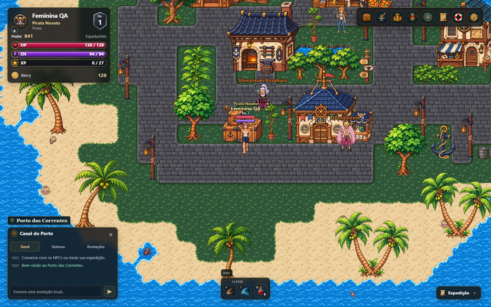
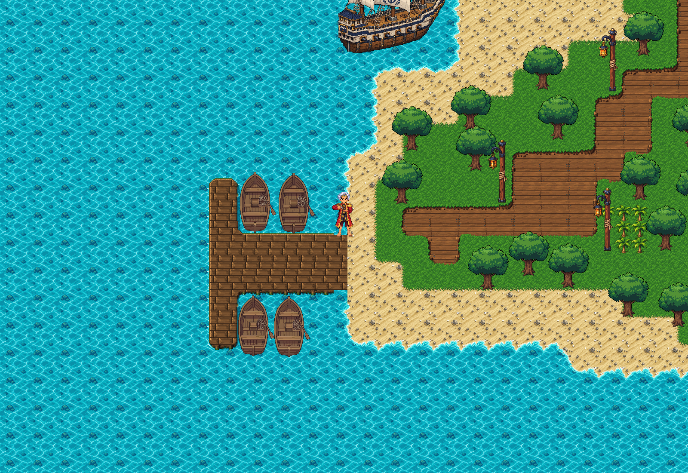
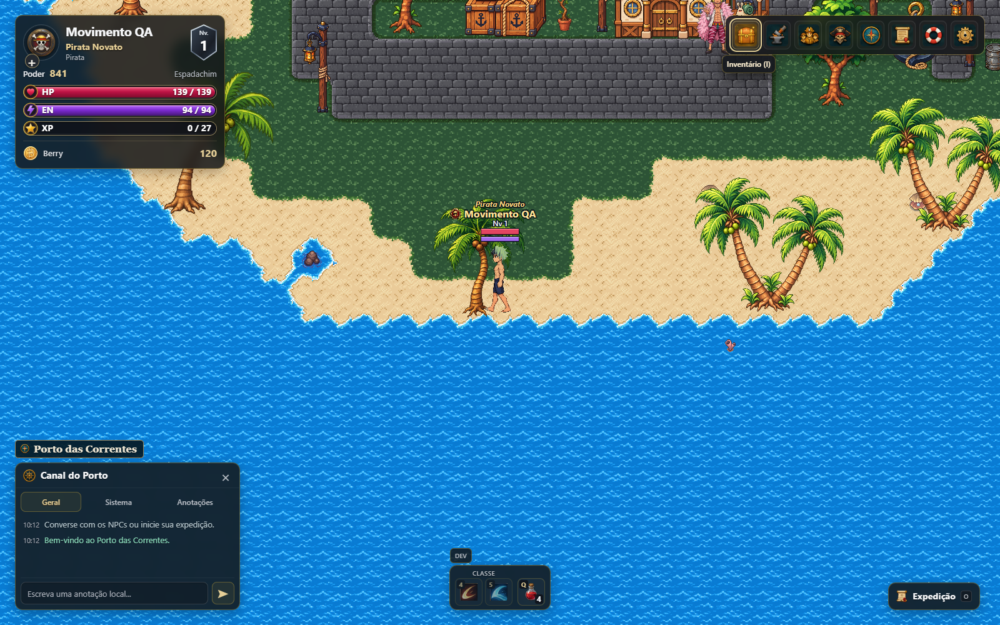

# Rework do personagem — progresso e bloqueios

**Escopo atualizado:** capas (slot cloak; defs 23, 24, 135, 142, 149, 156, 163, 170, 177 e 184) não têm impacto visual, conforme orientação do proprietário. Foram retiradas dos pedidos de arte e dos bloqueios visuais. Os resultados históricos de testes não foram reescritos: ocorrências de cloak omitido nessas rodadas deixam de ser pendências visuais. Esta revisão altera apenas o relatório, sem remover itens ou modificar atributos.

PR em rascunho, solicitado para preservar o trabalho acumulado. Não pronto para merge. Continuação do #321, que já foi integrado; base main b0d7cf81e7be357e7e4c2a6d1ff4c5f727a804d6. Nenhum merge/deploy foi executado nesta atualização.

## Correções acumuladas

- Retenção de frames por identidade, consumidor e direção; não reaproveitar NORTH/SOUTH ao pedir outra direção. Preparação das poses estáticas nas quatro direções e diagnóstico da direção efetivamente desenhada.
- Seleção prioriza o maior conjunto de equipamentos compatíveis antes de adaptar campos de aparência; conserva contratos exatos e informa campos/slots omitidos. Durante carga, usa uma fonte nativa disponível na mesma direção.
- Cabeça espelhada considera mirrorLayerIDs já declarado; mantém prova exata de pixels e âncoras.
- Cores dos cabelos femininos nomeados e da íris usam as camadas/paletas existentes. Cache é invalidado quando a API de paletas fica disponível após recarga.
- Regressões preservam identidade da família feminina 151/luva152, distinguem referência 512×512 e ataque 640×640, e exigem cinco estados da V5.
- Nenhuma mudança em PNGs de arte, escala do mapa, pivôs, combate, catálogo, IDs salvos ou regras de equipamento.

## Resultados e limites

| Verificação | Resultado | Escopo |
|---|---|---|
| Suíte Node de rework | 214/214 passaram | player-rework-*.test.cjs e testes direction-retention, integration e v5-binding; execução serial |
| Build publicável | Passou | tools/build_pages.py, saída isolada dist-direction-fix; quatro módulos conferidos por SHA-256 |
| Movimento/idle pela interface | Passou na rodada registrada | Masculino/feminino, sem equipamento e inicial, teclado nas quatro direções; build anterior ao último ajuste de cache de paletas |
| V5 por combate real | Cinco estados 0,1,3,2,4 e controle incompatível passaram | 115+151+157, SOUTH, rodada anterior ao último ajuste de cache; não confundir com todas as variantes de 115 |
| Todas as armas no ataque | 82/84 cenários passaram | 42 defs × dois corpos × quatro direções, inventário real; arma 0 omitida em ambos. Rodada dist anterior à última candidata |
| Personalização feminina na última candidata | Cabelo bob/pink e íris green passaram ao aplicar/recarregar | Estilo de olhos e pele continuam falhando na aplicação e recarga |
| Repetição de carga inicial na última candidata | 7/12 cenários sem falhas | Nenhuma direção errada/transparência nesses 12; peitorais6/7 nos dois corpos e head18 feminino tiveram slots omitidos em amostras |
| Matriz de equipamento em andamento | 133/316 cenários registrados; 50 com falhas | Foto parcial da rodada dist anterior. 158 conjuntos conhecidos/itens isolados × dois corpos; NÃO produto cartesiano de todos os slots |
| Integridade dos assets | Passou | 252 ZIPs, 16.073 PNGs nativos e 179 de cabeça; 16.252 PNGs decodificados |
| Capacetes masculinos18/19 recebidos | 6 hashes/alfas corretos; 390/390 poses da cabeça compatíveis | Fonte candidata, não capacete validado no mapa. Sem duplicar PNGs |

Candidata local: native96-8d6ab865bc7ffa0d, construída sobre a base acima com alterações locais. Os testes não são prova da produção. A construção/teste completos em checkout limpo do commit final e o CI remoto ainda precisam ser concluídos.

## Bloqueios explícitos

1. Feminina: eyeStyle=face-focused e skinColor=dark persistem, mas não chegam à arte do mapa. Outros estilos de olhos também não têm vínculo exato selecionável nos dois corpos.
2. Arma0: fonte histórica de ataque encontrada; combinação original/assinatura e contratos de outras direções ainda pendentes. Porte idle/walk sem fonte compatível localizada.
3. Peitorais6/7 e head18 feminino podem ser omitidos durante carga inicial. A correção de direção não equivale a manter todas as peças visíveis.
4. Botas/luvas e demais combinações fechadas não podem ser usadas como camadas genéricas. Cobertura completa de todas as combinações não foi executada.
5. Capacetes18/19 masculinos recebidos são candidatos com approval=false: falta política de cabelo, encaixe e equipar/ocultar/desequipar/reload no mapa.
6. Não há declaração de CI remoto verde, validação online, integração final de todas as fontes ou calibragem aprovada.

## Relatórios

- [Artes e contratos pendentes](rework-art-requests.md) — lista atual para produção, fontes históricas que não devem ser refeitas e pacote recebido.
- [Lacunas por def/corpo/ação/direção](rework-map-coverage-gaps.md) — ausência no índice não é prova de PNG inexistente.
- [Referências das máscaras de pele](female-skin-source-contracts.csv).
- [Manifesto18/19 recebido](candidates/head18-19-male-manifest.json) e [validação limitada da cabeça](candidates/head18-19-male-validation.json).

## Reprodução

Executar o materializador e a build na ordem do workflow native-hd-visual.yml. Testes novos usam MARE_TEST_URL e MARE_EVIDENCE_DIR; a matriz também recebe MARE_COVERAGE_FILE produzido por node tools/audit_rework_map_coverage.cjs <saída>. As fixtures preparam somente personagens/itens descartáveis; inventário, movimento e personalização usam controles reais. A instrumentação é aplicada pelo teste, não fica ligada na produção.

O teste tests/rework_female_appearance_ui_browser.cjs permanece falhando nos quatro pontos documentados; não foi reduzido a um teste verde parcial. As capturas/vídeos completos, saves descartáveis e builds locais não são incluídos em massa no Git. O workflow publica evidência de movimento/V5 como artefato quando executado.

## Capturas reais selecionadas

As imagens representam somente os cenários e rodadas identificados na tabela, não cobertura de todas as combinações.
