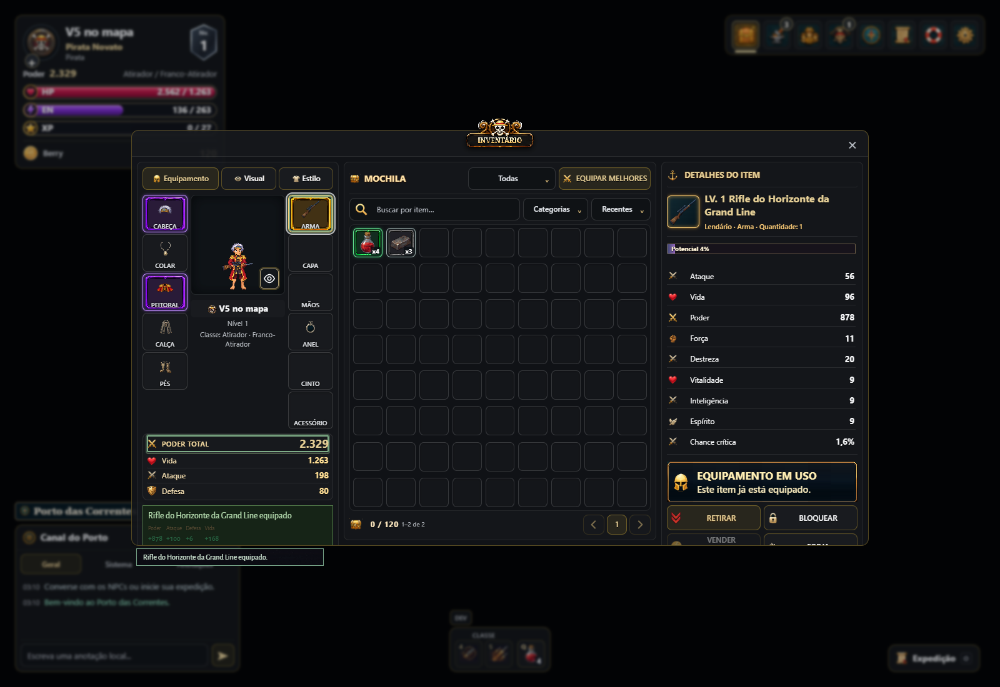
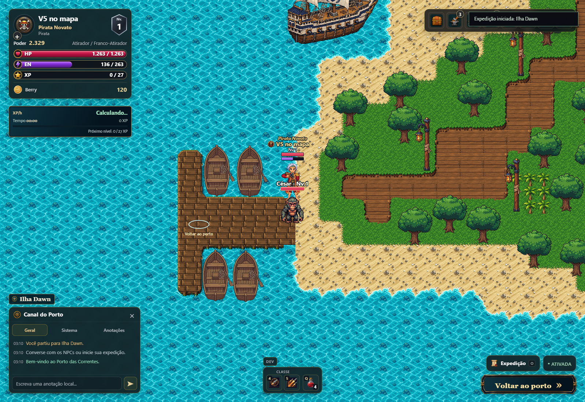

# PR #321 — vínculo exato da 115 SOUTH V5

Continuação na mesma branch `fix/rework-canonical-integration`. Sem merge ou comando de deploy.

## Causa e vínculo corrigido

O `def=115` é **Rifle do Horizonte da Grand Line**, slot `weapon`. O registro `rifle115-v5-south-native-layers` era excluído por `originalAppearanceCompatible:false`. Essa proteção era correta para uma base nua: a V5 contém corpo, roupa, diadema e mãos.

O piloto ancestral identifica **M151 / head157**. O catálogo atual confirma:

| def | Nome | Slot |
|---:|---|---|
|115|Rifle do Horizonte da Grand Line|weapon|
|151|Sobretudo do Almirante|coat|
|157|Diadema da Tormenta|head|

A origem histórica é `2801902:art-approved/weapons/mosquete4-south-v3-approved/4_SOUTH_V3_M151_157/Mosquete4_SOUTH_CanoFrontal_Editavel_Candidato.zip`. Comparação direta dos cinco backings e cinco hands: **10/10 arquivos idênticos à V5**, byte a byte. O cabelo prateado pertence ao raster do diadema, não ao cabelo salvo. A política específica dessa arte no índice de cabeça oculta o cabelo; não se alterou a política genérica de outros capacetes.

A seleção agora possui um contrato separado e restrito para essa composição:
- Masculino, SOUTH, arma115 + coat151 + head157 visível; nenhum outro slot visual.
- Paleta original/default clara, olhos originais/azuis. Outras peles/olhos não são declarados compatíveis; não há máscara de recoloração da composição.
- Hash do ZIP `d87a8ccc05a8aff100db2c7454dd40355c7dfef65e7fbc45d164005f3535d585`.
- Assinaturas fixadas de backing, equipamento, mãos e referência aprovada, em todos os estados.
- Canvas640×640, densidade4, pivô80/128 e relógio43 ticks/24fps verificados.
- Subconjuntos de fallback não podem ativar essa composição descartando outras peças.
- Ocultar o capacete, trocar corpo/roupa/arma ou cor incompatível invalida o contrato.
- Idle SOUTH reutiliza apenas o estado0 original; o ataque conserva o relógio integral.

`originalAppearanceCompatible:false` continua intacto no índice. Nenhum PNG, ZIP, máscara, pivô ou escala aprovado foi editado. As imagens renderizadas dos cinco estados foram comparadas em RGBA com os PNGs originais e coincidiram integralmente.

## Outras variantes auditadas

| Grupo | Diagnóstico | Alteração |
|---|---|---|
|48 cabelos masculinos, 12 estilos ×4 direções|A base já tinha o mesmo nome de cabelo e pulava o registro de ajuste|Usar o ajuste aprovado e validar a identidade por pixels do headBase|
|Revisões derivadas de luvas152|O primeiro registro do índice ocultava a revisão com `sourceOutfitId` explícito|Preferir a revisão somente com equipamento, corpo, pose, direção, canvas, pivô e relógio idênticos ao pai|
|48 bases idle femininas históricas|O runtime usa corpo original + cabeça separada para preservar a identidade facial|Mantidas como histórico; alternativa identificada por linha|
|Composições/paletas fora dos contratos exatos|Não são provadas pela existência de um PNG semelhante|Continuam sem cobertura declarada; não liberadas por heurística|

O CSV completo passou a ter **4.424 linhas /91 defs**, incluindo os três slots do contrato V5. As **144 linhas históricas não selecionadas** são 96 linhas de registros-pai substituídos por revisões explícitas e 48 bases femininas com cabeça separada. Nenhuma dessas 144 consultas ficou sem um registro alternativo selecionado. Isso não certifica todas as combinações possíveis.

**Separação das pendências:** não foi encontrado arquivo ausente nessas consultas dos índices. As calibragens de cabelo já existiam e foram ligadas ao runtime; os ajustes das revisões de luvas foram reutilizados, sem inventar coordenadas. Não foi necessário gerar novos PNGs para corrigir esses vínculos. Continuam sem fonte compatível comprovada as paletas não originais da V5 e combinações arbitrárias de outros equipamentos sobre seu backing composto. Essas lacunas não foram convertidas em simples “calibragem” nem declaradas resolvidas por geração de arte.

Os status `candidate`/`provisional` originais são conservados. A auditoria de resolução não promove uma fonte candidata a aprovação artística.

## Validação

- Testes de vínculo/regressão: **13/13**, incluindo rejeição de hashes alterados, corpo/slots incompatíveis, capacete oculto e fallback por subconjunto.
- **48/48** variantes masculinas idle passaram pela composição e prova de pixels da cabeça.
- Revisões de luvas: seleção/preparação nas quatro direções, masculino/feminino, idle/walk.
- Bateria focada de runtime/armas/cabeça/fallback: **50/50**; após a correção adicional do cache, núcleo/armas/fallback **44/44**.
- Build Pages: passou.
- `combat-targeted-browser.cjs`: passou na build publicada localmente, incluindo golpe desarmado real, restauração exata de weapon5, retenção dos IDs, HUD e bloqueio de movimento durante ataque. Duas asserções antigas foram corrigidas: ler `action` do renderer nativo e aceitar a fonte exata carry5 quando disponível, sem exigir sua omissão.
- Inventário/mapa: **56 capturas**, equipar/retirar, cabeça, movimento e reload; passou.
- Teste de propriedade visual: atraso de carregamento, flags antigas, fonte ausente/corrompida e troca tardia de identidade; passou.
- V5: equipados151,157 e115 pelos botões reais do inventário, reload com as mesmas instâncias e aparência; ataque oficial `heroAttack` contra alvo local controlado em SOUTH, com dano positivo; cinco estados0,1,2,4,R desenhados pelo renderer nativo. Sem substituição artificial da pose nesse teste.
- Integridade: o ZIP original e cada camada da V5 conferidos por SHA; comparação RGBA dos cinco estados passou.

O cenário de combate usa um personagem local descartável, alvo controlado e RNG determinístico, sem conta de servidor. A primeira tentativa iniciou antes do mapa carregar; o teste foi corrigido para aguardar o carregamento. Outra tentativa sofreu ausência de dano; a fixture passou a exigir linha de combate livre e RNG determinístico. Somente as execuções aprovadas são evidência final.

## CI anterior e correções

- `regressions`/`testes`: o suporte novo lia `index.json` inexistente no checkout limpo; agora também lê o transporte `index.json.gz`.
- `lobby96`: expectativa antiga de `bare-rework-base`; substituída pela validação do modo nativo/parcial com identidade preservada.
- `weapons96`/`otherWeapons96`: o diagnóstico confundia a ação genérica solicitada com a ação nativa resolvida. Agora informa a ação efetivamente selecionada.
- `shared-lobby-browser`: mapa e retrato expulsavam as poses um do outro. A chave do cache usava a instância inteira, incluindo atributos e slots não desenhados, duplicando a mesma fonte. Agora a chave usa fonte resolvida + aparência da composição, com LRU de quatro fontes. A retenção visual continua vinculada à identidade salva. A regressão de três poses simultâneas falhou antes e passou depois. O cenário completo no navegador também passou após atualizar as asserções antigas descritas acima.

Os resultados remotos pertencem ao commit consultado, não à branch em abstrato. Consulte a atualização no PR para o último SHA.

## Capturas reais




Reprodução adicional:
```text
node --test tests/rework-v5-binding.test.cjs tests/rework-integration.test.cjs
python tools/build_pages.py
MARE_TEST_URL=http://127.0.0.1:8157/dist/ node tests/rework_v5_game_browser.cjs
```
