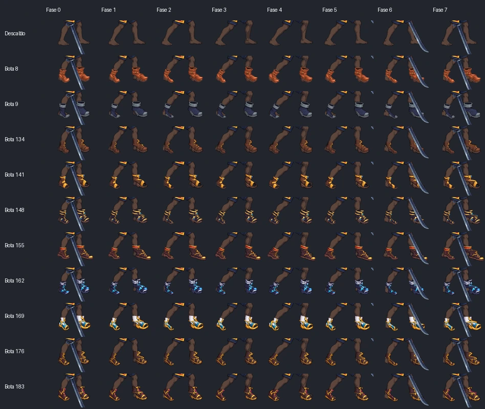

# Montagem masculina de botas e cabeça nas orbes

Código verificado em 6b20251d2e9d99a5a44a44b9044c75f2fb611664. Assinatura do build: e1cae37bafe9c0205696bc358e897cc4b7dd8d4753b03b4e80968e09c62401d2. O censo percorreu os 1.176 contextos. Os 143 contextos parciais são ataques masculinos armados. Todos os receptores com arma e sem vestuário passaram.

| Consulta de seleção | Antes (3e5ad7d) | Agora | Total |
|---|---:|---:|---:|
| Peça isolada, masculino armado | 18.675 | 18.975 | 25.200 |
| Pares, masculino armado | 361.503 | 364.583 | 504.000 |
| Conjuntos de cinco peças amostrados, masculino armado | 36.100 | 36.100 | 50.400 |

Feminino armado: 25.200 peças, 504.000 pares e 50.400 conjuntos amostrados passaram. Os dois corpos desarmados somaram 8.400 peças, 168.000 pares e 16.800 conjuntos amostrados aprovados. A enumeração direta feminina anterior, incluindo os 700.000 conjuntos do repouso desarmado Sul e os 600.000 do disparo Norte, está no [relatório do produto feminino](../censo-d7027df/).

## Fontes, montagem e desenho

Os dez grupos de bota vêm das camadas originais de cada ID. O exportador vincula biqueira, sola e cano aos pés e joelhos das três famílias articuladas. Ele verifica anatomia, fase, geometria e o espelhamento da direção. A máscara se aplica à pele do pé coberta pelo calçado. Os registros e hashes por parte estão em [desenho.json.gz](desenho.json.gz). O mesmo arquivo conserva os resultados por arma e direção e a rota efetivamente desenhada nas 78 observações do mapa.

Nos oito quadros anatômicos, 2.080 combinações de bota, arma, direção e fase foram desenhadas. Com as sustentações do relógio das orbes, o teste verificou 2.560 instantes: 960 de espada, 800 de mosquete e 800 de orbe. A comparação exige pixels originais do calçado e preservação fora de sua região de influência. Nas orbes 17 e 122, o receptor ordenado agora expõe o escalpo e a anatomia da cabeça. A verificação de cabelo usa 4.994 amostras coincidentes com a referência por fase, e o teste cobre as dez cabeças.

O ensaio do navegador percorreu as dez botas no mapa, equipando, retirando e voltando ao primeiro item nos dois sentidos para as armas 68, 4 e 17. A aparência salva usou pele ébano, cabelo azul e olhos verdes. Houve 78 desenhos de ataque verificados, com zero erros de página. A figura de ciclo mostra oito fases de espada e a captura do mapa mostra a orbe com a bota 162.

## Reprodução

Exporte o jogo com python tools/build_pages.py --static-demo e aponte HD_PUBLISHED_ROOT para a saída. Execute tests/rework-articulated-boots.cjs separadamente para sword, gunner e strategist, tests/rework-ordered-orb-anatomy.cjs e tests/rework-articulated-weapon-heads.cjs. Reproduza o censo com tools/audit-hd-wardrobe-product.cjs em PRODUCT_MODE=sample. O arquivo [censo.ndjson.gz](censo.ndjson.gz) guarda os resultados por contexto, [detalhes.tsv.gz](detalhes.tsv.gz) permite filtrar por item, [pendencias.json.gz](pendencias.json.gz) preserva as causas e [resumo.json](resumo.json) contém as contagens.

## Estado por item
As duas colunas armadas têm 504 contextos cada, a desarmada tem 168. Por item, o censo armado tem 40.320 consultas de pares e 10.080 participações em conjuntos amostrados.

| ID | Slot | Masc. armado | Fem. armado | Desarmado | Pares armados | Conjuntos amostrados armados | Estado global |
|---:|---|---:|---:|---:|---:|---:|---|
| 6 | Peitoral | 362 | 504 | 168 | 34.601 | 8.650 | Parcial |
| 7 | Peitoral | 361 | 504 | 168 | 34.600 | 8.650 | Parcial |
| 130 | Peitoral | 361 | 504 | 168 | 34.600 | 8.650 | Parcial |
| 137 | Peitoral | 361 | 504 | 168 | 34.600 | 8.650 | Parcial |
| 144 | Peitoral | 361 | 504 | 168 | 34.600 | 8.650 | Parcial |
| 151 | Peitoral | 391 | 504 | 168 | 34.842 | 8.650 | Parcial |
| 158 | Peitoral | 391 | 504 | 168 | 34.842 | 8.650 | Parcial |
| 165 | Peitoral | 391 | 504 | 168 | 34.842 | 8.650 | Parcial |
| 172 | Peitoral | 361 | 504 | 168 | 34.600 | 8.650 | Parcial |
| 179 | Peitoral | 391 | 504 | 168 | 34.842 | 8.650 | Parcial |
| 21 | Calça | 370 | 504 | 168 | 34.608 | 8.650 | Parcial |
| 22 | Calça | 362 | 504 | 168 | 34.602 | 8.650 | Parcial |
| 133 | Calça | 361 | 504 | 168 | 34.600 | 8.650 | Parcial |
| 140 | Calça | 361 | 504 | 168 | 34.600 | 8.650 | Parcial |
| 147 | Calça | 361 | 504 | 168 | 34.600 | 8.650 | Parcial |
| 154 | Calça | 361 | 504 | 168 | 34.600 | 8.650 | Parcial |
| 161 | Calça | 361 | 504 | 168 | 34.600 | 8.650 | Parcial |
| 168 | Calça | 361 | 504 | 168 | 34.600 | 8.650 | Parcial |
| 175 | Calça | 361 | 504 | 168 | 34.600 | 8.650 | Parcial |
| 182 | Calça | 361 | 504 | 168 | 34.600 | 8.650 | Parcial |
| 8 | Bota | 387 | 504 | 168 | 34.908 | 8.650 | Parcial |
| 9 | Bota | 391 | 504 | 168 | 34.917 | 8.650 | Parcial |
| 134 | Bota | 387 | 504 | 168 | 34.908 | 8.650 | Parcial |
| 141 | Bota | 387 | 504 | 168 | 34.908 | 8.650 | Parcial |
| 148 | Bota | 388 | 504 | 168 | 34.908 | 8.650 | Parcial |
| 155 | Bota | 387 | 504 | 168 | 34.908 | 8.650 | Parcial |
| 162 | Bota | 387 | 504 | 168 | 34.908 | 8.650 | Parcial |
| 169 | Bota | 387 | 504 | 168 | 34.908 | 8.650 | Parcial |
| 176 | Bota | 387 | 504 | 168 | 34.908 | 8.650 | Parcial |
| 183 | Bota | 387 | 504 | 168 | 34.908 | 8.650 | Parcial |
| 25 | Luva | 366 | 504 | 168 | 34.610 | 8.650 | Parcial |
| 26 | Luva | 361 | 504 | 168 | 34.600 | 8.650 | Parcial |
| 131 | Luva | 361 | 504 | 168 | 34.600 | 8.650 | Parcial |
| 138 | Luva | 361 | 504 | 168 | 34.600 | 8.650 | Parcial |
| 145 | Luva | 361 | 504 | 168 | 34.600 | 8.650 | Parcial |
| 152 | Luva | 361 | 504 | 168 | 34.600 | 8.650 | Parcial |
| 159 | Luva | 361 | 504 | 168 | 34.600 | 8.650 | Parcial |
| 166 | Luva | 361 | 504 | 168 | 34.600 | 8.650 | Parcial |
| 173 | Luva | 361 | 504 | 168 | 34.600 | 8.650 | Parcial |
| 180 | Luva | 361 | 504 | 168 | 34.600 | 8.650 | Parcial |
| 18 | Cabeça | 413 | 504 | 168 | 34.908 | 8.650 | Parcial |
| 19 | Cabeça | 413 | 504 | 168 | 34.908 | 8.650 | Parcial |
| 129 | Cabeça | 413 | 504 | 168 | 34.908 | 8.650 | Parcial |
| 136 | Cabeça | 413 | 504 | 168 | 34.908 | 8.650 | Parcial |
| 143 | Cabeça | 413 | 504 | 168 | 34.908 | 8.650 | Parcial |
| 150 | Cabeça | 413 | 504 | 168 | 34.908 | 8.650 | Parcial |
| 157 | Cabeça | 413 | 504 | 168 | 34.908 | 8.650 | Parcial |
| 164 | Cabeça | 415 | 504 | 168 | 34.916 | 8.650 | Parcial |
| 171 | Cabeça | 413 | 504 | 168 | 34.908 | 8.650 | Parcial |
| 178 | Cabeça | 415 | 504 | 168 | 34.908 | 8.650 | Parcial |
