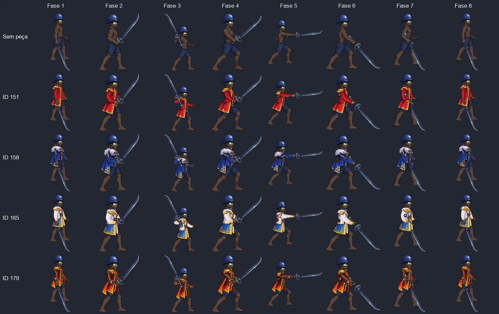

# Peitorais masculinos no golpe lateral de espada

As espadas 0, 1, 67, 68, 69 e 70 compartilham o mesmo corpo articulado e a mesma sequência anatômica de oito fases em cada sentido. Têm lâminas, pontos de empunhadura e transformações próprios. O [build 3e5ad7d](https://github.com/Eximaq/mare-partida/commit/3e5ad7d630806d32b6ac36fd0643c87bd69fbb35) conecta as quatro faixas de tecido do pacote original do sabre 1 e da nodachi 68 a essa anatomia. A assinatura do produto exportado é `01467a14412ffb2130fbab7ad04c3180d01178c74aedad258f46b4c51d258af4`.

| Origem | Aplicação verificada |
|---|---|
| Peitorais 151, 158, 165 e 179 | 32 PNGs exclusivos de roupa em `clothing/{item}/{fase}-cloth.png`, com SHA-256 validado pelo manifesto do arquivo original |
| Receptor | Pivô 80 × 128, densidade 4, registros completos de membros e materiais, crânio e relógio da espada equipada |
| Contato | Máscaras originais dos dois doadores e a silhueta do antebraço real nas fases de entrada e retorno |
| Profundidade | As mangas cobrem a anatomia de tronco e braços. A lâmina visível, os dedos, o rosto, o cabelo e o capacete mantêm suas camadas e oclusões |
| Oeste | Espelhamento único do tecido e da máscara de mão. A arma utiliza sua própria matriz de empunhadura |

O censo do recorte executou 600 consultas individuais, 12.000 pares e 1.200 conjuntos amostrados sobre as 12 poses. As quatro roupas passaram em **48 de 48** combinações de peitoral, arma e direção e funcionaram com os dez capacetes. As 12 poses ainda têm lacunas em outras roupas. [Seleção por ID e pose](selecao-12-poses.json.gz).

O teste carregou os PNGs e desenhou **384 de 384 quadros** com o capacete 19 e a aparência salva de pele ébano, cabelo azul e olhos verdes. Em cada fase, conferiu tecido próprio visível, preservação das mãos e da lâmina e igualdade de pixels fora da área do peitoral. [Teste por quadro](../../../../tests/rework-articulated-sword-coats.cjs).

No mapa, as seis armas atacaram para Leste e Oeste. O inventário trocou os peitorais 151 → 158 → 165 → 179 → 151 e retirou a peça. Foram **72 ataques observados** e zero erros do navegador. [Registro dos ataques](mapa.json.gz) · [Captura durante a troca](mapa-espada-68.webp).

O censo anterior contém a tabela dos 50 itens, as 143 poses ainda incompletas, o detalhamento por causa e as 58,8 milhões de consultas diretas femininas. [Censo do catálogo](../censo-d7027df).
