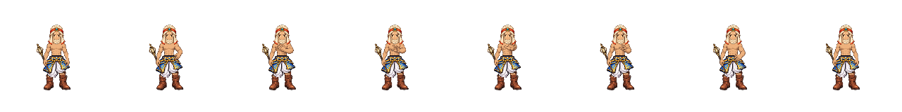
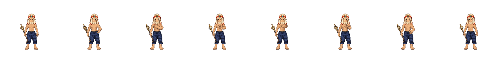
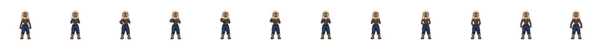
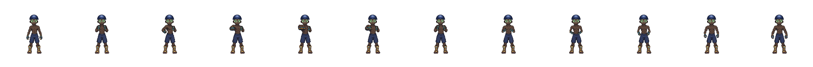
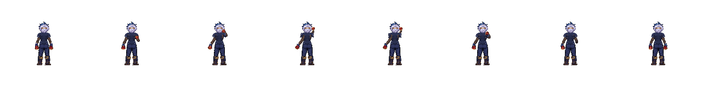
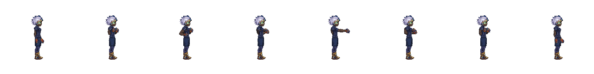
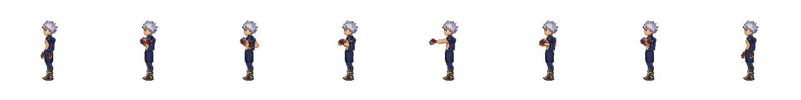

# Manopla e adagas laterais no mapa

O censo do código `6c38e70cce8c60240f252dc897fd604d28e20ab6` tem a assinatura `723760d447e0e7f29589b2de07a28d6b7af6c7d9665bffbcc5acc43ded07e557`. Há **1.056 contextos completos na seleção e 120 com lacunas**, todos em ataques masculinos armados. Os 1.176 receptores sem roupas foram selecionados. Nenhum dos 50 itens atendeu ao critério global de seleção e desenho em todas as poses. [Censo por contexto](censo.ndjson.gz) · [Resultados por item](detalhes.tsv.gz) · [Fila de causas e IDs](pendencias.json.gz) · [Resumo](resumo.json)

| Corpo e equipamento | Contextos completos | Itens individuais | Pares | Conjuntos mistos |
|---|---:|---:|---:|---:|
| Feminino armado | 504/504 | 25.200/25.200 | 504.000/504.000 | 50.400/50.400 |
| Masculino armado | 384/504 | 21.796/25.200 | 411.427/504.000 | 38.400/50.400 |
| Feminino desarmado | 84/84 | 4.200/4.200 | 84.000/84.000 | 8.400/8.400 |
| Masculino desarmado | 84/84 | 4.200/4.200 | 84.000/84.000 | 8.400/8.400 |

Cada contexto consulta 50 peças, todos os 1.000 pares entre slots e 100 conjuntos completos determinísticos. As sete classes entram separadamente nos estados desarmados. O auditor distingue falhas de receptor e de montagem. Falhas de carregamento, desenho e encaixe exigem testes adicionais com imagens. [Antes desta rodada](../norte-articulado/) · [Repouso feminino desarmado e tiros femininos para Norte](../rifles-e-foco-norte/) · [58,8 milhões de seleções femininas diretas em build anterior](../censo-d7027df/cartesiano-feminino-4ff9073.json.gz)

| Revisão | Individuais masculinos armados | Pares masculinos armados | Contextos completos |
|---|---:|---:|---:|
| ca5e805 | 19.678 | 370.795 | 361 |
| e4c4971 | 19.778 | 372.795 | 363 |
| e6bf34c | 19.898 | 373.275 | 363 |
| 6fee649 | 20.018 | 374.955 | 363 |
| 8d0b359 | 20.218 | 378.955 | 367 |
| e4cdf54 | 20.594 | 386.955 | 375 |
| 976b294 | 20.674 | 387.355 | 375 |
| f1dff07 | 20.720 | 388.355 | 376 |
| d8b7e4c | 20.800 | 388.755 | 376 |
| a5b3e21 | 20.840 | 389.555 | 376 |
| c12034b | 20.900 | 390.155 | 376 |
| 1e5fb47 | 20.960 | 391.355 | 376 |
| f3e2445 | 21.100 | 394.715 | 376 |
| 713b566 | 21.220 | 397.595 | 376 |
| a08424e | 21.260 | 398.555 | 376 |
| f09360d | 21.380 | 401.435 | 376 |
| 1d6817b | 21.460 | 403.435 | 376 |
| 9783fb2 | 21.528 | 404.275 | 376 |
| 859a53d | 21.608 | 407.075 | 380 |
| c0265d6 | 21.648 | 408.675 | 384 |
| 4eea58b | 21.712 | 409.507 | 384 |
| dd993d1 | 21.736 | 409.987 | 384 |
| 6c38e70 | 21.796 | 411.427 | 384 |

## Dez calças no ataque de foco Norte

As armas 16, 17, 31, 32, 121 e 122 passaram de 24 para 34 peças selecionadas em cada pose. Os dez novos vínculos reutilizam os painéis próprios das calças 21, 22, 133, 140, 147, 154, 161, 168, 175 e 182. Em cada fase, o ajuste usa a cintura e os dois apoios da pose real. O compositor substitui a parte contínua do short original na camada dele. A pele personalizada, o fragmento da mão presente no mesmo arquivo e a ordem dos braços e das botas são preservados.

O teste comparou **480 quadros individuais** com uma montagem independente dos pixels originais, a partir dos pontos de apoio e do recorte do short. Outros **480 quadros com capacete, bota e peitoral** confirmaram as fontes vizinhas e limitaram as diferenças à calça selecionada e à roupa substituída. Os ensaios usaram pele clara e ébano, cabelo azul e olhos verdes. No mapa, o inventário trocou as dez calças em cada arma, voltou à primeira e retirou só a calça. Foram **78 ataques**, com capacete 19, botas 148 e peitoral 151, e **6 ciclos completos de 8 quadros**. [Mapa e trocas das dez calças](calcas-foco-norte-inventario-e-mapa.jpg) · [Fontes, quadros e rastros do mapa](calcas-foco-norte-quadros.json.gz)

O pacote exportado por `python tools/build_pages.py --static-demo` foi usado no navegador, no censo e no teste de desenho. Com `HD_PUBLISHED_ROOT` apontando para esse pacote, execute `node --expose-gc tests/rework-north-focus-trousers.cjs`. O registro de cintura é reproduzido por `python tools/register_north_focus_trousers.py --verify`. O cenário de mapa usa `node tests/rework-independent-world-browser.cjs --north-focus-trousers` e `MARE_TEST_URL`.

## Peitorais na pose de foco Norte

Nas armas 16, 17, 31, 32, 121 e 122, cada receptor passou de 20 para 24 peças selecionadas entre as 50. Os quatro peitorais recuperados são 151, 158, 165 e 179. O arquivo editável da bússola fica em `art-approved/weapons/clothing-batch-20261112/16_N_M`; os dois orbes estão em `art-approved/weapons/male17-122-north-four-torsos`. Os outros três receptores têm o mesmo corpo modular, pivô, direção e relógio de oito fases. O registro valida esses dados e usa a fonte do próprio peitoral sobre a empunhadura real de cada arma.

O exportador reproduz cada quadro editorial com sua máscara, recupera o tecido que as outras fontes do mesmo item deixam visível e confere a posição do cabelo no quadro 1. Durante o desenho, o compositor usa o metal da ação atual e a mão efetivamente equipada, respeitando a transparência da borda e as partes do corpo que ficam à frente. Nenhuma peça exige os IDs das outras roupas.

| Ensaio | Cobertura executada | Resultado |
|---|---:|---|
| Seleção na pose recuperada | 6 armas × 4 peitorais × 10 capacetes × 10 botas × 2 ordens | 4.800 seleções com os mesmos IDs e fontes |
| Desenho isolado | 468 quadros em 14 armas, incluindo 192 nas seis armas de foco | Comparação RGBA com o corpo e a roupa do quadro |
| Desenho combinado no foco | 192 quadros com capacete 19 e botas 148 | Toda diferença ao retirar o peitoral ficou dentro do seu tecido |
| Oclusão no foco | 19.552 ocorrências de pixel opaco e 66.578 de borda parcial | Metal opaco preservado e bordas comparadas com a composição de referência |
| Mapa e inventário | 42 ataques, 6 ciclos completos, 8 quadros por ciclo | Trocas entre quatro peitorais, retorno ao primeiro e retirada; pele ébano, cabelo azul e olhos verdes preservados |

O censo global enumera cada peça e todos os pares em cada contexto. Os conjuntos de cinco roupas dessa rodada são amostrados. Os seis contextos de foco ainda têm lacunas em outras peças. [Quadros, fontes e rastros do mapa](foco-norte-quadros-e-mapa.json.gz) · [Ciclos das seis armas no mapa](foco-norte-seis-ciclos.png)

Para reproduzir, exporte com `python tools/build_pages.py --static-demo`, aponte `HD_PUBLISHED_ROOT` para o diretório exportado e execute `node --expose-gc tests/rework-north-focus-coats.cjs`. Para conferir as origens use `python tools/register_north_weapon_coats.py --verify`. Com o jogo servido localmente e `MARE_TEST_URL` configurado, execute `node tests/rework-independent-world-browser.cjs --north-orb-compass-coats`. Para o censo use `PRODUCT_MODE=sample` com `node tools/audit-hd-wardrobe-product.cjs <pasta>`.

## Relíquia 32 para Leste e Oeste

Cada direção passou de duas para 34 peças individuais. São dez botas, dez luvas, dez capacetes e os quatro peitorais originais 151, 158, 165 e 179. Para as luvas, cada mão recebe seu material próprio sobre os planos do antebraço do corpo original. A pintura da pele respeita a preferência de ocultação do cabelo. As dez calças e os seis peitorais restantes ainda precisam de montagem lateral.

As duas aparências passaram em 1.088 quadros individuais e 1.088 mistos. A comparação reconstruiu o peitoral com o arquivo original sobre o corpo e a arma e conferiu a área visível de cada luva. O inventário e o mapa passaram em 78 ataques, incluindo oito fases em cada direção, com zero erros do navegador. Passaram também 18 regressões da composição, incluindo duas falhas artificiais que comparam o desenho pixel a pixel após perder apenas o arquivo de uma peça. O censo ganhou 64 consultas individuais e 832 pares. [Dados por quadro e por ataque](reliquia32-leste-oeste.json.gz) · [Ciclo Leste](reliquia-32-east-ciclo.png) · [Ciclo Oeste](reliquia-32-west-ciclo.png)

## Dez calças nos quatro punhos originais para Sul

As armas 2, 3, 14 e 110 agora vestem as dez calças. Os oito desenhos originais fornecem a máscara da cintura. Nas quatro fases adicionais, a projeção do braço preserva a pele e a cobertura do metal ao passar sobre o tecido. A auditoria de pixels mediu 960 quadros individuais e 960 com peitoral, botas, luvas e capacete, em duas aparências. No mapa, 52 ataques e quatro ciclos completos exercitaram as trocas, a retirada e o retorno pelo inventário, com zero erros do navegador. [Fontes da cintura](../../../../tools/register_south_punch_trousers.py) · [Medições por quadro e mapa](dez-calcas-quatro-punhos-originais.json.gz) · [Ciclo da arma 2](calcas-punho-2-south-ciclo.png) · [Ciclo da arma 14](calcas-punho-14-south-ciclo.png)

Passaram 400.000 de 400.000 seleções diretas neste build. Somadas às quatro armas do lote anterior, as oito armas de punho cobrem 800.000 conjuntos distintos selecionados para Sul em duas revisões sucessivas. O censo geral ganhou quatro contextos completos, 40 peças individuais e 1.600 pares. [Produto direto](produto-quatro-punhos-calcas.json.gz)

## Dez peitorais nas doze fases do punho para Sul

Os nove casacos articulados usam o forro, o tronco e as mangas dos registros originais de cada ID. O peitoral 151 preserva seus oito desenhos e usa as sete partes do próprio casaco para acompanhar as quatro projeções adicionais. A ordem conserva o forro atrás do corpo, os dedos e o metal à frente da roupa e o capacete acima da gola. A regeneração do acervo comparou os pixels dos doze desenhos com o material exportado.

Passaram 1.920 quadros individuais e 1.920 com outras peças em duas aparências, além de 104 ataques no mapa e oito ciclos completos, com zero erros do navegador. As armas 111, 118, 119 e 120 passaram nas 400.000 seleções do produto direto dos cinco slots. As armas 2, 3, 14 e 110 ainda precisam da montagem das calças neste build. O ganho geral foi de quatro contextos completos, 80 consultas individuais e 2.800 pares masculinos armados. [Produto direto](produto-quatro-punhos-peitorais.json.gz) · [Medições por quadro e mapa](dez-peitorais-oito-punhos.json.gz) · [Manopla 2](peitorais-punho-2-south-ciclo.png) · [Antebraço 119](peitorais-punho-119-south-ciclo.png)

A regressão histórica de botas 8/9 e luvas 25/26 agora exige o conjunto de referência e compara os ciclos da peça isolada com o corpo sem ela. Passaram seis regressões locais de armas e ações do mapa (eighth, ninth, ordered, seventh, tenth e wardrobe-map-action). A suíte Akainu passa a fornecer o mesmo build aos testes de mapa que dependem do índice exportado.

## Bússola 16 para Leste e Oeste

As onze referências corporais da bússola coincidem quadro a quadro com o pacote modular da pose lateral. O compositor confere as referências e as oito fases, conserva a mão que cobre a bússola e usa os painéis próprios de cada roupa. Foram integradas as dez cabeças, dez botas, dez luvas e os peitorais 151, 158, 165 e 179.

Em duas aparências, o teste comparou 1.088 quadros individuais e 1.088 com as demais peças. O inventário e o mapa completaram 78 ataques, com retirada e restauração em quatro slots, dois ciclos de oito fases e zero erros do navegador. A troca histórica 14 → 16 → 31 também passou. O censo recuperou 68 seleções individuais e 840 pares. As dez calças e os seis outros peitorais continuam na fila desta pose. [Medições por quadro e mapa](bussola-lateral-quatro-slots.json.gz) · [Ciclo Leste](bussola-16-east-ciclo.png) · [Ciclo Oeste](bussola-16-west-ciclo.png)

## Luvas nos doze quadros das oito armas de punho para Sul

As armas 2, 3, 14 e 110 usam o corpo original de doze desenhos. As armas 111, 118, 119 e 120 usam a mesma silhueta de punho com as quatro projeções de antebraço e seu próprio metal. O segundo grupo distribui as doze fases em vinte instantes. Os dois punhos de cada luva vêm do registro frontal do próprio item. A montagem segue a anatomia em cada desenho e conserva o pigmento da arma nas oclusões. O caminho dos saves antigos da arma 14 preserva seu relógio original.

Passaram 1.920 quadros individuais e 1.920 com botas 169 e cabeça 19, com duas aparências. A verificação compara a roupa diante da pele, o metal translúcido, as áreas opacas e todos os pixels fora do tecido. O mapa completou 104 ataques, oito ciclos de doze desenhos, trocas de luvas e retorno à aparência anterior, com zero erros do navegador. O censo ganhou 80 consultas individuais e 2.000 pares no ataque masculino armado. No teste histórico de seleção ordenada, a etapa da manopla 14 passou e expôs uma segunda lacuna, a luva 152 com a bússola 16 para Leste. [Prova de cada quadro e do mapa](luvas-oito-punhos-sul.json.gz) · [Manopla 14](luvas-manopla-14-south-ciclo.png) · [Antebraço 119](luvas-manopla-119-south-ciclo.png)

## Luvas das seis adagas para Leste e Oeste

As adagas 12, 13 e 71–74 usam as mãos do próprio registro de ataque. Os painéis direito e esquerdo de cada luva vêm do pacote editável de adagas. A montagem segue o antebraço próximo, a mão distante que aparece ao lado da calça e o punho que fecha na abertura e na recuperação. Cada arma conserva sua lâmina dianteira, lâmina traseira e máscara de contato. A origem Oeste já tem a anatomia invertida; a roupa acompanha sua posição uma única vez.

O teste comparou 1.920 quadros individuais e 1.920 com peitoral 151, botas 169 e cabeça 19, nas duas direções e em duas aparências. Verificou os pixels fora das luvas, o contato e a lâmina exposta. Na adaga 13, a máscara original coloca os dedos à frente de todos os contatos opacos da lâmina. No mapa, as trocas no inventário produziram 156 ataques, 12 ciclos completos e zero erros do navegador. A regressão histórica da troca 12 → 74 passou. Os testes de casacos e da referência de pescoço corrigidos em 535e587 passaram nos quatro cenários locais. O censo ganhou 120 consultas individuais e 2.880 pares aprovados no ataque masculino armado. As 128 lacunas de contexto ainda incluem outras peças. [Quadros e eventos de mapa](luvas-seis-adagas.json.gz) · [Adaga 13 para Leste](luvas-adaga-13-east-ciclo.png) · [Adaga 74 para Oeste](luvas-adaga-74-west-ciclo.png)

## Luvas dos orbes 17 e 122 para Leste e Oeste

No ataque lateral de foco, a mão próxima usa o antebraço original. A mão distante abre a palma sob o orbe; o desenho difere do cajado em cinco das oito fases. As dez luvas usam seus dois materiais do arquivo editável de foco. A montagem recupera a silhueta da mão original em cada fase e aplica a máscara própria do orbe por cima da luva. Os arquivos de aparência anteriores à versão 1 passam pelo adaptador de gênero e estilo no momento do desenho, conservando as cores gravadas.

Foram comparados **640 quadros individuais e 640 com peitoral 151, botas 169 e cabeça 19**, nos dois sentidos e em duas aparências. O teste confere a palma à frente e atrás da arma, os pixels fora dos punhos, a fase final mantida até o vigésimo instante e o plano dos saves antigos. No mapa, houve 52 ataques com trocas no inventário, quatro ciclos de oito fases e zero erros no navegador. O décimo lote histórico passou nas três sequências de troca. O grupo ganhou 40 seleções individuais e 960 de pares. [Dados por arma e fase](luvas-dois-orbes.json.gz) · [Orbe 17 para Leste](luvas-orbe-17-east-ciclo.png) · [Orbe 122 para Oeste](luvas-orbe-122-west-ciclo.png)

Na [execução de referência dos testes essenciais](https://github.com/Eximaq/mare-partida/actions/runs/45133097276), a CI identificou omissões reais de luva com adagas 74 para Leste e manopla 14 para Sul. Também registrou divergências em duas regressões de casacos e testes que usavam o catálogo anterior à exportação. O nono e o décimo lote passaram localmente após as correções de espada e orbe. A [CI de propriedade do personagem](https://github.com/Eximaq/mare-partida/actions/runs/45133097254) aprovou os cinco grupos no commit de referência. A suíte de criação das HUDs excedeu o tempo de espera no navegador e continua acompanhada separadamente.

## Luvas das seis espadas para Leste e Oeste

As espadas 0, 1 e 67–70 conservam suas duas empunhaduras e suas oito fases originais. Os dez modelos de luva usam as peças de mão do pacote editável de espada e, quando a lâmina cobre o material doador, a mão independente do mesmo ID no pacote de foco. As espadas 1, 68 e 69 viram a mão próxima na abertura e na recuperação. A montagem acompanha essa virada. O corpo equipado restaura o contato de cada mão sob a máscara original, com o deslocamento de cabeça da própria fase.

O build `9f1d25e738bc40137a9248473e132ff561171058015fa884f7285e482f0e105e` passou em **1.920 comparações de quadros individuais e 1.920 com peitoral 151, botas 169 e cabeça 19**. Cada espada foi testada com duas aparências, nas duas direções. O teste confere os pixels fora dos punhos, a camada de metal e o retorno da aparência. O mapa executou **156 ataques**, 12 ciclos de oito fases e trocas A → B → A pelo inventário, com zero erros do navegador. A seleção ganhou 120 aprovações individuais e 2.880 de pares. Os 12 contextos ainda têm calças e peitorais pendentes. [Comparações e eventos reais](luvas-seis-espadas.json.gz) · [Espada 69 para Leste](luvas-espada-69-east-ciclo.png) · [Espada 70 para Oeste](luvas-espada-70-west-ciclo.png)

Os testes históricos agora utilizam o catálogo do build publicado. Os lotes oitavo e nono passaram localmente. No décimo, o ensaio de troca de espadas passou e expôs um problema separado no formato antigo de aparência com os orbes 17 e 122. A tabela distingue as consultas de seleção da validação dos quadros no mapa.

## Luvas dos sete cajados para Leste e Oeste

As dez luvas agora se prendem às duas mãos nas oito fases de ataque dos cajados 31, 123, 124, 125, 126, 127 e 128. A mão próxima e a distante vêm do material próprio da peça em `orbe-cajado-reviewed-gloves/map.json`. O punho da frente conserva a empunhadura. O cajado 128 já tinha a abertura dos dedos na camada de metal; a composição conserva o corpo original e usa essa abertura nas duas direções. A cor da pele, o cabelo e os olhos pertencem ao personagem salvo.

No build `71297313532905db438afef334f78bda919bae1eed9b46d9ff725c38a9a47a01`, foram desenhados e comparados **2.240 quadros individuais e 2.240 quadros com botas 169, peitoral 151 e cabeça 19**. Os testes verificam a imagem fora das mãos, a transparência da luva e os pontos em que o metal encobre o tecido. O mapa executou **182 ataques** com troca, retirada e retorno da luva pelo inventário, nas duas direções, com zero erros do navegador. Em 14 contextos, as luvas ganharam 140 aprovações individuais e 3.360 aprovações de pares. Calças e seis peitorais ainda têm lacunas nessas poses. Os 128 contextos masculinos pendentes continuam identificados na fila. [Medições por arma, luva, fase e aparência](luvas-sete-cajados.json.gz) · [Ciclo do cajado 127 para Leste](luvas-cajado-127-east-ciclo.png) · [Ciclo do cajado 128 para Oeste](luvas-cajado-128-west-ciclo.png)

A regressão do oitavo lote voltou a desenhar a luva 152 com o cajado 127. Na repetição local dos testes históricos dos lotes oito a onze, 26 de 28 passaram. Os dois que falharam cobram a luva 152 nas poses de espada 69 e 70. O relatório visual registra essas falhas na família de espadas. A suíte independente de caça e sincronização passou nos cinco trabalhos da [execução 45126149508](https://github.com/Eximaq/mare-partida/actions/runs/45126149508).

## Botas e calças no gesto Sul das seis armas de foco

Cada bota usa os seus painéis de frente, forro e sola, montados nos dois pés do corpo de conjuração. O ajuste segue o contorno de cada pé nas oito fases. A pele aparece nas aberturas dos modelos que as possuem. A calça conserva a sua camada acima do corpo e encontra a borda da bota. Cada uma das seis armas passou de 20 para 30 peças isoladas e de 100 para 300 pares entre slots. Restam os peitorais e as luvas de roupa nessas seis poses. [Registro dos painéis, origens, deslocamentos e oclusões](../../../../tools/rework-combat-wardrobe/south-focus-boots.json)

As doze execuções cobriram as seis armas e duas aparências. Foram 960 comparações de quadros da bota sozinha e 9.600 dos cem pares de bota e calça com o capacete 136. O teste reconstruiu os pixels da arma e da roupa ao longo de todo o ciclo. No mapa, 78 ataques exercitaram as dez botas por arma, com calça 168 e capacete 136, incluindo a retirada e o retorno pelo inventário. [Recibos por par, arma, fase e aparência](botas-seis-focos-sul.json.gz) · [Ciclo da arma 121](solas-sul-121-ciclo.png)



## Cintura no gesto Sul das seis armas de foco

Os bastões e orbes 16, 17, 31, 32, 121 e 122 usam o corpo `male-attack-focus-south-drawn8`. O registro original da calça 133 identifica o corpo, os quadros de pele e o deslocamento do arquivo. As dez calças usam dez painéis de tecido distintos. A montagem conserva o short sob 21, 22 e 133. Nas outras sete peças, remove os pixels do short que o tecido cobre. As duas mãos seguem na frente da cintura e o orbe 31 conserva a empunhadura atrás da mão. [Fontes e verificação](../../../../tools/register_south_focus_trousers.py)

No build exportado, cada uma das seis armas passou de 10 para 20 peças isoladas e de zero para 100 pares. Os testes compararam integralmente 1.920 imagens de 640 × 640 com duas aparências, oito fases e dez calças, sozinhas ou junto do capacete 136. No mapa, o inventário passou por 78 ataques, incluindo retirada, troca e retorno à primeira calça. [Recibos por arma, item, fase e aparência](calcas-seis-focos-sul.json.gz) · [Ciclo da arma 16](foco-sul-16-ciclo.png)



## Trocas durante o carregamento e combate

A revisão `d937b62` encerra imediatamente o pedido de aparência que perdeu a vez. A regressão de navegador atrasou a entrega anterior e verificou a troca com 26 pedidos a frio e 12 repetições a quente. O pacote foi conferido sobre 2.122 recursos na revisão `57a1fab`. Nos dois grupos de combate, o teste passou a observar a peça equipada e o desenho no mapa depois da troca. As duas execuções locais registraram 44 combates, 40 abates preparados e 102 abates de caçada natural. A validação correu também sem arma. [Regressão das respostas atrasadas](../../../../tests/world-visual-async.test.cjs) · [Verificação de combate no navegador](../../../../tests/paper_doll_96_weapons_browser.cjs)

## Cintura e pernas nos quatro punhos articulados

As dez calças reaproveitam seus próprios painéis da base `male-attack-unarmed-south-drawn8`. Os IDs 21, 22 e 133 conservam o short sob o tecido. Os IDs 140, 147, 154, 161, 168, 175 e 182 substituem apenas o painel do short. Nas quatro poses adicionais do ataque, os braços passam à frente da calça na cintura. O metal, o capacete e os painéis de bota mantêm sua ordem. Em cada arma (111, 118, 119 e 120), passaram 30 de 50 peças individuais e 300 de 1.000 pares. Os peitorais e as luvas de roupa continuam na fila desta pose.

Foram 1.920 comparações de quadros inteiros de 640 × 640, distribuídas pelas dez calças, quatro armas, duas paletas, doze fases e duas composições. O teste reconstrói a cintura a partir do painel de origem, da ausência ou presença do short, das duas metades da folha de braços e do metal assinado. No mapa, 52 ataques cobriram troca, retirada e retorno de cada primeira calça com os outros slots equipados. O preview exportado repetiu os 52 ataques com as mesmas fontes. [Recibos por ID, fase e aparência](calcas-bracos-sul-20.json.gz) · [Ciclo da arma 119](cintura-sul-119-ciclo.png)



## Punhos de vinte instantes para o Sul

As armas 111, 118, 119 e 120 usam doze poses ao longo de vinte instantes, a 24 por segundo. Cada arma mantém suas camadas de metal. A luva mecânica 119 aceita a cor de cabelo e de olhos salva. Os dez capacetes usam o crânio, a máscara de cabelo e os olhos da base aprovada. As dez botas usam os painéis originais e acompanham a perna da pose. Em cada uma dessas quatro armas, a seleção passou de zero para 20 de 50 peças e 100 de 1.000 pares.

Os testes compararam 960 quadros de capacetes e 1.920 de botas nas aparências clara e escura. Cruzaram os 100 pares de capacete e bota por arma nos doze quadros, totalizando 4.800 comparações de imagem. No navegador, o inventário e o mapa passaram pelas quatro armas em 108 ataques. Uma segunda execução sobre o preview estático exportado repetiu os 108 ataques com as mesmas fontes. [Resultados por arma, peça, fase e troca](quadros-bracos-sul-20-ticks.json.gz)



O teste de caminhada com o peitoral 151 repetiu 96 desenhos pelo compositor do mapa em três fases, duas direções, duas aparências e quatro modelos de calça. O ensaio de combate em Chromium passou por vinte lutas dos dois corpos, vinte abates preparados e 102 abates nas cinco caçadas contínuas. Cinco testes históricos agora solicitam a pose e a direção efetivamente usadas. A luva 152 ainda impede a aprovação dos conjuntos que a exigem nesses ataques masculinos.

## Manopla 110 para o Norte

O ataque conserva os oito quadros do arquivo `2-3-110_N_M` em 768 × 768. A base de roupas de 640 × 640 entra com margem física de 64 pixels. O metal mantém o pivô da arma. Os peitorais 151, 158, 165 e 179 usam suas mangas registradas nesse arquivo, entre o cabelo e a luva dianteira. O capacete fechado 136 volta a ocultar o cabelo conforme a política do jogo.

A pose passou de 4 para **50 peças isoladas** e selecionou os **1.000 pares** e **100.000 de 100.000 conjuntos completos**. Comparamos 1.600 quadros completos em duas aparências. Em cada aparência foram 50 peças isoladas, dez conjuntos completos mistos e os quarenta pares dos quatro peitorais registrados com as dez luvas, cada qual nos oito quadros. O mapa exibiu 26 ataques em duas sequências contínuas de trocas nos cinco slots, retirada e retorno da arma. [Produto direto, fonte por item e resultados de desenho](arma110-norte-produto-e-quadros.json.gz)



## Punhos para o Sul

Nos ataques masculinos das armas 2, 3, 14 e 110, o receptor preserva as 12 fases assinadas. O capacete usa o crânio e a máscara de cabelo da base `male-attack-unarmed-south-drawn8`. A comparação nos 5.503 pixels da máscara confere a posição em cada fase. Os dez modelos de bota usam as camadas próprias à frente e atrás das pernas e o movimento registrado na base. As quatro fases adicionais mudam os braços. A área das botas mantém a mesma anatomia do último quadro de pernas.

Cada uma dessas quatro poses passou de zero para **20 de 50 peças** e **100 de 1.000 pares** selecionados. O mapa registrou 108 ataques com os dois slots. Uma segunda execução contra o preview gerado pelo comando oficial repetiu os mesmos 108 casos e as mesmas fontes. O ensaio isolado de capacetes fez outras 64 observações. Os testes compararam 960 quadros de capacetes, 1.920 quadros de botas com e sem capacete e 4.800 quadros de todos os 400 pares. Peitorais, calças e luvas continuam pendentes nessas quatro poses. [Resultados por arma, item, pele e fase](quadros-e-mapa-punho-sul.json.gz)


## Produto direto masculino

Na revisão `24013e7ec5ab2074b8de88455223646bda9f67d3`, assinatura `598f3cebfcc8cee76c27f63b42dd5852dad1c45c9bdc03c5b4f58a103de758b3`, o auditor enumerou e selecionou **44.500.000 de 44.500.000 conjuntos completos** nos 445 contextos masculinos que então completavam a seleção. São 196 contextos de repouso, 196 de caminhada e 53 de soco, incluindo 84 contextos desarmados. Cada um dos 50 IDs participou de 10.000 conjuntos por contexto. O arquivo inclui as fontes individuais e o resultado dos 1.000 pares em cada contexto. As próximas três rodadas de ataques laterais estão documentadas abaixo com suas próprias assinaturas. Esta medição abrange a seleção. As contagens de quadros e de observações no mapa aparecem nas seções de cada arma. [Resultados dos 445 contextos](produto-masculino-24013e7.json.gz)

## Manopla 110

A manopla usa a mesma silhueta da pose lateral de soco. A montagem preserva o metal próprio e as cores registradas nas bordas que continuam descobertas após vestir o personagem. O cabelo, a íris e a pele vêm da aparência salva. O Oeste usa o espelhamento indicado pela fonte. O auditor direto percorreu **100.000/100.000 conjuntos a Leste e 100.000/100.000 a Oeste** no código `e4c4971`, assinatura `4507d75c4dac5a9ee76ccbf073f9aa8a37e129fe0715e58e4dc7492e0e455382`. As 960 comparações das imagens finais cobrem os oito quadros de 50 peças isoladas e dez conjuntos por direção. O mapa registrou 26 ataques alternando os cinco slots, retirada e retorno da arma, duas aparências e duas ordens de equipar. [Seleções diretas com resultados por ID](produto-manopla-110.json.gz) · [Registros das comparações de pixels e ataques](quadros-e-mapa.json.gz)


## Manoplas 2 e 3

O metal das duas armas tem arquivos próprios já orientados a Leste e Oeste. O jogo mantém o movimento dos punhos e aplica as cinco peças à anatomia compartilhada. O censo direto selecionou os 400.000 conjuntos das duas armas nas duas direções. As comparações de pixels cobriram os oito quadros de 50 itens e dez conjuntos por direção e arma, totalizando 1.920 imagens. O mapa registrou 52 ataques durante trocas de equipamento, retirada e retorno da arma. [Seleção por item e contexto](produto-punhos-2-3.json.gz) · [Resultados por quadro e registros do mapa](quadros-punhos-2-3.json.gz)




## Manoplas 111 e 112 e braços mecânicos 118 e 119

As quatro armas usam o próprio metal e os quadros da pose lateral. As armas 118 e 119 distribuem oito poses em 20 instantes, com retenção do quadro final. Os casacos 151, 158, 165 e 179 usam as mangas originais e o deslocamento de punho do próprio registro. Na 111, cinco fases têm contorno diferente no braço. Na 119, a borda semitransparente do metal tem uma cobertura adicional em três fases. A montagem preserva essas diferenças na camada de origem. Cabelo, olhos e pele acompanham a aparência salva. [Seleção e desenho](../../../../player-rework-native-hd.js) · [Origens do metal e do punho](../../../../player-rework-weapon-native-hd.js)

O produto direto selecionou **800.000 de 800.000 conjuntos**. A comparação independente de pixels cobriu **3.840 quadros** dos 50 itens isolados e dez conjuntos completos por arma e direção. Outros **192 quadros** reproduziram as imagens aprovadas dos casacos e seus punhos. No mapa foram **104 ataques observados** com as cinco peças equipadas durante as trocas, duas aparências, retirada e retorno da arma, alterações A → B → A e ordem inversa. A falha induzida ao carregar uma manga da 118 ficou isolada naquele slot e a peça reapareceu após a recuperação. [Seleção por ID](produto-punhos-111-112-118-119.json.gz) · [Quadros e registros do mapa](quadros-punhos-111-112-118-119.json.gz) · [Teste reproduzível](../../../../tests/rework-lateral-gauntlet-wardrobe.cjs)


## Botas nas seis adagas

As lâminas 12, 13, 71, 72, 73 e 74 compartilham a anatomia dos tornozelos a Leste e Oeste. Cada arma tem sua própria máscara que restaura a mão e o corpo depois da lâmina dianteira. Aplicar a bota apenas à primeira passagem do corpo fazia a máscara recompor a pele em cima dela. Agora as duas passagens usam a bota selecionada, preservando a ordem das duas lâminas. O registro verifica a anatomia sob toda a área alterada em cada fase. As dez botas usam seus próprios grupos dianteiro e traseiro. As origens, os pivôs e a posição por fase estão no registro reproduzível. [Registro e conferência dos doadores](../../../../tools/export_articulated_boots.py) · [Teste contra a recomposição independente](../../../../tests/rework-lateral-dagger-boots.cjs)

Nas 960 imagens finais, cada bota produziu ao menos 3.749 pixels diferentes do pé descoberto. Foram verificadas as quatro opções de peitoral já integradas à pose nas duas ordens de montagem. O mapa registrou 156 ataques com o peitoral 151, as dez botas, retorno à primeira bota e retirada individual. Houve captura dos oito quadros das seis armas nas duas direções. Abaixo estão dois dos doze ciclos. [Registros de quadros e mapa](quadros-e-mapa.json.gz)


## Capacetes nas seis adagas

Os dez equipamentos de cabeça usam o crânio, o nariz e a nuca da pose assinada. O registro de ataque desloca o grupo inteiro oito pixels físicos para trás e quatro para baixo. A Leste e Oeste, todos os 4.994 pixels da área do cabelo coincidiram com a referência em cada fase; as lâminas ficaram fora dessa área. Para capacetes fechados o jogo revela a pele da aparência salva. O capacete é desenhado com seu próprio ajuste após as mangas. Os testes confrontaram 960 quadros novos (mais 480 quadros de regressão a Norte). O mapa registrou 180 ataques nas seis armas com botas 148 e peitoral 151, alternando as dez cabeças, ocultação e retorno, ordem inversa e duas aparências salvas. [Fontes e comparação de pixels](../../../../tests/rework-articulated-weapon-heads.cjs) · [Registros dos testes de cabeça](capacetes-quadros-e-mapa.json.gz)


Para repetir, execute `node --expose-gc tests/rework-articulated-weapon-heads.cjs rogue`. No navegador, use `--dagger-heads=east` e `--dagger-heads=west` no mesmo teste de mapa.

## Execução

Exporte o jogo com `python tools/build_pages.py --static-demo` e defina `HD_PUBLISHED_ROOT` para o diretório exportado. Para repetir cada lote, use os comandos abaixo. O navegador usa `MARE_TEST_URL` e `MARE_EVIDENCE_DIR`.

```sh
python tools/export_articulated_boots.py --daggers --verify
node --expose-gc tests/rework-lateral-gauntlet-wardrobe.cjs east
node --expose-gc tests/rework-lateral-gauntlet-wardrobe.cjs west light
node --expose-gc tests/rework-lateral-dagger-boots.cjs east
node --expose-gc tests/rework-lateral-dagger-boots.cjs west
node tests/rework-independent-world-browser.cjs --lateral-gauntlet-wardrobe
for w in 111 112 118 119; do
  node --expose-gc tests/rework-lateral-gauntlet-wardrobe.cjs east ebony "$w"
  node --expose-gc tests/rework-lateral-gauntlet-wardrobe.cjs west light "$w"
  node tests/rework-independent-world-browser.cjs "--lateral-gauntlet=$w"
done
node tests/rework-registered-weapon-coats.cjs
node --test tests/rework-sn4-approved-preview.test.cjs
node tests/rework-independent-world-browser.cjs --dagger-boots=east
node tests/rework-independent-world-browser.cjs --dagger-boots=west
PRODUCT_MODE=sample node tools/audit-hd-wardrobe-product.cjs resultados
PRODUCT_MODE=direct PRODUCT_FILTER='{"body":["masculino"],"weapon":[2,3,110,111,112,118,119],"direction":["east","west"],"action":["attack-unarmed"]}' node tools/audit-hd-wardrobe-product.cjs resultados
```

## Situação dos 50 itens

As colunas individuais contam até 504 contextos armados por corpo e 168 desarmados entre os dois corpos. Pares e conjuntos são as participações aprovadas do item nos contextos armados dos dois corpos. Para obter a cobertura por arma, ação e lado, consulte o [detalhamento](detalhes.tsv.gz).

| ID | Slot | Masculino armado | Feminino armado | Desarmado | Pares armados | Conjuntos amostrados armados | Global |
|---:|---|---:|---:|---:|---:|---:|---|
| 6 | Peitoral | 385 | 504 | 168 | 35.521 | 8.880 | Parcial |
| 7 | Peitoral | 384 | 504 | 168 | 35.520 | 8.880 | Parcial |
| 130 | Peitoral | 384 | 504 | 168 | 35.520 | 8.880 | Parcial |
| 137 | Peitoral | 384 | 504 | 168 | 35.520 | 8.880 | Parcial |
| 144 | Peitoral | 384 | 504 | 168 | 35.520 | 8.880 | Parcial |
| 151 | Peitoral | 444 | 504 | 168 | 37.123 | 8.880 | Parcial |
| 158 | Peitoral | 444 | 504 | 168 | 37.123 | 8.880 | Parcial |
| 165 | Peitoral | 444 | 504 | 168 | 37.123 | 8.880 | Parcial |
| 172 | Peitoral | 384 | 504 | 168 | 35.520 | 8.880 | Parcial |
| 179 | Peitoral | 444 | 504 | 168 | 37.123 | 8.880 | Parcial |
| 21 | Calça | 405 | 504 | 168 | 35.896 | 8.880 | Parcial |
| 22 | Calça | 402 | 504 | 168 | 35.886 | 8.880 | Parcial |
| 133 | Calça | 401 | 504 | 168 | 35.884 | 8.880 | Parcial |
| 140 | Calça | 401 | 504 | 168 | 35.884 | 8.880 | Parcial |
| 147 | Calça | 401 | 504 | 168 | 35.884 | 8.880 | Parcial |
| 154 | Calça | 401 | 504 | 168 | 35.884 | 8.880 | Parcial |
| 161 | Calça | 401 | 504 | 168 | 35.884 | 8.880 | Parcial |
| 168 | Calça | 401 | 504 | 168 | 35.884 | 8.880 | Parcial |
| 175 | Calça | 401 | 504 | 168 | 35.884 | 8.880 | Parcial |
| 182 | Calça | 401 | 504 | 168 | 35.884 | 8.880 | Parcial |
| 8 | Bota | 468 | 504 | 168 | 37.206 | 8.880 | Parcial |
| 9 | Bota | 472 | 504 | 168 | 37.219 | 8.880 | Parcial |
| 134 | Bota | 468 | 504 | 168 | 37.206 | 8.880 | Parcial |
| 141 | Bota | 468 | 504 | 168 | 37.206 | 8.880 | Parcial |
| 148 | Bota | 469 | 504 | 168 | 37.206 | 8.880 | Parcial |
| 155 | Bota | 468 | 504 | 168 | 37.206 | 8.880 | Parcial |
| 162 | Bota | 468 | 504 | 168 | 37.206 | 8.880 | Parcial |
| 169 | Bota | 468 | 504 | 168 | 37.206 | 8.880 | Parcial |
| 176 | Bota | 468 | 504 | 168 | 37.206 | 8.880 | Parcial |
| 183 | Bota | 468 | 504 | 168 | 37.206 | 8.880 | Parcial |
| 25 | Luva | 435 | 504 | 168 | 36.638 | 8.880 | Parcial |
| 26 | Luva | 430 | 504 | 168 | 36.624 | 8.880 | Parcial |
| 131 | Luva | 430 | 504 | 168 | 36.624 | 8.880 | Parcial |
| 138 | Luva | 430 | 504 | 168 | 36.624 | 8.880 | Parcial |
| 145 | Luva | 430 | 504 | 168 | 36.624 | 8.880 | Parcial |
| 152 | Luva | 430 | 504 | 168 | 36.624 | 8.880 | Parcial |
| 159 | Luva | 430 | 504 | 168 | 36.624 | 8.880 | Parcial |
| 166 | Luva | 430 | 504 | 168 | 36.624 | 8.880 | Parcial |
| 173 | Luva | 430 | 504 | 168 | 36.624 | 8.880 | Parcial |
| 180 | Luva | 430 | 504 | 168 | 36.624 | 8.880 | Parcial |
| 18 | Cabeça | 471 | 504 | 168 | 37.206 | 8.880 | Parcial |
| 19 | Cabeça | 471 | 504 | 168 | 37.206 | 8.880 | Parcial |
| 129 | Cabeça | 471 | 504 | 168 | 37.206 | 8.880 | Parcial |
| 136 | Cabeça | 471 | 504 | 168 | 37.206 | 8.880 | Parcial |
| 143 | Cabeça | 471 | 504 | 168 | 37.206 | 8.880 | Parcial |
| 150 | Cabeça | 471 | 504 | 168 | 37.206 | 8.880 | Parcial |
| 157 | Cabeça | 471 | 504 | 168 | 37.206 | 8.880 | Parcial |
| 164 | Cabeça | 471 | 504 | 168 | 37.206 | 8.880 | Parcial |
| 171 | Cabeça | 471 | 504 | 168 | 37.206 | 8.880 | Parcial |
| 178 | Cabeça | 471 | 504 | 168 | 37.206 | 8.880 | Parcial |
