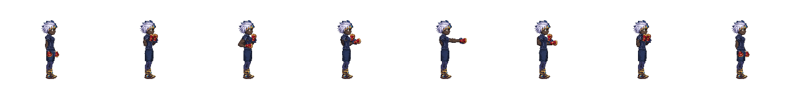
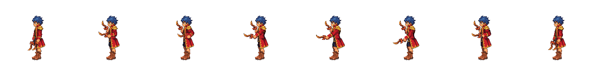

# Manopla e adagas laterais no mapa

O censo do código `8d0b35933f73da1e0755b61f2e350aa0ca3f5e21` tem a assinatura `af3819cd7db7f1d048a76a82147cd34927ad24ac146d443de6201f47ce40cf74`. Há **1.039 contextos completos na seleção e 137 com lacunas**, todos em ataques masculinos armados. Os 1.176 receptores sem roupas foram selecionados. Nenhum dos 50 itens atendeu ao critério global de seleção e desenho em todas as poses. [Censo por contexto](censo.ndjson.gz) · [Resultados por item](detalhes.tsv.gz) · [Fila de causas e IDs](pendencias.json.gz) · [Resumo](resumo.json)

| Corpo e equipamento | Contextos completos | Itens individuais | Pares | Conjuntos mistos |
|---|---:|---:|---:|---:|
| Feminino armado | 504/504 | 25.200/25.200 | 504.000/504.000 | 50.400/50.400 |
| Masculino armado | 367/504 | 20.218/25.200 | 378.955/504.000 | 36.700/50.400 |
| Feminino desarmado | 84/84 | 4.200/4.200 | 84.000/84.000 | 8.400/8.400 |
| Masculino desarmado | 84/84 | 4.200/4.200 | 84.000/84.000 | 8.400/8.400 |

Cada contexto consulta 50 peças, todos os 1.000 pares entre slots e 100 conjuntos completos determinísticos. As sete classes entram separadamente nos estados desarmados. O auditor distingue falhas de receptor e de montagem. Falhas de carregamento, desenho e encaixe exigem testes adicionais com imagens. [Antes desta rodada](../norte-articulado/) · [Repouso feminino desarmado e tiros femininos para Norte](../rifles-e-foco-norte/) · [58,8 milhões de seleções femininas diretas em build anterior](../censo-d7027df/cartesiano-feminino-4ff9073.json.gz)

| Revisão | Individuais masculinos armados | Pares masculinos armados | Contextos completos |
|---|---:|---:|---:|
| ca5e805 | 19.678 | 370.795 | 361 |
| e4c4971 | 19.778 | 372.795 | 363 |
| e6bf34c | 19.898 | 373.275 | 363 |
| 6fee649 | 20.018 | 374.955 | 363 |
| 8d0b359 | 20.218 | 378.955 | 367 |

## Manopla 110

A manopla usa a mesma silhueta da pose lateral de soco. A montagem preserva o metal próprio e as cores registradas nas bordas que continuam descobertas após vestir o personagem. O cabelo, a íris e a pele vêm da aparência salva. O Oeste usa o espelhamento indicado pela fonte. O auditor direto percorreu **100.000/100.000 conjuntos a Leste e 100.000/100.000 a Oeste** no código `e4c4971`, assinatura `4507d75c4dac5a9ee76ccbf073f9aa8a37e129fe0715e58e4dc7492e0e455382`. As 960 comparações das imagens finais cobrem os oito quadros de 50 peças isoladas e dez conjuntos por direção. O mapa registrou 26 ataques alternando os cinco slots, retirada e retorno da arma, duas aparências e duas ordens de equipar. [Seleções diretas com resultados por ID](produto-manopla-110.json.gz) · [Registros das comparações de pixels e ataques](quadros-e-mapa.json.gz)




## Manoplas 2 e 3

O metal das duas armas tem arquivos próprios já orientados a Leste e Oeste. O jogo mantém o movimento dos punhos e aplica as cinco peças à anatomia compartilhada. O censo direto selecionou os 400.000 conjuntos das duas armas nas duas direções. As comparações de pixels cobriram os oito quadros de 50 itens e dez conjuntos por direção e arma, totalizando 1.920 imagens. O mapa registrou 52 ataques durante trocas de equipamento, retirada e retorno da arma. [Seleção por item e contexto](produto-punhos-2-3.json.gz) · [Resultados por quadro e registros do mapa](quadros-punhos-2-3.json.gz)


## Botas nas seis adagas

As lâminas 12, 13, 71, 72, 73 e 74 compartilham a anatomia dos tornozelos a Leste e Oeste. Cada arma tem sua própria máscara que restaura a mão e o corpo depois da lâmina dianteira. Aplicar a bota apenas à primeira passagem do corpo fazia a máscara recompor a pele em cima dela. Agora as duas passagens usam a bota selecionada, preservando a ordem das duas lâminas. O registro verifica a anatomia sob toda a área alterada em cada fase. As dez botas usam seus próprios grupos dianteiro e traseiro. As origens, os pivôs e a posição por fase estão no registro reproduzível. [Registro e conferência dos doadores](../../../../tools/export_articulated_boots.py) · [Teste contra a recomposição independente](../../../../tests/rework-lateral-dagger-boots.cjs)

Nas 960 imagens finais, cada bota produziu ao menos 3.749 pixels diferentes do pé descoberto. Foram verificadas as quatro opções de peitoral já integradas à pose nas duas ordens de montagem. O mapa registrou 156 ataques com o peitoral 151, as dez botas, retorno à primeira bota e retirada individual. Houve captura dos oito quadros das seis armas nas duas direções. Abaixo estão dois dos doze ciclos. [Registros de quadros e mapa](quadros-e-mapa.json.gz)




## Capacetes nas seis adagas

Os dez equipamentos de cabeça usam o crânio, o nariz e a nuca da pose assinada. O registro de ataque desloca o grupo inteiro oito pixels físicos para trás e quatro para baixo. A Leste e Oeste, todos os 4.994 pixels da área do cabelo coincidiram com a referência em cada fase; as lâminas ficaram fora dessa área. Para capacetes fechados o jogo revela a pele da aparência salva. O capacete é desenhado com seu próprio ajuste após as mangas. Os testes confrontaram 960 quadros novos (mais 480 quadros de regressão a Norte). O mapa registrou 180 ataques nas seis armas com botas 148 e peitoral 151, alternando as dez cabeças, ocultação e retorno, ordem inversa e duas aparências salvas. [Fontes e comparação de pixels](../../../../tests/rework-articulated-weapon-heads.cjs) · [Registros dos testes de cabeça](capacetes-quadros-e-mapa.json.gz)


Para repetir, execute `node --expose-gc tests/rework-articulated-weapon-heads.cjs rogue`. No navegador, use `--dagger-heads=east` e `--dagger-heads=west` no mesmo teste de mapa.

## Execução

Exporte o jogo com `python tools/build_pages.py --static-demo` e defina `HD_PUBLISHED_ROOT` para o diretório exportado. Para repetir cada lote, use os comandos abaixo. O navegador usa `MARE_TEST_URL` e `MARE_EVIDENCE_DIR`.

```sh
python tools/export_articulated_boots.py --daggers --verify
node --expose-gc tests/rework-lateral-gauntlet-wardrobe.cjs east
node --expose-gc tests/rework-lateral-gauntlet-wardrobe.cjs west light
node --expose-gc tests/rework-lateral-dagger-boots.cjs east
node --expose-gc tests/rework-lateral-dagger-boots.cjs west
node tests/rework-independent-world-browser.cjs --lateral-gauntlet-wardrobe
node tests/rework-independent-world-browser.cjs --dagger-boots=east
node tests/rework-independent-world-browser.cjs --dagger-boots=west
PRODUCT_MODE=sample node tools/audit-hd-wardrobe-product.cjs resultados
PRODUCT_MODE=direct PRODUCT_FILTER='{"body":["masculino"],"weapon":[2,3,110],"direction":["east","west"],"action":["attack-unarmed"]}' node tools/audit-hd-wardrobe-product.cjs resultados
```

## Situação dos 50 itens

As colunas individuais contam até 504 contextos armados por corpo e 168 desarmados entre os dois corpos. Pares e conjuntos são as participações aprovadas do item nos contextos armados dos dois corpos. Para obter a cobertura por arma, ação e lado, consulte o [detalhamento](detalhes.tsv.gz).

| ID | Slot | Masculino armado | Feminino armado | Desarmado | Pares armados | Conjuntos amostrados armados | Global |
|---:|---|---:|---:|---:|---:|---:|---|
| 6 | Peitoral | 368 | 504 | 168 | 34.841 | 8.710 | Parcial |
| 7 | Peitoral | 367 | 504 | 168 | 34.840 | 8.710 | Parcial |
| 130 | Peitoral | 367 | 504 | 168 | 34.840 | 8.710 | Parcial |
| 137 | Peitoral | 367 | 504 | 168 | 34.840 | 8.710 | Parcial |
| 144 | Peitoral | 367 | 504 | 168 | 34.840 | 8.710 | Parcial |
| 151 | Peitoral | 424 | 504 | 168 | 35.725 | 8.710 | Parcial |
| 158 | Peitoral | 424 | 504 | 168 | 35.725 | 8.710 | Parcial |
| 165 | Peitoral | 424 | 504 | 168 | 35.725 | 8.710 | Parcial |
| 172 | Peitoral | 367 | 504 | 168 | 34.840 | 8.710 | Parcial |
| 179 | Peitoral | 424 | 504 | 168 | 35.725 | 8.710 | Parcial |
| 21 | Calça | 376 | 504 | 168 | 34.952 | 8.710 | Parcial |
| 22 | Calça | 373 | 504 | 168 | 34.942 | 8.710 | Parcial |
| 133 | Calça | 372 | 504 | 168 | 34.940 | 8.710 | Parcial |
| 140 | Calça | 372 | 504 | 168 | 34.940 | 8.710 | Parcial |
| 147 | Calça | 372 | 504 | 168 | 34.940 | 8.710 | Parcial |
| 154 | Calça | 372 | 504 | 168 | 34.940 | 8.710 | Parcial |
| 161 | Calça | 372 | 504 | 168 | 34.940 | 8.710 | Parcial |
| 168 | Calça | 372 | 504 | 168 | 34.940 | 8.710 | Parcial |
| 175 | Calça | 372 | 504 | 168 | 34.940 | 8.710 | Parcial |
| 182 | Calça | 372 | 504 | 168 | 34.940 | 8.710 | Parcial |
| 8 | Bota | 441 | 504 | 168 | 35.806 | 8.710 | Parcial |
| 9 | Bota | 445 | 504 | 168 | 35.819 | 8.710 | Parcial |
| 134 | Bota | 441 | 504 | 168 | 35.806 | 8.710 | Parcial |
| 141 | Bota | 441 | 504 | 168 | 35.806 | 8.710 | Parcial |
| 148 | Bota | 442 | 504 | 168 | 35.806 | 8.710 | Parcial |
| 155 | Bota | 441 | 504 | 168 | 35.806 | 8.710 | Parcial |
| 162 | Bota | 441 | 504 | 168 | 35.806 | 8.710 | Parcial |
| 169 | Bota | 441 | 504 | 168 | 35.806 | 8.710 | Parcial |
| 176 | Bota | 441 | 504 | 168 | 35.806 | 8.710 | Parcial |
| 183 | Bota | 441 | 504 | 168 | 35.806 | 8.710 | Parcial |
| 25 | Luva | 372 | 504 | 168 | 34.854 | 8.710 | Parcial |
| 26 | Luva | 367 | 504 | 168 | 34.840 | 8.710 | Parcial |
| 131 | Luva | 367 | 504 | 168 | 34.840 | 8.710 | Parcial |
| 138 | Luva | 367 | 504 | 168 | 34.840 | 8.710 | Parcial |
| 145 | Luva | 367 | 504 | 168 | 34.840 | 8.710 | Parcial |
| 152 | Luva | 367 | 504 | 168 | 34.840 | 8.710 | Parcial |
| 159 | Luva | 367 | 504 | 168 | 34.840 | 8.710 | Parcial |
| 166 | Luva | 367 | 504 | 168 | 34.840 | 8.710 | Parcial |
| 173 | Luva | 367 | 504 | 168 | 34.840 | 8.710 | Parcial |
| 180 | Luva | 367 | 504 | 168 | 34.840 | 8.710 | Parcial |
| 18 | Cabeça | 450 | 504 | 168 | 35.806 | 8.710 | Parcial |
| 19 | Cabeça | 450 | 504 | 168 | 35.806 | 8.710 | Parcial |
| 129 | Cabeça | 450 | 504 | 168 | 35.806 | 8.710 | Parcial |
| 136 | Cabeça | 450 | 504 | 168 | 35.806 | 8.710 | Parcial |
| 143 | Cabeça | 450 | 504 | 168 | 35.806 | 8.710 | Parcial |
| 150 | Cabeça | 450 | 504 | 168 | 35.806 | 8.710 | Parcial |
| 157 | Cabeça | 450 | 504 | 168 | 35.806 | 8.710 | Parcial |
| 164 | Cabeça | 452 | 504 | 168 | 35.814 | 8.710 | Parcial |
| 171 | Cabeça | 450 | 504 | 168 | 35.806 | 8.710 | Parcial |
| 178 | Cabeça | 452 | 504 | 168 | 35.806 | 8.710 | Parcial |
