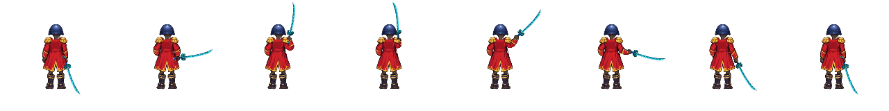
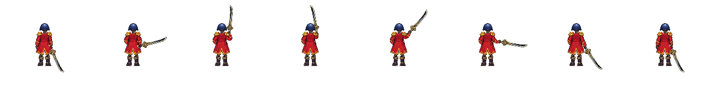
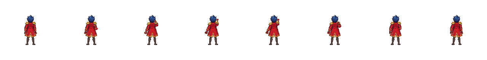

# Botas e peitorais no ataque masculino para Norte

Build do censo `ca5e80599262bbfad6a2fa30aaa406ea0a835f7e`, assinatura `5fa508894cd8d6f4ac80f5ff518bec1e50b313508def8aa53be7d6e9ab5bc8ce`. A seleção passou em 1.033 dos 1.176 contextos. Os 143 contextos com lacunas ficam nos ataques masculinos armados. Nenhum dos 50 itens fechou todos os contextos obrigatórios. [Resumo](resumo.json) · [Resultados por ID e contexto](detalhes.tsv.gz) · [Registros do auditor](censo.ndjson.gz) · [Causas e IDs pendentes](pendencias.json.gz)

| Corpo e arma | Contextos completos | Individuais | Pares | Conjuntos mistos |
|---|---:|---:|---:|---:|
| Feminino, 42 armas | 504/504 | 25.200/25.200 | 504.000/504.000 | 50.400/50.400 |
| Masculino, 42 armas | 361/504 | 19.678/25.200 | 370.795/504.000 | 36.100/50.400 |
| Feminino, desarmado | 84/84 | 4.200/4.200 | 84.000/84.000 | 8.400/8.400 |
| Masculino, desarmado | 84/84 | 4.200/4.200 | 84.000/84.000 | 8.400/8.400 |

Cada contexto testa o receptor sem roupas, 50 peças individuais, todos os 1.000 pares entre slots e 100 conjuntos mistos determinísticos. As sete classes entram separadamente na contagem desarmada. O [produto direto feminino](../censo-d7027df/cartesiano-feminino-4ff9073.json.gz) tem uma assinatura própria e 58,8 milhões de seleções. O [relatório anterior](../rifles-e-foco-norte/) contém a comparação dos tiros, dos cajados e do repouso.

## O que mudou no mapa

**Botas.** As dez botas usam os grupos dianteiro e traseiro da própria peça. A montagem segue os dois contornos de panturrilha e os apoios da sola em cada uma das oito fases de espada, adagas e foco para Norte. O teste verifica a origem de cada grupo no ataque desarmado e os pixels finais com a arma e o capacete 19 equipados. Foram 1.360 comparações completas, 17 armas × 10 botas × 8 fases. Em cada quadro, ao menos 5.692 pixels mudaram na área própria da peça. O navegador registrou 221 ataques com troca pelo inventário, retirada e retorno à primeira bota. [Identidades e fontes dos doadores](../../../../tools/rework-combat-wardrobe/north-boot-donors.json) · [Registro de encaixe](../../../../tools/register_north_articulated_boots.py)

**Peitorais.** Os peitorais 151, 158, 165 e 179 usam os passes de tecido e de proteção dos arquivos editáveis de cada arma. A recomposição precisa reproduzir o original em todas as fases e manter o pivô mesmo quando a espada usa margem de 64 pixels. São 96 quadros novos nas armas 67, 70 e 110 e 180 quadros de regressão nos cinco cajados. Nas duas espadas o teste cruzou os quatro peitorais com dez cabeças e dez botas, em duas ordens de montagem. O navegador registrou 21 ataques e capturou os oito quadros de cada uma das três armas no canvas do mapa. As espadas mantiveram a bota 148 e o capacete 19. O ensaio também verificou retirada, retorno ao peitoral 151 e preservação da aparência salva. [Receitas e fontes de tecido](../../../../tools/register_north_weapon_coats.py) · [Registros dos quadros e ataques](quadros-e-mapa.json.gz)

| Código | Roupas isoladas nos ataques e movimentos masculinos armados | Pares |
|---|---:|---:|
| 24013e7 | 19.496 | 368.935 |
| 3bfbf45 | 19.666 | 370.635 |
| ca5e805 | 19.678 | 370.795 |

[Totais por versão, assinatura e ID](comparacao.json.gz)

## Reprodução

1. Execute `python tools/build_pages.py --static-demo` e configure `HD_PUBLISHED_ROOT` para a pasta exportada.
2. Execute `python tools/register_north_articulated_boots.py --verify` e `python tools/register_north_weapon_coats.py --verify` com Pillow e NumPy. O build de distribuição usa os registros já verificados.
3. Execute `node --expose-gc tests/rework-north-moving-boots.cjs` e `node --expose-gc tests/rework-north-focus-coats.cjs`.
4. Sirva a pasta exportada. Defina `MARE_TEST_URL` e `MARE_EVIDENCE_DIR` e execute `node tests/rework-independent-world-browser.cjs --north-moving-boots` e `node tests/rework-independent-world-browser.cjs --north-weapon-coats` em diretórios de evidência separados.
5. Execute `node tools/audit-hd-wardrobe-product.cjs <pasta-de-resultados>` com `PRODUCT_MODE=sample`. O auditor encerra com código 1 quando encontra lacunas. Para enumerar um produto específico, configure `PRODUCT_MODE=direct` e `PRODUCT_FILTER` conforme o recorte desejado.

## Cobertura de seleção por equipamento

A coluna de pares conta seleções envolvendo o ID nos dois corpos. Cada peça participa de 47.040 pares e 11.760 conjuntos mistos previstos.

| ID | Slot | Masculino armado / 504 | Feminino armado / 504 | Desarmado / 168 | Pares | Mistos | Integração |
|---:|---|---:|---:|---:|---:|---:|---|
| 6 | Peitoral | 362 | 504 | 168 | 34.601 | 8.650 | Parcial |
| 7 | Peitoral | 361 | 504 | 168 | 34.600 | 8.650 | Parcial |
| 130 | Peitoral | 361 | 504 | 168 | 34.600 | 8.650 | Parcial |
| 137 | Peitoral | 361 | 504 | 168 | 34.600 | 8.650 | Parcial |
| 144 | Peitoral | 361 | 504 | 168 | 34.600 | 8.650 | Parcial |
| 151 | Peitoral | 418 | 504 | 168 | 35.245 | 8.650 | Parcial |
| 158 | Peitoral | 418 | 504 | 168 | 35.245 | 8.650 | Parcial |
| 165 | Peitoral | 418 | 504 | 168 | 35.245 | 8.650 | Parcial |
| 172 | Peitoral | 361 | 504 | 168 | 34.600 | 8.650 | Parcial |
| 179 | Peitoral | 418 | 504 | 168 | 35.245 | 8.650 | Parcial |
| 21 | Calça | 370 | 504 | 168 | 34.712 | 8.650 | Parcial |
| 22 | Calça | 367 | 504 | 168 | 34.702 | 8.650 | Parcial |
| 133 | Calça | 366 | 504 | 168 | 34.700 | 8.650 | Parcial |
| 140 | Calça | 366 | 504 | 168 | 34.700 | 8.650 | Parcial |
| 147 | Calça | 366 | 504 | 168 | 34.700 | 8.650 | Parcial |
| 154 | Calça | 366 | 504 | 168 | 34.700 | 8.650 | Parcial |
| 161 | Calça | 366 | 504 | 168 | 34.700 | 8.650 | Parcial |
| 168 | Calça | 366 | 504 | 168 | 34.700 | 8.650 | Parcial |
| 175 | Calça | 366 | 504 | 168 | 34.700 | 8.650 | Parcial |
| 182 | Calça | 366 | 504 | 168 | 34.700 | 8.650 | Parcial |
| 8 | Bota | 423 | 504 | 168 | 35.398 | 8.650 | Parcial |
| 9 | Bota | 427 | 504 | 168 | 35.411 | 8.650 | Parcial |
| 134 | Bota | 423 | 504 | 168 | 35.398 | 8.650 | Parcial |
| 141 | Bota | 423 | 504 | 168 | 35.398 | 8.650 | Parcial |
| 148 | Bota | 424 | 504 | 168 | 35.398 | 8.650 | Parcial |
| 155 | Bota | 423 | 504 | 168 | 35.398 | 8.650 | Parcial |
| 162 | Bota | 423 | 504 | 168 | 35.398 | 8.650 | Parcial |
| 169 | Bota | 423 | 504 | 168 | 35.398 | 8.650 | Parcial |
| 176 | Bota | 423 | 504 | 168 | 35.398 | 8.650 | Parcial |
| 183 | Bota | 423 | 504 | 168 | 35.398 | 8.650 | Parcial |
| 25 | Luva | 366 | 504 | 168 | 34.614 | 8.650 | Parcial |
| 26 | Luva | 361 | 504 | 168 | 34.600 | 8.650 | Parcial |
| 131 | Luva | 361 | 504 | 168 | 34.600 | 8.650 | Parcial |
| 138 | Luva | 361 | 504 | 168 | 34.600 | 8.650 | Parcial |
| 145 | Luva | 361 | 504 | 168 | 34.600 | 8.650 | Parcial |
| 152 | Luva | 361 | 504 | 168 | 34.600 | 8.650 | Parcial |
| 159 | Luva | 361 | 504 | 168 | 34.600 | 8.650 | Parcial |
| 166 | Luva | 361 | 504 | 168 | 34.600 | 8.650 | Parcial |
| 173 | Luva | 361 | 504 | 168 | 34.600 | 8.650 | Parcial |
| 180 | Luva | 361 | 504 | 168 | 34.600 | 8.650 | Parcial |
| 18 | Cabeça | 432 | 504 | 168 | 35.398 | 8.650 | Parcial |
| 19 | Cabeça | 432 | 504 | 168 | 35.398 | 8.650 | Parcial |
| 129 | Cabeça | 432 | 504 | 168 | 35.398 | 8.650 | Parcial |
| 136 | Cabeça | 432 | 504 | 168 | 35.398 | 8.650 | Parcial |
| 143 | Cabeça | 432 | 504 | 168 | 35.398 | 8.650 | Parcial |
| 150 | Cabeça | 432 | 504 | 168 | 35.398 | 8.650 | Parcial |
| 157 | Cabeça | 432 | 504 | 168 | 35.398 | 8.650 | Parcial |
| 164 | Cabeça | 434 | 504 | 168 | 35.406 | 8.650 | Parcial |
| 171 | Cabeça | 432 | 504 | 168 | 35.398 | 8.650 | Parcial |
| 178 | Cabeça | 434 | 504 | 168 | 35.398 | 8.650 | Parcial |
