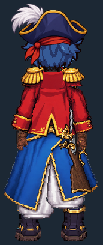
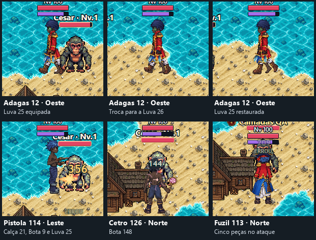

# Catálogo de vestuário no mapa

O catálogo tem 50 peças em cinco slots, 42 armas e sete classes. Cada consulta ao seletor identifica corpo, arma, ação e direção. Os testes de desenho usam o carregador do jogo, o compositor dos quadros e a caçada no navegador.

## Fontes reaproveitadas

| Corpo e contexto | Material da peça | Montagem no jogo |
|---|---|---|
| Feminino, repouso armado e espada | Catálogo assinado de espada, grupos de roupa, luvas, botas e capacetes do índice modular e do registro de cabelo | Seis espadas usam os grupos próprios nos oito quadros. Mangas acompanham os segmentos do braço. As peças preservam a base e a arma. |
| Feminino, soco, tecnologia e foco | Pacotes editáveis `soco-editable-sources.tgz` e `focus-editable-sources.tgz` do checkpoint de 18/11 | 240 vínculos de peça/direção e 2.676 PNGs únicos exportados. Punhos e antebraços do foco usam 64 vínculos entre a pose original e a receptora. |
| Feminino, caminhada armada | Camadas de caminhada do índice modular, peças da perna e mão do rig Norte, oclusões de perfil | Quarenta posições sincronizam o vestuário com as oito fases da arma no ciclo de um segundo. Registros de perfil e Norte conservam a mão de contato. |
| Masculino, repouso e caminhada | Grupos `equipmentLayerGroups.boots`, registros `frozenBootContract`, `frozenPantsSource` e `frozenGloveLayers` no índice modular | Bota, cintura e pernas são montadas pelos pontos anatômicos do receptor. As placas Oeste registradas nesse sentido usam uma única reflexão efetiva. Capacetes usam a orientação final do corpo para verificar a identidade. |
| Masculino, Pistola 114 | `docs/native-hd/editable-male-equipment/sources/pistola114-masculino-camadas.zip` | 68 entradas originais. Doze já tinham registro e 56 imagens entraram no carregador. P21, B9 e G25 nas quatro direções e P22 no Sul. O relógio tem 30 posições no Sul e oito por lateral e no Norte. A máscara lateral distingue os pixels de pele, cabelo, olhos e arma. |
| Masculino, cetros | `docs/native-hd/editable-male-equipment/sources/cetros-equipamentos-aprovados.{json,zip}` | O Cetro 123 recebe C6 e G25 no Sul em oito fases. A luva substitui a cor dentro da máscara e conserva o alfa. O Cetro 126 recebe os passes traseiro e dianteiro de B148 no Norte em nove fases. O arquivo contém 17 PNGs originais. |

Os arquivos de revisão com 16 e 51 casos documentam propostas e comparações lado a lado. O pacote complementar aponta para `809d0df`, ancestral da branch. As contagens históricas de 1.579 e 2.203 sobre 2.208 descrevem posições de catálogo de revisões anteriores. O censo atual usa o produto dos equipamentos que o jogador pode vestir.

## Reprodução

```powershell
python tools/build_pages.py --static-demo
$env:HD_PUBLISHED_ROOT = (Resolve-Path dist).Path
node --expose-gc tools/audit-hd-wardrobe-product.cjs resultados
node tools/summarize-hd-wardrobe-product.cjs resultados/<assinatura>/sample resumo.json detalhes.tsv
node --expose-gc tests/rework-armed-female-wardrobe-pixels.cjs
node --expose-gc tests/rework-male-p114-signed-slots.cjs
node --expose-gc tests/rework-signed-staff-wardrobe.cjs
node --expose-gc tests/rework-male-dagger-profile-wardrobe.cjs
node --expose-gc tests/rework-female-rifle-signed-wardrobe.cjs
node --expose-gc tests/rework-independent-world-browser.cjs
```

A assinatura identifica o export usado. O censo grava um resultado por contexto e retorna código de falha quando encontra lacunas. Cada contexto exercita 50 peças individuais, todos os 1.000 pares entre slots e 100 conjuntos determinísticos de cinco peças. O modo `PRODUCT_MODE=direct` passa os 100.000 conjuntos daquele contexto pelo seletor. `PRODUCT_FILTER` aceita arma, classe, corpo, direção e ação. O modo direto percorre o produto em memória constante e retoma os contextos concluídos. Os relatórios por contexto registram a fonte individual, os pares incompletos e as contagens por item.

## Desenho e uso no mapa

Na revisão `aeaaa62`, as 4.200.000 combinações com todas as armas passaram pelo seletor no repouso feminino Sul. Outro lote executou 400.000 seleções de ataque da espada 1 entre as quatro direções. Os lotes têm contextos diferentes e podem conter a mesma configuração de itens. Cada desenho do teste por pixels compara o quadro com um controle que remove exatamente um slot do mesmo personagem.

A caminhada feminina passou por 200 retiradas de slot, com 8.000 comparações de fase. A caminhada e o repouso masculinos com a espada 1 passaram por 400 retiradas, com 3.400 comparações de fase. Todas as retiradas alteraram pixels em pelo menos uma fase do ciclo. O teste de espada feminino também mediu 400 retiradas no repouso e ataque e 1.800 comparações. Nos testes de soco Leste, tecnologia Norte e foco Leste foram 150 retiradas e 1.200 comparações. O teste da Pistola 114 compara a montagem com passes originais em 212 posições de relógio. Nos cetros, 66 imagens coincidiram com a montagem calculada a partir do pacote editável.

As evidências locais da caçada incluem criação, inventário, trocas de arma e roupa, caminhada, ataque, retorno de poder e reconexão. A prova por slot e por ciclo faz parte dos testes Node. As capturas do navegador amostram momentos do mapa.


### Encaixes recuperados a partir de 63db412

No porte lateral de adagas masculino, o renderizador projeta a lâmina somente quando a mão correspondente existe no quadro. A verificação da luva passou a usar a mão próxima que realmente é desenhada. Os painéis próprios das calças laterais usam as posições de quadril, joelho e perna da pose receptora. A Calça 168 mantém seus dois passes. A Luva 25 mantém as 16 fases, inclusive o espelhamento já presente na imagem Oeste. A troca 25 → 26 → 25 foi feita pelo inventário durante a caminhada. Nas 64 comparações Leste/Oeste de Calça 168 e Luva 25, os 260.636 pixels que mudaram ficaram dentro da arte da peça retirada.

No disparo Norte feminino, o arquivo `fuzil113-ns.zip` do checkpoint de 18/11 contém 31 registros aproveitados. São dez calças, dez botas, dez luvas e o Sobretudo 151, distribuídos em 163 PNGs distintos. A comparação com o corpo do jogo verificou os 11 grupos de anatomia, os pivôs, as oito poses e o relógio. As duas mãos, os passes da bota 148 e a ordem entre manga e punho vêm do pacote. Os dez equipamentos de cabeça usam o registro de personalização da personagem, incluindo o deslocamento de nove pixels do quadro de recuo. O mesmo receptor funciona nas armas 4, 5, 113, 114, 115 e 116.

O controle por pixels montou os quadros diretamente dos registros do arquivo editável. As seis armas reproduziram o controle em 192 quadros, com duas combinações de roupas e dois tons de pele. A retirada isolada das cinco peças em dez conjuntos produziu 50 ciclos com diferença visível e 400 comparações de fase.



### Leitura dos casos pendentes

- No ataque feminino Norte de adagas 73, o seletor encontra a Calça 168 e a Luva 25. O Peitoral 6 e a Cabeça 18 ainda carecem de montagem nessa direção. O teste de mapa cobre o Peitoral 6 e a Calça 168 nas laterais.
- No disparo feminino Norte, o conjunto com o Sobretudo 151 aceita todas as dez opções dos quatro slots restantes. Os outros nove peitorais ainda precisam do vínculo da manga e do tronco nessa pose.
- O pacote de pistolas laterais guarda 25 camadas de uma composição. O corpo utilizado pelo jogo tem 11 camadas e nenhuma imagem inicial de anatomia coincide entre as duas estruturas. O Oeste compartilha as poses. No Leste, a sequência de pontos anatômicos é diferente. O registro Sul do fuzil tem oito quadros e 68.388 correções de pixel dependentes da reconstrução original. O reaproveitamento dos passes nessas direções ainda exige separar as oclusões e demonstrar o encaixe no corpo atual.
- No ataque masculino Leste da Espada 1, a consulta do censo com pele Ébano, olhos verdes e cabelo azul ainda falha para Peitoral 6, Calça 168 e Luva 25. Na Pistola 114 masculina, os quatro sentidos passaram no visual com cabelo preto e olhos azuis. A variação azul/verde passou no Leste e no Oeste. O Sul continua pendente para essa variação.

## Capturas da caçada

A sessão passou por criação, inventário, caminhada equipada, combate, retorno de poder e reconexão. Foram 74 observações e zero erros registrados no navegador. Os recortes mostram as trocas feitas pelo inventário. A animação acima contém o ciclo medido diretamente no compositor usado pelo mapa.



## Resultado do censo por equipamento

O código de jogo auditado é `8d08469`. A assinatura do build é `1473b55ab8bce40b47f57128f4f545cc89b784ee9c2129e7932728ae9336f418`. São 42 armas e sete classes desarmadas, dois corpos, quatro direções e três ações normalizadas por família. Cada execução usa um personagem com pele Ébano, cabelo azul e olhos verdes. Os testes específicos do mapa também usam outras aparências.

| Equipamento de mão | Corpo | Contextos | Peças selecionadas / consultas | Pares selecionados / consultas | Conjuntos mistos selecionados / consultas | Contextos com todas essas seleções |
|---|---|---:|---:|---:|---:|---:|
| Com arma | feminino | 504 | 23.793 / 25.200 | 467.865 / 504.000 | 45.675 / 50.400 | 456 |
| Com arma | masculino | 504 | 8.076 / 25.200 | 155.806 / 504.000 | 14.400 / 50.400 | 144 |
| Desarmado | feminino | 84 | 1.141 / 4.200 | 13.309 / 84.000 | 700 / 8.400 | 7 |
| Desarmado | masculino | 84 | 2.758 / 4.200 | 42.357 / 84.000 | 2.996 / 8.400 | 0 |

Cada célula abaixo conta seleções completas com o ID e a fonte de todos os slots solicitados, a pose e a direção corretas. Cada ID participa de 504 consultas individuais armadas por corpo, 168 desarmadas nos dois corpos, 40.320 consultas armadas de pares e 10.080 participações em conjuntos mistos armados. Um par aparece na linha das duas peças. Cada conjunto misto aparece nas cinco linhas correspondentes.

| ID | Item | Slot | Masculino / 504 | Feminino / 504 | Desarmado / 168 | Pares / 40.320 | Mistos / 10.080 | Integração global |
|---:|---|---|---:|---:|---:|---:|---:|---|
| 6 | Casaco de Marinheiro | Peitoral | 160 | 468 | 77 | 24.855 | 6.015 | Parcial |
| 7 | Casaco da Bruma | Peitoral | 160 | 456 | 77 | 24.480 | 6.000 | Parcial |
| 130 | Casaco das Marés | Peitoral | 160 | 456 | 77 | 24.480 | 6.000 | Parcial |
| 137 | Túnica do Peregrino | Peitoral | 160 | 456 | 63 | 24.480 | 6.000 | Parcial |
| 144 | Manto das Correntes Celestes | Peitoral | 160 | 456 | 63 | 24.480 | 6.000 | Parcial |
| 151 | Sobretudo do Almirante | Peitoral | 160 | 462 | 35 | 24.720 | 6.060 | Parcial |
| 158 | Manto das Tempestades | Peitoral | 160 | 456 | 77 | 24.480 | 6.000 | Parcial |
| 165 | Vestes do Santuário Oceânico | Peitoral | 160 | 456 | 77 | 24.480 | 6.000 | Parcial |
| 172 | Casaco da Grand Line | Peitoral | 160 | 456 | 84 | 24.480 | 6.000 | Parcial |
| 179 | Armadura do Imperador | Peitoral | 160 | 456 | 77 | 24.480 | 6.000 | Parcial |
| 21 | Grevas de Navegante | Calça | 162 | 486 | 77 | 25.177 | 6.006 | Parcial |
| 22 | Calças da Maré Alta | Calça | 166 | 486 | 56 | 25.293 | 6.012 | Parcial |
| 133 | Calças do Convés | Calça | 168 | 486 | 105 | 25.333 | 6.006 | Parcial |
| 140 | Calças do Deserto | Calça | 168 | 486 | 77 | 25.333 | 6.009 | Parcial |
| 147 | Calças do Observador dos Ventos | Calça | 168 | 486 | 77 | 25.333 | 6.012 | Parcial |
| 154 | Calças de Comando | Calça | 168 | 486 | 77 | 25.333 | 6.006 | Parcial |
| 161 | Calças da Monção | Calça | 168 | 486 | 77 | 25.333 | 6.006 | Parcial |
| 168 | Saia/Pernas do Rito Marinho | Calça | 168 | 486 | 119 | 25.333 | 6.006 | Parcial |
| 175 | Calças do Conquistador | Calça | 168 | 486 | 77 | 25.333 | 6.006 | Parcial |
| 182 | Calças do Trono dos Mares | Calça | 168 | 486 | 77 | 25.333 | 6.006 | Parcial |
| 8 | Botas de Navegante | Bota | 168 | 486 | 77 | 25.323 | 6.006 | Parcial |
| 9 | Botas do Recifal | Bota | 170 | 486 | 77 | 25.327 | 6.006 | Parcial |
| 134 | Botas do Corsário | Bota | 168 | 486 | 77 | 25.323 | 6.012 | Parcial |
| 141 | Botas do Oásis | Bota | 168 | 486 | 77 | 25.323 | 6.012 | Parcial |
| 148 | Botas de Maré Serena | Bota | 168 | 486 | 77 | 25.323 | 6.006 | Parcial |
| 155 | Botas Imperiais | Bota | 168 | 486 | 77 | 25.323 | 6.006 | Parcial |
| 162 | Botas do Vendaval | Bota | 168 | 486 | 77 | 25.323 | 6.006 | Parcial |
| 169 | Sandálias da Ressurgência | Bota | 168 | 486 | 70 | 25.323 | 6.006 | Parcial |
| 176 | Botas da Supremacia | Bota | 168 | 486 | 70 | 25.323 | 6.006 | Parcial |
| 183 | Botas do Horizonte Eterno | Bota | 168 | 486 | 70 | 25.323 | 6.009 | Parcial |
| 25 | Luvas de Cordame | Luva | 154 | 486 | 63 | 24.847 | 6.006 | Parcial |
| 26 | Luvas do Vigia | Luva | 152 | 486 | 63 | 24.843 | 6.009 | Parcial |
| 131 | Luvas do Navegante | Luva | 152 | 486 | 70 | 24.843 | 6.006 | Parcial |
| 138 | Luvas de Areia | Luva | 152 | 486 | 63 | 24.843 | 6.006 | Parcial |
| 145 | Luvas do Cartógrafo Elemental | Luva | 152 | 486 | 63 | 24.843 | 6.006 | Parcial |
| 152 | Manoplas da Autoridade | Luva | 152 | 486 | 63 | 24.843 | 6.006 | Parcial |
| 159 | Braçadeiras do Trovão | Luva | 152 | 486 | 63 | 24.843 | 6.006 | Parcial |
| 166 | Manoplas da Cura Profunda | Luva | 152 | 486 | 63 | 24.843 | 6.012 | Parcial |
| 173 | Manoplas Reais | Luva | 152 | 486 | 63 | 24.843 | 6.012 | Parcial |
| 180 | Manoplas da Vontade Absoluta | Luva | 152 | 486 | 98 | 24.843 | 6.006 | Parcial |
| 18 | Bandana das Correntes | Cabeça | 160 | 462 | 133 | 24.666 | 6.006 | Parcial |
| 19 | Capacete do Corsário | Cabeça | 160 | 462 | 91 | 24.666 | 6.006 | Parcial |
| 129 | Chapéu do Corsário | Cabeça | 160 | 462 | 91 | 24.666 | 6.006 | Parcial |
| 136 | Capuz das Dunas | Cabeça | 160 | 462 | 91 | 24.666 | 6.006 | Parcial |
| 143 | Chapéu do Navegador Arcano | Cabeça | 160 | 462 | 91 | 24.666 | 6.006 | Parcial |
| 150 | Chapéu Carmesim | Cabeça | 160 | 462 | 91 | 24.666 | 6.006 | Parcial |
| 157 | Diadema da Tormenta | Cabeça | 160 | 468 | 91 | 24.852 | 6.012 | Parcial |
| 164 | Tiara da Maré Sagrada | Cabeça | 160 | 465 | 91 | 24.759 | 6.009 | Parcial |
| 171 | Tricórnio do Soberano | Cabeça | 160 | 462 | 91 | 24.666 | 6.006 | Parcial |
| 178 | Coroa do Horizonte Final | Cabeça | 160 | 468 | 91 | 24.852 | 6.012 | Parcial |

O resultado global requer seleção, carregamento e desenho em todos os contextos. A tabela registra o estágio de seleção. Permanecem 569 contextos com pelo menos uma lacuna entre os 1.176 exercitados. O arquivo opcional `detalhes.tsv` gerado pelo resumo contém as 58.800 consultas individuais com ID, slot, corpo, classe, arma, ação, direção, pose resolvida, fonte e motivo informado pelo seletor. Os JSONs de cada contexto preservam os pares que falharam e as contagens dos conjuntos.

Os testes exercitaram os cinco slots vazios em cada contexto. Com uma arma e as roupas vazias, houve uma seleção de fonte verificável em 490 de 504 consultas femininas e 190 de 504 masculinas. Com os seis slots vazios, houve 84 seleções em cada corpo.

## Produto completo nos contextos executados

| Contexto do build 8d08469 | Configurações completas enumeradas e consultadas | Seleção completa | Seleção pendente |
|---|---:|---:|---:|
| Repouso feminino Sul, todas as 42 armas | 4.200.000 | 4.200.000 | 0 |
| Disparo feminino Norte, seis armas de fogo | 600.000 | 60.000 | 540.000 |
| Caminhada masculina Leste, Adagas 12 | 100.000 | 100.000 | 0 |
| Caminhada masculina Oeste, Adagas 12 | 100.000 | 100.000 | 0 |

Essas 5.000.000 consultas contam a configuração novamente quando muda o contexto. No disparo Norte, as 10.000 combinações por arma com o Sobretudo 151 passaram. As restantes incluem um dos nove peitorais cuja montagem ainda está pendente. O carregamento e o desenho foram medidos nos ciclos e sessões descritos acima. A matriz completa com 100.000 conjuntos em cada um dos 1.008 contextos armados teria 100.800.000 consultas.

Além dos lotes armados, o repouso Sul feminino com os cinco slots de roupa e a mão vazia foi enumerado nas sete classes. Seleções completas: 0 / 700.000.

Para repetir os lotes de 100.000 conjuntos por contexto no PowerShell, a partir do mesmo export:

```powershell
$env:PRODUCT_MODE = 'direct'
$env:PRODUCT_FILTER = '{"body":["feminino"],"direction":["south"],"action":["idle"]}'
node --expose-gc tools/audit-hd-wardrobe-product.cjs resultados
$env:PRODUCT_FILTER = '{"body":["feminino"],"direction":["north"],"action":["attack-firearm"]}'
node --expose-gc tools/audit-hd-wardrobe-product.cjs resultados
$env:PRODUCT_FILTER = '{"weapon":[12],"body":["masculino"],"direction":["east","west"],"action":["walk"]}'
node --expose-gc tools/audit-hd-wardrobe-product.cjs resultados
Remove-Item Env:PRODUCT_MODE
Remove-Item Env:PRODUCT_FILTER
```

## Verificações da publicação

O build padrão e o build estático de demonstração terminaram com sucesso. Os 26 módulos de personagem, equipamento, aparência e catálogo usados na comparação são idênticos aos do export examinado. As 17 regressões do compositor de mapa e de carregamento passaram. Outros 12 testes de planejamento das peças, trocas, cache e espera por região também passaram. O teste que atrasa deliberadamente uma resposta confirmou a liberação da composição obsoleta.

O ensaio histórico de carregamento no navegador (`tests/performance_native_loading_browser.cjs`) voltou a falhar nos 12 desenhos imediatos com cabelo bob violeta. A mesma falha foi reproduzida usando a referência f515727. A sessão de caçada desta entrega aguardou a peça pedida em cada ação e registrou 74 observações com zero erros.

Nas execuções de CI comparadas de f515727, 2fb39af e 8d08469, as falhas de save com slots nulos, regressão de armas e prévia de personagem aparecem nos mesmos arquivos e linhas. A comparação dos logs identificou tests/rework-literal-null-equipment.cjs:33, paper-doll-96-weapons.test.cjs:30 e player-rework-default-hd.test.cjs:37. A publicação do preview das revisões 2fb39af e 8d08469 passou. Os resultados de cada nova revisão aparecem nas [verificações do PR](https://github.com/Eximaq/mare-partida/pull/374/checks).
