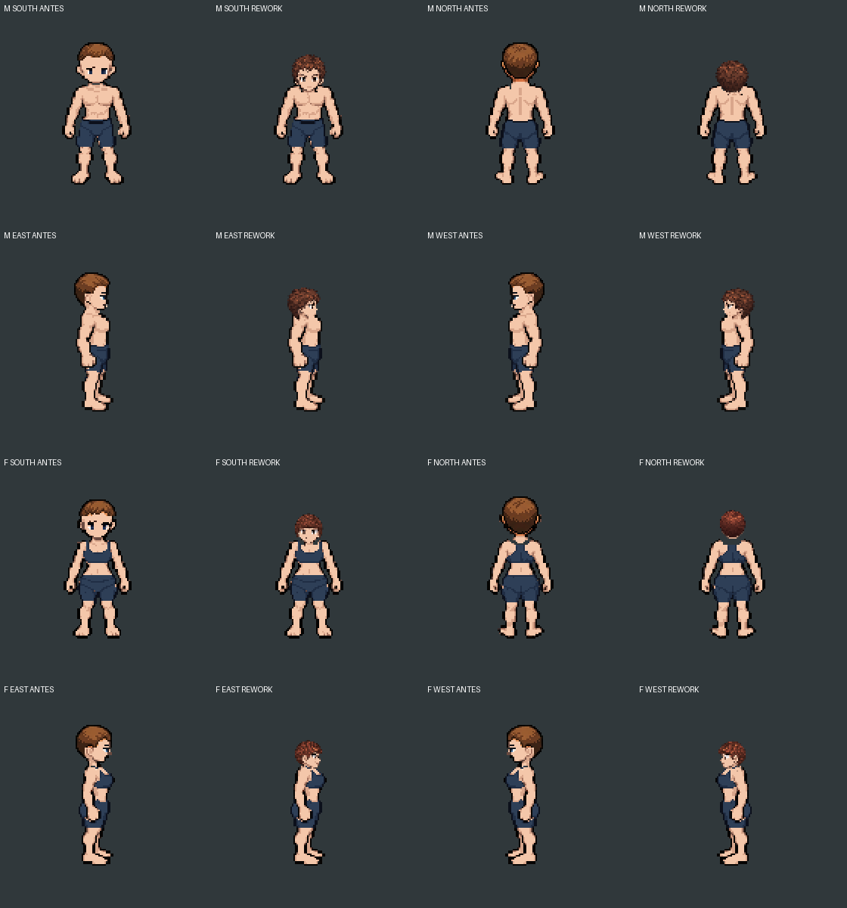

# Live rework pieces, not a review-mode switch

The normal player wardrobe now replaces the complete head family (head base, face, hair and headgear) from existing rework sources. This is active without a URL query. It retains the current animated body, clothing, weapon, action timing and saved appearance data. It is a progressive piece integration, **not full replacement of body/clothes/weapons**.

## Decisions
- 876 exact source records: 837 user-adjusted records plus 39 unadjusted source positions explicitly marked `adjustment-zero-candidate`. The adaptation of these pieces to the current body is a new calibration candidate, not individual visual approval of every combination.
- `Original` maps to rework `cropped` for both bodies as a declared candidate visual choice. It is not pixel-identical to the previous hairstyle. Named supported styles keep their identity; the save is not rewritten.
- The head family moves together at the current pose's neck socket. No complete character snapshot is pasted on the player.
- Original source head proportions are retained. The new head looks smaller than the previous native head; this is visible in the comparison and may be refined with the owner.
- Skin recolouring includes the face's skin pixels; hair recolouring and headgear visibility preferences remain active.
- Unsupported face expressions/eye-colour requests, missing style/item/direction combinations, or loading failures retain the existing family with an explicit on-screen diagnostic. Never change the requested face/eyes silently.
- Body, clothes, weapon sources and their dynamic fitting remain current. Full rework of those pieces still requires source extraction and pose-specific fitting, not enabling the composite review catalogue globally.

## Verification
- The actual wardrobe compositor was exercised offline: 480 frames across both bodies, four directions and eight actions, plus dark/light skin samples and before/after images.
- A bug leaving light facial skin on a dark head was found and fixed before publication.
- All 876 source families rendered without body layers. All 179 referenced assets exist locally and match their filename SHA-256.
- Existing body strips have separate head layers across all 64 clips/480 frames; sample inspection found no old-head halo at the new neck join.
- The normal browser entry points, Pages build, preference mapping, failure handling and unsupported cases have automated tests.
- This is offline compositor QA, not a claim of completed in-game browser playtesting or visual approval of all combinations.

## Delivery and network
The live head integration uses **only local build assets**, not raw GitHub ZIP downloads. The index is fetched once; images are SHA-verified, loaded on demand and cached with a 32-image limit. Adjusted/recoloured 128px head families are cached separately with a 16-family bound, so animation frames only translate the prepared family instead of rerendering 512px source pieces. Existing review-only weapon/outfit modes still depend on immutable raw GitHub URLs. Their first access can be slow or fail offline, so they are not the production live-piece dependency. The production head path has explicit current-piece retention on failure. No new third-party asset origin is added.
