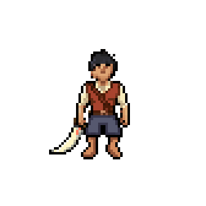

# Colete de Convés — repouso e caminhada frontal

Lote aprovado de 27/10/2026: uma chamada MCP `transfer_outfit`, 12 entradas nativas 64×64, referência do mesmo corpo com o colete ferrugem, transparência e seed omitida. **Cobrança confirmada: 10 gerações, dentro do teto de 25. Nenhum retry.** Com o piloto estático anterior de três gerações, o consumo destas duas etapas foi de 13 gerações.

## Entrega e limites

- **Idle/sul:** quatro desenhos de roupa distintos, correspondentes aos quatro frames existentes de repouso.
- **Walk/sul:** oito desenhos distintos, correspondentes aos oito frames existentes de caminhada.
- O corpo não foi reanimado. Cabelo preto e Sabre de Coral são os existentes; a arma utiliza a âncora e os sockets já inspecionados.
- A transferência retornou composições com recolorações de anatomia. As montagens usam apenas os pixels selecionados da roupa, sobre cada corpo original. Os resultados brutos permanecem intactos.
- O conjunto continua **`approved:false`, `productionEnabled:false`, `reviewOnly:true`**. Não foi registrado no motor, no inventário, nos bindings ou no save.
- Não cobre ataque, costas ou perfis laterais. O Topete Cobre continua reprovado e não foi regenerado. Não se declara validação em combate real das sete classes nesta etapa isolada.

## Avaliação visual

[Abrir a prévia interativa](preview.html): comparação sincronizada entre roupa azul e colete ferrugem, seleção de movimento/frame, reprodução/pausa, pivô opcional e inspeção da camada ou do resultado bruto. Os controles começam pausados; a reprodução pausa quando a aba fica oculta.



- [Repouso frontal](idle-review.gif).
- [12 resultados brutos, na ordem original](raw-sheet.png).
- [Atlas transparente da roupa extraída](outfit-layers.png).
- [Máscaras de extração por pose — controles, não arte](extraction-masks.png).
- [Montagens sobre os corpos nativos](fitted-bodies.png).
- [Montagens completas no rig 84×84](combined-frames.png).
- [Cobertura, pivôs e hashes](review.json).
- [Receita e prompt exato aprovado](outfit-motion.blueprint.json).

Os atlas têm quatro colunas: primeira linha = Idle 0–3; segunda = Walk 0–3; terceira = Walk 4–7. As células são 64×64, exceto `combined-frames.png`, que usa 84×84. Nenhuma pose foi descartada, duplicada, espelhada ou reordenada.

## Montagem e preservação de identidade

`assemble_review.py` somente seleciona e compõe pixels existentes. Não faz chamadas externas, não pinta reparos e não modifica arquivos do jogo. Cada pixel selecionado é copiado integralmente do resultado PixelLab correspondente. Todo pixel fora da seleção permanece igual ao da entrada original.

As máscaras usam a geometria real da roupa existente em cada pose, registrada em `existing-outfit-guides.png`, e a identificação das áreas de tecido. A expansão de seleção é limitada por regiões protegidas da cabeça, mãos e parte inferior do corpo. A inspeção encontrou pequenos contornos faciais indevidamente selecionados no repouso; eles foram excluídos da máscara, preservando a anatomia original sem geração adicional. Não foram redesenhados pixels da roupa ou do rosto.

As regiões protegidas foram verificadas nos 12 PNGs montados. A verificação também confirmou quatro camadas distintas de Idle e oito de Walk; isso complementa, mas não substitui, a conferência visual dos frames e dos ciclos.

Contrato preservado: pivô nativo 32/52, padding 10/13 para o rig 84×84, pivô 42/65, `rootOffsets`, sockets, offsets e profundidade das camadas existentes. A comparação com os atlas anteriores confirmou, nas 12 poses, que as diferenças ficam exclusivamente na união das áreas das roupas antiga/nova; corpo, cabelo e sabre permanecem iguais fora dessa região. Os PNGs originais enviados e devolvidos são 64×64, com alpha binário. A montagem verifica se o corpo da versão de referência ainda corresponde à entrada, evitando recomposição silenciosa contra outra versão de sprites.

Para reproduzir a montagem local, com Pillow disponível:

```text
python pixellab-pip-generations/paper-doll-catalog-outfit-motion-20261027/assemble_review.py
```

Ela depende também dos assets existentes de `paper-doll-complete-20261026` e do sabre candidato de `paper-doll-catalog-pilot-20261027`. O SHA256 do manifesto de referência foi registrado em `review.json`. A execução local do script não refaz a chamada paga; qualquer replay PixelLab da receita exige nova autorização.

## Tempo e formatos

- Prévia Canvas: Idle a 250ms/frame; Walk a 125ms/frame, sem interpolação.
- GIF de Idle: quatro frames de 250ms, ciclo de 1.000ms.
- GIF de Walk: oito frames de 120/130ms alternados, ciclo de 1.000ms. O formato GIF não representa 125ms exatos; a média preserva 8FPS.
- Os GIFs foram decodificados e verificados pelo helper: contagem, cores, transparência e durações corretas, sem quantização de cores. A escala 4× é somente de inspeção; os PNGs nativos continuam sendo a referência.

## Verificação e publicação

Foram conferidos todos os resultados, os atlas, os encaixes e os ciclos; a prévia foi aberta em navegador real, com seleção do último frame em ambos os movimentos, reprodução/pausa, pivôs e viewport 390×844 sem overflow horizontal da página. Não houve erro de console. A comparação usa a mesma pose e o mesmo corpo nos dois lados.

Passaram três arquivos Node (`paper-doll-player`, `paper-doll-look`, `paper-doll-attachment`), o build `python tools/build_pages.py`, a sintaxe JavaScript e a compilação Python do montador. Capturas de navegador, imagens intermediárias de inspeção e ledger privado ficam fora do Git.

Esta pasta não foi adicionada à allowlist do build Pages. O envio ao GitHub é para avaliação; não representa merge, deploy ou ativação das peças na aventura normal. Próxima decisão: avaliação visual do colete nestes movimentos antes de produzir outras direções ou ataques e antes de implementar o catálogo de múltiplos IDs.
