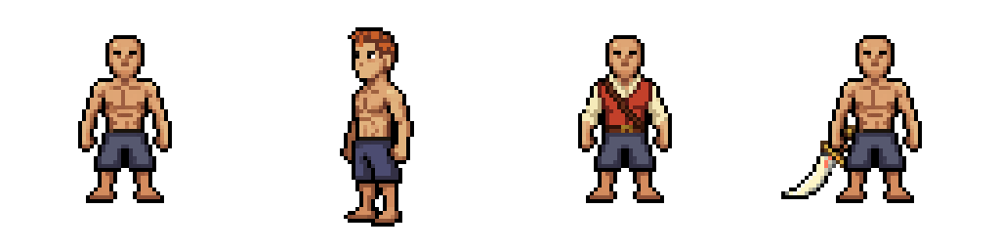

# Catálogo Paper Doll — piloto frontal

Teste de 27/10/2026, após a auditoria do PR #131 e a confirmação dos três prompts em inglês. **Três chamadas Pixen concluídas, uma geração cobrada por chamada: três gerações no total, sem retries.**

Nenhuma peça foi registrada no motor, ativada na aventura normal ou incorporada aos saves. O manifesto de produção existente e os itens permanecem intactos. Os candidatos têm `approved:false` e `productionEnabled:false`.

## Avaliação

| Proposta | Resultado | Entrega real |
| --- | --- | --- |
| Topete Cobre | **Reprovado para encaixe** | A edição virou o corpo, mudou a silhueta e levou os pés de y=52 para y=58. Original preservado; nenhuma camada aceita |
| Colete de Convés | **Candidato estático para avaliação visual** | A composição gerada também recoloriu anatomia. Uma máscara seleciona apenas roupa; a prévia mantém rosto, mãos expostas, calças e pés do corpo original |
| Sabre de Coral | **Candidato estático para avaliação visual** | Extraídos os pixels da arma fora da silhueta original; a mão original permanece em primeiro plano. Não altera o item `def:1` nem seus atributos |

“Candidato” não significa aprovação artística nem cobertura completa de animação. As três edições pagas cobrem somente **Idle/sul/frame 0**. O complemento técnico abaixo reutiliza movimentos existentes para conferir o attachment do sabre; a roupa ferrugem ainda não tem frames de caminhada. Não há ataque, outras direções ou validação nas sete classes para as novas peças.

### Ver o resultado

- [Prévia interativa](preview.html): ampliações 2×/4×/8×, resultado bruto e encaixe, fontes e máscaras.
- [Comparação nativa transparente](comparison-fits.png): base original, cabelo reprovado, roupa candidata, sabre candidato, nessa ordem.
- [Comparação ampliada para inspeção](comparison-inspection-4x.png): nearest-neighbor, sem alterar os originais.
- [Montagem com cabelo preto atual](combined-fit-candidate.png): combina roupa/sabre candidatos com a peça de cabelo já existente. **Não é o Topete Cobre.**
- [Receita e prompts exatos](catalog-pilot.blueprint.json); [estados e cobertura](review.json).

Para abrir a página local: servir a raiz do repositório e acessar `pixellab-pip-generations/paper-doll-catalog-pilot-20261027/preview.html`. Este diretório **não foi adicionado à allowlist do build Pages**; o PR preserva o teste para revisão, sem publicar novas peças no jogo.

## Contrato e integridade

- Fonte: frame frontal do corpo aprovado em `paper-doll-complete-20261026/player-pack.json`, `shared-body-idle.png`.
- Canvas nativo 64×64, pivô 32/52. A remoção das margens transparentes do frame 84×84 foi verificada por roundtrip exato; padding 10/13 restaura o pivô 42/65. Sem redimensionamento da fonte enviada ao PixelLab.
- Três edições independentes sobre a mesma fonte. Nenhuma utilizou o cabelo reprovado como entrada. `edit_image_pixen`, MCP, `width:64`, `height:64`, `no_background:true`; seed omitida.
- Todos os originais entregues são PNGs transparentes 64×64 com alpha binário. Foram preservados sem reparo.
- As máscaras são **controles de seleção**, não desenhos de roupa/arma. Todo pixel visível de cada camada candidata foi conferido contra o pixel correspondente da imagem PixelLab. Fora da camada, a montagem conserva os pixels da fonte. Não houve pintura local de arte, deformação ou substituição de anatomia.
- A roupa usa máscara semântica estática de torso/mangas, protegendo pele exposta. A seleção é específica deste frame; não é um algoritmo validado para 208 poses.
- O sabre seleciona apenas a nova área visível fora do corpo. Isso preserva a oclusão da mão nesta pose; não garante o encaixe das demais direções ou do ataque.
- A montagem conjunta usa o cabelo preto aprovado do mesmo frame. A referência nativa foi salva ao lado para inspeção reproduzível.
- Nenhum destes arquivos é um `player-pack.json`, `review-pack.json` registrado ou novo item de gameplay. Os flags em `review.json` são apenas metadados da prévia.

## Verificação executada

- PNGs decodificados; dimensões, alpha, JSONs, origem dos pixels extraídos, preservação da anatomia fora das máscaras e estados de não produção conferidos.
- Inspeção visual dos originais e montagens, incluindo a mudança de direção no cabelo e o contato da arma com a mão.
- Navegador real: todas as imagens carregaram; seletor de zoom funcionou; prévia conferida em desktop e viewport 390×844, sem overflow horizontal da página em 4×. Isso não é teste de performance em celular físico.
- Passaram três arquivos Node: `paper-doll-player.test.cjs`, `paper-doll-look.test.cjs`, `paper-doll-attachment.test.cjs`.
- `python tools/build_pages.py` passou; o jogo continua utilizando exclusivamente seus assets anteriores. Evidências de navegador ficam fora do Git.

## Próxima decisão

### Complemento sem consumo: sabre nos movimentos existentes

Foi preparada uma inspeção de attachment para a direção sul, reutilizando integralmente os quatro frames de Idle e os oito de Walk do corpo, cabelo preto e **roupa azul antiga**. O Sabre de Coral usa sua camada estática candidata, com a mesma âncora 20/36 e as trilhas de sockets já existentes. Não foi criada uma nova animação de corpo nem simulada uma roupa animada com uma camada estática.

- [Sabre em repouso — quatro frames](motion-preflight/sabre-idle-south-verified.gif).
- [Sabre em caminhada — oito frames](motion-preflight/sabre-walk-south-8fps.gif).
- [Todos os frames da caminhada para inspeção](motion-preflight/walk-contact-inspection.png).
- [Pivôs, offsets, sockets e limites do teste](motion-preflight/preflight.json).

Os PNGs preservam a ordem original dos frames. O helper de GIF verificou alpha/cores sem quantização e a contagem dos quadros. Como GIF armazena centésimos de segundo, a caminhada alterna 120/130ms para manter o ciclo de 1.000ms, equivalente à média nativa de 8FPS; o contrato de runtime continua 125ms por frame. Repouso mantém 250ms por frame. São prévias ampliadas 4×, sem alteração dos sprites originais ou do jogo.

**Zero gerações adicionais neste complemento.** A transferência da roupa nos 12 frames é uma proposta separada, estimada em 10–25 gerações, teto de 25 e sem retries; ainda não foi executada.

Avaliar o desenho da roupa e do sabre antes de produzir outros frames. Para o cabelo, o Pixen de edição livre falhou em preservar a pose: outra tentativa precisa de plano e orçamento próprios, preferencialmente com proteção por máscara. Não ampliar automaticamente o lote nem tratar a previsão de gerações da auditoria como custo de uma rota já validada.

A cobertura completa, os bindings e o catálogo por múltiplos IDs **não foram implementados nesta etapa**. Dependem da avaliação visual e do orçamento autorizado para as artes restantes.
